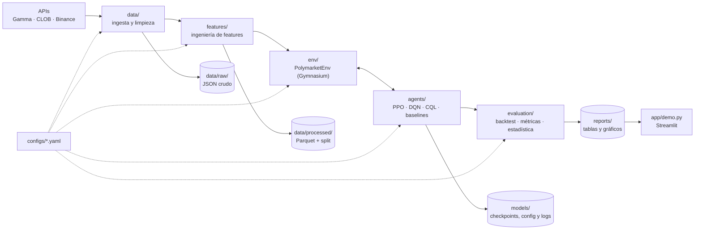

# 02 — Arquitectura

La arquitectura busca ser **robusta pero simple**. Es un proyecto universitario de un semestre con
5 personas, así que se priorizan la reproducibilidad, la separación clara entre módulos (para que
cada rol trabaje en paralelo) y la facilidad de testear, por sobre el rendimiento o la escala.

**Principios:**

1. **Un solo paquete Python** (`polym4v`) con módulos desacoplados por contratos claros.
2. **Todo se configura en YAML**: nada de números mágicos dentro del código.
3. **Reproducibilidad**: semillas fijas, datasets versionados por hash y configuraciones guardadas
   junto a cada modelo.
4. **Sin fuga de información del futuro** (*lookahead*): es la regla de oro del backtesting.
5. **Interfaz común para todas las políticas**: los baselines, PPO, DQN y Offline RL se evalúan con
   el mismo código.

---

## 1. Vista general



Flujo: **ingesta → dataset procesado → entorno → entrenamiento → evaluación → demo**.
Cada flecha es un archivo en disco con un esquema definido. Así los módulos se pueden desarrollar
y testear de forma independiente, usando *fixtures*.

---

## 2. Módulos

### 2.1 `data/` — Ingesta y construcción del dataset (Rol 2)

**Fuentes:**

| Fuente | Endpoint | Para qué |
| -------- | ---------- | ---------- |
| Gamma API (vía SDK) | `PublicClient.list_events(series_ids=10114, closed=True)` | Metadatos: pregunta, `condition_id`, tokens, ventana, resultado, esquema de comisiones |
| CLOB API | `GET https://clob.polymarket.com/prices-history?market=<token_id>&startTs=&endTs=&fidelity=1` | Serie de precios `{t, p}` del token YES, un punto por minuto (ADR-007) |
| Binance (público) | `GET https://api.binance.com/api/v3/klines?symbol=BTCUSDT&interval=1m` (y `1h`) | Precio spot como feature y verificación del resultado |

La Data API v2 del SDK (`list_price_history`) devuelve vacío en mercados cerrados, por eso no se
usa para el historial ([spike de datos](notas/spike_datos.md)).

**Familia de mercados:** *"Bitcoin Up or Down"* **horario** (ADR-004). Hay del orden de 12 000
episodios homogéneos y resuelven con la vela 1h de Binance. El detalle del ETL, el contrato de
datos ampliado y la observación del agente están en
[08_datos_y_entrada_modelo.md](08_datos_y_entrada_modelo.md).

**Componentes:**

```
src/polym4v/data/
├── clients/
│   ├── gamma.py        # GammaClient: lista y filtra mercados, maneja paginación
│   ├── clob.py         # ClobClient: historia de precios por token
│   └── binance.py      # BinanceClient: klines spot
├── cache.py            # Caché en disco de respuestas crudas (data/raw/), evita volver a descargar
├── schemas.py          # Esquemas pandera/pydantic de MarketMeta y PriceStep
├── build_dataset.py    # Orquesta descarga → limpieza → alineación temporal → Parquet
└── splits.py           # Split temporal train/val/test POR MERCADO
```

**Reglas:**

- Rate limiting y reintentos con *backoff* exponencial (`tenacity`).
- Todas las respuestas crudas se cachean en `data/raw/`, así que reconstruir el dataset no repite
  las llamadas de red.
- Los precios se re-muestrean a una grilla fija (por ejemplo, 1 minuto) con *forward-fill* hacia
  adelante **únicamente**. Nunca se usa *back-fill*, porque introduciría información del futuro.
- Se descartan los mercados con muy pocos puntos, con huecos largos o con una resolución ambigua.
- **El split es temporal y por mercado**: train = los mercados más antiguos (≈70 %), val = los
  siguientes (≈15 %) y test = los más recientes (≈15 %). Un mismo mercado nunca aparece en dos
  splits.

**Contrato de salida** (`data/processed/<dataset_id>/`):

`markets.parquet` — una fila por mercado:

| Columna | Tipo | Descripción |
| --------- | ------ | ------------- |
| `market_id` | str | `conditionId` |
| `question` | str | Texto de la pregunta |
| `asset` | str | `BTC` / `ETH` |
| `start_ts`, `end_ts` | int (unix s) | Ventana del episodio |
| `outcome` | int | `1` si se resolvió YES, `0` si NO |
| `split` | str | `train` / `val` / `test` |

`steps.parquet` — una fila por (mercado, paso):

| Columna | Tipo | Descripción |
| --------- | ------ | ------------- |
| `market_id` | str | FK a `markets` |
| `ts` | int | Timestamp del paso |
| `p_yes` | float ∈ [0,1] | Precio del token YES (el de NO se aproxima como `1 - p_yes`) |
| `spot` | float | Precio spot del activo subyacente |
| `spot_open` | float | Precio spot al inicio de la ventana (referencia en los mercados Up/Down) |

`manifest.json` — configuración usada, fecha de construcción, número de mercados por split y hash
SHA-256 de los Parquet.

### 2.2 `features/` — Ingeniería de features (Rol 2)

Funciones **puras** que solo reciben la historia hasta `t` (inclusive):

| Feature | Descripción |
| --------- | ------------- |
| `p_yes_t` | Precio actual |
| `ret_p_{1,5,15}` | Cambio de `p_yes` en los últimos 1/5/15 pasos |
| `vol_p_15` | Desviación estándar de los cambios de `p_yes` (15 pasos) |
| `spot_ret_{1,5,15}` | Retorno log del spot |
| `spot_vs_open` | `(spot - spot_open) / spot_open`, la señal clave en los mercados Up/Down |
| `time_left` | Fracción del episodio que queda, en [0,1] |

La normalización (media y desviación) se ajusta **solo con train** y se guarda junto al dataset.

La lista concreta para la serie horaria, con la volatilidad del spot, el valor justo `p_fair` y
`edge = p_fair - p_yes`, está en la sección 4.1 de
[08_datos_y_entrada_modelo.md](08_datos_y_entrada_modelo.md).

### 2.3 `env/` — Entorno simulado (Rol 3)

`PolymarketEnv(gymnasium.Env)`: **un episodio = un mercado**.

```
src/polym4v/env/
├── market_env.py   # PolymarketEnv: reset/step/render
├── portfolio.py    # Portfolio: cash, posición, ejecución de órdenes, mark-to-market
├── execution.py    # Modelo de costos: spread, slippage, comisión
├── reward.py       # Funciones de recompensa intercambiables (registry)
└── wrappers.py     # Normalización de observaciones, frame-stacking si se usa
```

**Espacio de observación** — `Box(shape=(n_features + 4,))`:

- Las features de mercado del paso `t` (sección 2.2).
- El estado del agente: `position_side ∈ {-1: NO, 0: nada, 1: YES}`, `position_size` normalizado,
  `unrealized_pnl` normalizado y `cash / initial_cash`.

**Espacio de acción** — `Discrete(4)`: `0 = WAIT`, `1 = BUY_YES`, `2 = BUY_NO`, `3 = SELL`.

**Reglas de la simulación:**

| Regla | Detalle |
| ------- | --------- |
| Price-taker | El agente no mueve el precio. Ejecuta al precio de `t` más el spread y el slippage. |
| Ejecución | La acción elegida con la observación de `t` se ejecuta al precio de `t+1` (`execute_at: next`, propuesta en el ADR-011). `current` queda como ablación. |
| Una posición a la vez | `BUY_*` con una posición ya abierta es una **acción inválida**: se trata como `WAIT` y se aplica una pequeña penalización. |
| Tamaño fijo | Cada compra usa `stake_fraction` del saldo inicial (por ejemplo, 10 %). |
| `SELL` sin posición | Acción inválida, se trata como `WAIT` y se penaliza. |
| Costos | `buy_price = p + spread/2 + slippage`, `sell_price = p - spread/2 - slippage`, más la comisión taker `acciones × fee_rate × (precio × (1 - precio))^fee_exponent` (ADR-009). |
| Fin del episodio | Al llegar a `w1` (fin de la vela), la posición abierta **se liquida** a `1` o `0` según `outcome`, sin comisión. |
| Precio de NO | `p_no = 1 - p_yes` (aproximación documentada en el ADR-003). |

**Invariantes** (verificados por tests, ver [05_testing.md](05_testing.md)):

- Conservación: `cash + valor_posición` solo cambia por variaciones de precio, costos y liquidación.
- `cash ≥ 0` siempre. No hay apalancamiento.
- La observación en `t` no depende de ningún dato con `ts > t`.

**`info` de cada paso** (lo usan el backtest y la demo): `ts`, `p_yes`, `action`, `action_valid`,
`position_side`, `position_size`, `cash`, `portfolio_value`, `fees_paid` y `reward_components`.

### 2.4 Función de recompensa (Rol 3, en colaboración con Rol 4)

Se implementa como un objeto configurable para poder hacer ablaciones:

```
r_t =  ΔV_t / V_0                         # beneficio/pérdida mark-to-market del paso
     - λ_dd   · max(0, DD_t - DD_{t-1})   # penaliza el aumento del drawdown (riesgo)
     - λ_cost · costos_t / V_0            # costos ya incluidos en ΔV; se pueden reforzar
     - λ_inv  · 1[acción inválida]        # acciones que no tienen sentido
     - λ_hold · 1[posición abierta]       # opcional: costo por mantener (timing)
```

donde `V_t = cash_t + valor_mark_to_market_t` y `DD_t = max_{τ≤t} V_τ - V_t`.

| Variante (`reward.name`) | Descripción | Uso |
| -------------------------- | ------------- | ----- |
| `pnl` | Solo `ΔV_t / V_0` | Línea base de la recompensa |
| `pnl_risk` | `pnl` más la penalización de drawdown | **Recompensa principal** |
| `terminal` | Solo el PnL final del episodio (recompensa escasa) | Ablación |
| `sharpe_like` | `ΔV_t` dividido por una volatilidad móvil | Ablación opcional |

Con mark-to-market, la suma de las recompensas `pnl` del episodio es igual al PnL total, así que la
recompensa densa no cambia el objetivo final: solo da más señal en cada paso. Esto se verifica con
un test.

### 2.5 `agents/` — Agentes y baselines (Rol 4)

Todos implementan la misma interfaz, definida en `src/polym4v/agents/base.py` (INF-06):

```python
class Action(IntEnum):
    WAIT = 0
    BUY_YES = 1
    BUY_NO = 2
    SELL = 3


@runtime_checkable
class Policy(Protocol):
    name: str

    def act(self, obs: np.ndarray, info: Mapping[str, Any] | None = None) -> int: ...
    def reset(self) -> None: ...  # al empezar cada episodio; limpia el estado interno
```

| Agente | Implementación | Notas |
| -------- | ---------------- | ------- |
| `RandomPolicy` | propia | Piso mínimo |
| `NoTradePolicy` | propia | Siempre `WAIT`. Retorno = 0 |
| `FavoritePolicy` | propia | Compra el lado con precio > 0.5 en el paso `k` y mantiene hasta la resolución |
| `MomentumPolicy` | propia | Compra en la dirección del cambio reciente de `p_yes` o del spot y sale con un umbral |
| `MeanReversionPolicy` | propia | Lo contrario de momentum |
| `PPOAgent` | `stable_baselines3.PPO` | `MlpPolicy` y entornos vectorizados (`SubprocVecEnv` o `DummyVecEnv`) |
| `DQNAgent` | `stable_baselines3.DQN` | Replay buffer y target network |
| `OfflineAgent` | `d3rlpy` `DiscreteCQL`, más `DiscreteBC` como referencia | Entrenado con un dataset fijo |

**Generación del dataset offline:** se ejecutan los baselines heurísticos con ε-greedy (por ejemplo,
`ε = 0.2`) sobre los mercados de **train** y se guardan las transiciones `(s, a, r, s', done)` en
`data/offline/<id>.h5`. Con eso se entrena CQL, que nunca interactúa con el entorno.

```
src/polym4v/agents/
├── base.py         # Policy Protocol + wrapper SB3/d3rlpy → Policy
├── baselines.py    # Políticas heurísticas
├── train_sb3.py    # Entrenamiento PPO/DQN (callbacks, checkpoints, early stopping por val)
├── offline.py      # Recolección del dataset offline + entrenamiento CQL/BC
└── registry.py     # nombre → constructor, para cargar desde config
```

**Selección de modelos:** el checkpoint se elige con su retorno medio en **val**. El conjunto de
**test** solo se usa **una vez**, para la tabla final.

### 2.6 `evaluation/` — Backtesting y métricas (Rol 5)

```
src/polym4v/evaluation/
├── backtest.py     # run_backtest(policy, env, markets) → DataFrame de trayectorias
├── metrics.py      # Métricas por episodio y agregadas
├── stats.py        # Bootstrap IC 95 %, test de diferencias pareadas
└── report.py       # Tablas markdown/LaTeX y gráficos (matplotlib)
```

**Métricas:**

| Métrica | Definición |
| --------- | ------------ |
| Retorno medio por mercado | `mean(V_final / V_0 - 1)` |
| Retorno acumulado | Capital compuesto mercado a mercado, en orden cronológico |
| Sharpe (por episodio) | `mean(ret) / std(ret)` |
| Max drawdown | Sobre la curva de capital acumulada |
| Win rate | % de mercados con PnL > 0 (entre los que operó) |
| Nº de operaciones y costos pagados | Para detectar *overtrading* |
| % de acciones inválidas | Calidad de la política |

**Protocolo estadístico:**

- Cada agente de RL se entrena con **≥ 5 semillas**. Se reporta la media ± la desviación entre
  semillas.
- IC 95 % por *bootstrap* sobre los mercados de test.
- Comparación **pareada** (los mismos mercados) entre el agente y el mejor baseline.

### 2.7 `app/` — Demo (Rol 5)

Streamlit (`app/demo.py`):

- Se elige un mercado de test y un agente (o varios para compararlos).
- Un reproductor paso a paso (*play/pause* y *slider* de tiempo).
- Gráfico de `p_yes` con marcas de compra y venta, curva de capital del agente frente a los
  baselines, y un panel con la acción, la posición, el saldo y la recompensa del paso actual.
- Lee trayectorias ya calculadas en `reports/trajectories/*.parquet`, así que no necesita GPU ni
  red.

### 2.8 `utils/` y CLI (Rol 1)

```
src/polym4v/utils/
├── config.py       # Carga YAML → dataclasses/pydantic validados
├── seeding.py      # set_global_seed(seed): random, numpy, torch, gym
├── logging.py      # logging estándar + TensorBoard
└── paths.py        # Rutas centralizadas (data/, models/, reports/)
src/polym4v/cli.py   # Typer: polym4v data build | train | evaluate | collect-offline | report
```

---

## 3. Estructura del repositorio

```
RL/
├── README.md
├── pyproject.toml              # dependencias, ruff, pytest, coverage, mypy
├── uv.lock
├── .pre-commit-config.yaml
├── .github/
│   └── workflows/
│       ├── ci.yml              # lint, mypy y tests con cobertura en cada push y PR a proyecto
│       ├── nightly.yml         # tests lentos y backtest corto (INF-08, previsto)
│       └── release.yml         # CD: en tag v* publica reporte y modelos (INF-09, previsto)
├── configs/
│   ├── data.yaml
│   ├── env.yaml
│   ├── ppo.yaml
│   ├── dqn.yaml
│   ├── offline.yaml
│   └── eval.yaml
├── src/polym4v/
│   ├── data/  features/  env/  agents/  evaluation/  utils/
│   └── cli.py
├── app/
│   └── demo.py
├── notebooks/                  # EDA y exploración (no es código de producción)
├── tests/
│   ├── unit/  integration/
│   ├── fixtures/               # JSON de API grabados + mini-dataset Parquet
│   └── conftest.py
├── docs/                       # esta documentación
├── data/        (gitignored)   # raw/, processed/, offline/
├── models/      (gitignored)   # <agente>/<run_id>/{model.zip, config.yaml, metrics.json}
└── reports/                    # resultados finales (tablas y figuras sí se versionan)
```

---

## 4. Stack tecnológico

| Área | Herramienta | Justificación |
| ------ | ------------- | --------------- |
| Lenguaje | Python 3.11 | Estándar en RL. Lo soportan todas las librerías. |
| Gestión de entorno | `uv` (alternativa: `pip` + `venv`) | Rápido y con lockfile reproducible |
| Entorno RL | `gymnasium` | API estándar que esperan SB3 y d3rlpy |
| PPO / DQN | `stable-baselines3` (PyTorch) | Implementaciones probadas, para no reimplementar |
| Offline RL | `d3rlpy` | Trae `DiscreteCQL` y `DiscreteBC` |
| Datos | `pandas`, `pyarrow`, `requests`, `tenacity` | Simples y suficientes |
| Validación | `pydantic` (configs), `pandera` (DataFrames) | Detecta errores de datos temprano |
| CLI | `typer` | Comandos legibles |
| Tracking | TensorBoard + `metrics.json` por run | Liviano, sin servidor |
| Visualización | `matplotlib`, `plotly` | Informe y demo |
| Demo | `streamlit` | Una app interactiva en pocas líneas |
| Calidad | `ruff` (lint + format), `mypy` (modo permisivo), `pre-commit` | |
| Tests | `pytest`, `pytest-cov`, `responses`, `hypothesis` | Ver [05_testing.md](05_testing.md) |
| CI/CD | GitHub Actions (ADR-014) | Gratis en repos de GitHub; corre en cada push y PR a `proyecto` |

**Hardware:** todo debe correr en una laptop con CPU. Las redes son MLP pequeñas (`[64, 64]`). Si
hace falta más cómputo, se puede usar Google Colab.

---

## 5. Configuración y reproducibilidad

- **Qué va en YAML y qué en `.env`:** todo parámetro que define un experimento va en
  `configs/*.yaml`, se versiona y se valida con pydantic (claves desconocidas y valores
  inconsistentes se rechazan). Las rutas de cada máquina (`POLYM4V_DATA_DIR`,
  `POLYM4V_MODELS_DIR`, `POLYM4V_REPORTS_DIR`), el nivel de log (`POLYM4V_LOG_LEVEL`) y las
  credenciales van en `.env`, que no se versiona; `.env.example` es la plantilla. El entorno
  nunca cambia parámetros de un experimento. `make config CONFIG=configs/data.yaml` valida un
  archivo y lo muestra resuelto.
- Cada run guarda en `models/<agente>/<run_id>/` el `config.yaml` **resuelto**, el `dataset_id`, el
  `git commit`, la semilla, el checkpoint y `metrics.json`.
- `run_id = <fecha>_<agente>_<reward>_s<seed>`.
- `dataset_id` = los primeros 8 caracteres del hash del `manifest.json`.
- Ejemplo de `configs/ppo.yaml`:

```yaml
dataset_id: btc_updown_1h_v1
env:
  stake_fraction: 0.10
  initial_cash: 1000.0
  spread: 0.02
  slippage: 0.005
  fee_rate: 0.07          # comisión taker vigente (ADR-009); 0.0 para la ablación
  fee_exponent: 1
  execute_at: next        # next | current (ADR-011)
reward:
  name: pnl_risk
  lambda_dd: 0.5
  lambda_invalid: 0.001
agent:
  algo: ppo
  policy: MlpPolicy
  net_arch: [64, 64]
  learning_rate: 3.0e-4
  n_steps: 2048
  batch_size: 64
  gamma: 0.99
  total_timesteps: 500000
  n_envs: 4
seeds: [0, 1, 2, 3, 4]
```

---

## 6. Límites conocidos del diseño

| Simplificación | Impacto | Por qué se acepta |
| ---------------- | --------- | ------------------- |
| No hay order book histórico | El spread y el slippage son supuestos | Polymarket no publica la historia del libro |
| Price-taker | Sobreestima lo ejecutable con tamaños grandes | Los tamaños simulados son pequeños |
| `p_no = 1 - p_yes` | Ignora pequeñas diferencias entre los dos libros | Se compensa con el spread |
| Granularidad de la API | Un punto por minuto; algunos minutos sin dato | Verificado en el spike DAT-01. Se rellena hacia adelante y se informa la antigüedad del precio (`p_stale`). |
| Comisiones uniformes | Los mercados anteriores a 2026 no cobraban | Se evalúa con el costo real de hoy (ADR-009) |

Estas limitaciones van en el informe final. Más detalle en
[07_riesgos_y_decisiones.md](07_riesgos_y_decisiones.md).
