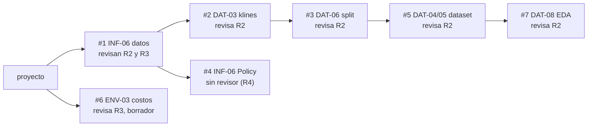
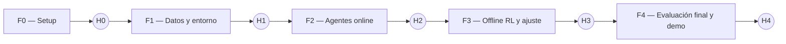
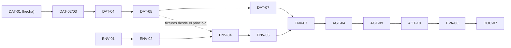

# 04 — Tareas

Backlog completo del proyecto, organizado por **fases** y por **rol**. Cada tarea tiene un ID, que
se usa en los mensajes de commit (ver [06_flujo_trabajo.md](06_flujo_trabajo.md)), sus dependencias
y un criterio de aceptación verificable.

> Las fases marcan el **orden** de trabajo, no fechas. Si el tiempo aprieta, se cortan primero
> las tareas **P2** y después las **P1**.

**Prefijos de ID:** `INF` = R1 (infraestructura), `DAT` = R2 (datos), `ENV` = R3 (entorno),
`AGT` = R4 (agentes), `EVA` = R5 (evaluación y demo), `DOC` = informe y presentación.

**Prioridad:** **P0** = sin esto no hay proyecto · **P1** = necesario para una buena nota ·
**P2** = deseable si da el tiempo.

---

## Tablero

El seguimiento del proyecto se lleva **solo en este documento** (ADR-015): no hay tablero en GitHub
Projects ni issues. R1 actualiza esta sección en `proyecto` cada vez que se abre o se mezcla un PR,
y el estado de cada tarea se marca en su fila (por ejemplo, **En PR** o **Hecha el 31/10/2026**).

**En revisión.** Los PR forman una pila: cada uno se mezcla después del que tiene como base
(ver "Pilas de PR" en [06_flujo_trabajo.md](06_flujo_trabajo.md)).

| Orden | PR | Tarea | Base | Revisa |
| --- | --- | --- | --- | --- |
| 1 | #1 | INF-06: contratos de datos | `proyecto` | R2 y R3 |
| 2 | #2 | DAT-03: klines de Binance | #1 | R2 |
| 3 | #3 | DAT-06: split con exclusiones de S11 | #2 | R2 |
| 4 | #5 | DAT-04 y DAT-05: `markets`, `prices_raw` y `spot_1m` | #3 | R2 |
| 5 | #7 | DAT-08: EDA sobre train | #5 | R2 |
| 2 (en paralelo) | #4 | INF-06: `Policy` y `Action` | #1 | Sin asignar (R4) |
| Independiente | #6 | ENV-03: costos. Borrador hasta la investigación de [comisiones](ia/investigaciones/comisiones_polymarket.md) | `proyecto` | R3 |

**Bloqueado por decisiones pendientes.** Las decisiones están en
[09_sistema_simulacion.md](09_sistema_simulacion.md): S3 y S4 en la sección 3, S9 y S10 en la
sección 4.3.

| Tarea | Qué falta | Decisión |
| --- | --- | --- |
| `steps.parquet` (resto de DAT-04 y DAT-05) y features (DAT-07) | Qué ve el agente en cada minuto y con qué antigüedad | S3 |
| Ejecución de órdenes en el entorno (ENV-04) y latencia de `prices_raw` | Cuándo y a qué precio se ejecuta una orden | S4 |
| Recompensa, PnL no realizado y drawdown (ENV-02 y ENV-05) | Con qué precio se valora la posición abierta | S9 |
| Fin de episodio (ENV-04) | Desde qué minuto no se compra y qué pasa con un `SELL` sin ejecutar | S10 |
| Claves de `info` (resto de INF-06) | Lo anterior | S4, S9 y S10 |
| Tests de no-fuga (ENV-10) y E2E (INF-07) | El entorno | S3, S4, S9 y S10 |

**Sin bloqueos, en curso:**

- DAT-10: captura del crudo de ETH (serie 10117), en curso desde el 31/10/2026.
- DOC-12: historial de prompts con su evaluación, que se lleva durante todo el proyecto.

Las decisiones previas al diseño (D1 a D9) están en
[decisiones_previas_al_diseno.md](notas/decisiones_previas_al_diseno.md) y las ya tomadas, como
ADR, en [07_riesgos_y_decisiones.md](07_riesgos_y_decisiones.md).

---

## 1. Fases e hitos

| Fase | Objetivo | Hito de cierre |
| ------ | ---------- | ---------------- |
| **F0 — Setup** | Repo, herramientas, CI y validar las APIs | **H0:** CI en verde, spike de datos con su conclusión |
| **F1 — Datos y entorno** | Dataset v1 y `PolymarketEnv` v1 testeado | **H1:** un baseline corre episodios de extremo a extremo sobre datos reales |
| **F2 — Agentes online** | Baselines, PPO y DQN entrenados, primer backtest | **H2:** primera tabla comparativa en *val* |
| **F3 — Offline RL y ajuste** | CQL/BC, ablación de la recompensa, ajuste de hiperparámetros, 5 semillas | **H3:** modelos finales congelados |
| **F4 — Evaluación final y demo** | Evaluación en test, demo, informe y presentación | **H4:** release `v1.0` y entrega |

| Rol | F0 | F1 | F2 | F3 | F4 |
| --- | --- | --- | --- | --- | --- |
| R1 Infra | INF-01 a 04 | INF-05, 06 | INF-07 E2E | INF-08 | INF-09, 10 |
| R2 Datos | DAT-01 (hecha) | DAT-02 a 06 | DAT-07, 08 | DAT-09 ETH (P2) | DOC |
| R3 Entorno | ENV-01 | ENV-02 a 06 | ENV-07 | ENV-08 ablación | DOC |
| R4 Agentes | AGT-01 | AGT-02, 03 | AGT-04 a 06 | AGT-07 a 10 | DOC |
| R5 Eval/Demo | EVA-01 | EVA-02 | EVA-03 a 05 | EVA-06, 07 | EVA-08 a 10 |

La CI/CD volvió al alcance con el ADR-014, que reemplaza al ADR-010.

---

## 2. Tareas por rol

### R1 — Líder técnico e integrador

| ID | Tarea | Fase | Prio | Depende de | Criterio de aceptación |
| ---- | ------- | ------ | ------ | ------------ | ------------------------ |
| INF-01 | **Hecha el 30/10/2026.** Crear la estructura del repo, `pyproject.toml` con `uv`, el paquete `polym4v` instalable y `src/` layout | F0 | P0 | — | `uv sync && uv run python -c "import polym4v"` funciona en una máquina limpia |
| INF-02 | **Hecha el 30/10/2026.** Configurar `ruff`, `mypy` (permisivo) y `pre-commit` | F0 | P0 | INF-01 | `pre-commit run --all-files` pasa |
| INF-03 | **Hecha el 30/10/2026.** Workflow `ci.yml`: lint, tests y cobertura en cada push a `proyecto` | F0 | P0 | INF-02 | La CI corre en un push de prueba y marca en rojo el commit si falla |
| INF-04 | **Hecha el 31/10/2026 (ADR-015):** el tablero es la sección "Tablero" de este documento, sin GitHub Projects ni issues | F0 | P0 | — | Cada tarea tiene su estado en su fila y la sección "Tablero" muestra lo que está en PR, bloqueado o sin empezar |
| INF-05 | **Hecha el 31/10/2026.** `utils/`: `config.py` (pydantic), `seeding.py`, `logging.py`, `paths.py` | F1 | P0 | INF-01 | Tests unitarios. La misma semilla da resultados idénticos. |
| INF-06 | Definir los **contratos** como código: `schemas.py` (con R2), protocolo `Policy` (con R4) y claves de `info` (con R3) | F1 | P0 | INF-05 | Revisado y aceptado por R2, R3 y R4 antes de subirlo |
| INF-07 | CLI `typer` (`data build`, `train`, `collect-offline`, `evaluate`, `report`) y test de integración E2E sobre el mini-dataset | F2 | P0 | DAT-05, ENV-05, AGT-03, EVA-02 | `pytest -m integration` corre todo el pipeline en < 2 min |
| INF-08 | Job *smoke-train* en la CI y workflow `nightly.yml` (tests `slow` y backtest corto) | F3 | P1 | INF-07 | El nightly corre por `workflow_dispatch` y por cron |
| INF-09 | `release.yml` (CD): en un tag `v*` genera el reporte y adjunta las tablas, figuras y modelos finales al GitHub Release | F4 | P1 | EVA-06 | El tag `v1.0` produce un Release con sus artefactos |
| INF-10 | Revisión de reproducibilidad: un integrante que no participó clona el repo y reproduce un resultado siguiendo el README | F4 | P0 | H3 | El resultado coincide dentro de la tolerancia (± IC) |

### R2 — Ingeniero de datos

| ID | Tarea | Fase | Prio | Depende de | Criterio de aceptación |
| ---- | ------- | ------ | ------ | ------------ | ------------------------ |
| DAT-01 | **Hecha el 30/10/2026: ver [spike](notas/spike_datos.md) y ADR-004, ADR-007 a ADR-009.** **Spike de APIs:** probar Gamma, CLOB `prices-history` y Binance. Medir la granularidad real en mercados cerrados, los límites de rate y los campos disponibles. Elegir la familia de mercados. | F0 | P0 | — | Nota en `docs/notas/spike_datos.md`, más un ADR con la familia de mercados y la granularidad elegidas |
| DAT-02 | `GammaClient`: listar mercados cerrados filtrados por tag o texto, con paginación | F1 | P0 | DAT-01, INF-01 | Tests con respuestas grabadas (`responses`), sin red |
| DAT-03 | `ClobClient` y `BinanceClient`, con caché en disco, reintentos y rate limiting | F1 | P0 | DAT-01 | Una segunda ejecución no hace llamadas de red (test con contador) |
| DAT-04 | Limpieza, re-muestreo a una grilla fija (solo *forward-fill*), alineación con el spot y filtros de calidad | F1 | P0 | DAT-02, DAT-03 | Test: ningún valor en `t` se deriva de datos con `ts > t` |
| DAT-05 | `build_dataset.py`: `markets.parquet`, `steps.parquet` y `manifest.json` con hash. **Mini-dataset de fixtures** (≈ 5 mercados) para los tests. | F1 | P0 | DAT-04, INF-06 | `polym4v data build` dos veces da el mismo hash. Valida con `pandera`. |
| DAT-06 | Split temporal por mercado (70/15/15) | F1 | P0 | DAT-05 | Test: hay intersección vacía entre splits y `max(ts_train) < min(ts_val) < min(ts_test)` |
| DAT-07 | `features/`: features de la sección 2.2 de la arquitectura y normalización ajustada solo con train | F2 | P0 | DAT-05 | Test de no-*lookahead*: truncar la serie en `t` no cambia las features en `≤ t` |
| DAT-08 | Notebook de EDA y una sección breve con sus hallazgos | F2 | P1 | DAT-05 | Notebook ejecutado y versionado, con ≥ 5 gráficos comentados |
| DAT-09 | Extensión a ETH y/o a la segunda familia de mercados | F3 | P2 | DAT-07 | Dataset `eth_*` construido y evaluación de transferencia BTC → ETH |
| DAT-10 | **Captura del crudo (S8, ADR-013):** historial de 1 minuto de los tokens YES y NO de todos los mercados horarios cerrados, con metadatos de cada petición y hash | F0 | P0 | DAT-01 | Una segunda ejecución no hace llamadas de red y el manifest lista cada archivo con su hash |

### R3 — Ingeniero del entorno y la recompensa

| ID | Tarea | Fase | Prio | Depende de | Criterio de aceptación |
| ---- | ------- | ------ | ------ | ------------ | ------------------------ |
| ENV-01 | Especificar el MDP por escrito (estado, acciones, transición, recompensa y fin de episodio) y revisarlo con el equipo | F0 | P0 | — | Sección "MDP" en `docs/notas/mdp.md` aprobada por R4 |
| ENV-02 | `Portfolio`: abrir y cerrar posiciones, mark-to-market y liquidación al resolver | F1 | P0 | ENV-01 | Tests unitarios de cada operación con valores calculados a mano |
| ENV-03 | **En PR desde el 31/10/2026**, verificado con la investigación de `docs/ia/investigaciones/comisiones_polymarket.md`. `execution.py`: spread, slippage y comisión configurables | F1 | P0 | ENV-02 | Test: un ciclo compra-venta inmediata sin cambio de precio pierde exactamente los costos |
| ENV-04 | `PolymarketEnv` v1: `reset` (elige un mercado del split), `step` y espacios. Manejo de acciones inválidas. | F1 | P0 | ENV-02, DAT-05 (fixtures) | Pasa `gymnasium.utils.env_checker.check_env` |
| ENV-05 | `reward.py`: variantes `pnl`, `pnl_risk` y `terminal`, elegibles por config. `reward_components` en `info`. | F1 | P0 | ENV-04 | Test: con `pnl`, la suma de recompensas del episodio = PnL final / V_0 |
| ENV-06 | Suite de invariantes con `hypothesis`: conservación del dinero, `cash ≥ 0` y política aleatoria durante N episodios sin errores | F1 | P0 | ENV-05 | Pasa con ≥ 200 ejemplos generados |
| ENV-07 | Integrar las features de R2 en la observación, wrapper de normalización y `render()` en modo texto | F2 | P0 | DAT-07 | El entorno con features reales pasa `check_env` y el test de no-*lookahead* |
| ENV-08 | **Ablación de la recompensa** (con R4): PPO con `pnl`, `pnl_risk` (2–3 valores de `λ_dd`) y `terminal` | F3 | P1 | AGT-04 | Tabla de ablación en `reports/` con ≥ 3 semillas por variante |
| ENV-09 | Variante `execute_at: next` y análisis de sensibilidad a los costos (spread × 0, ×1, ×2) | F3 | P2 | ENV-07 | Gráfico de retorno frente al costo para el mejor agente |
| ENV-10 | **Tests de no-fuga (ADR-013):** mercado nulo donde el precio es el valor justo, y alteración de datos con `ts > t` | F1 | P0 | ENV-04 | En el mercado nulo ninguna política gana de forma significativa, y alterar el futuro no cambia la observación |

### R4 — Ingeniero de agentes RL

| ID | Tarea | Fase | Prio | Depende de | Criterio de aceptación |
| ---- | ------- | ------ | ------ | ------------ | ------------------------ |
| AGT-01 | Revisar la teoría y las librerías (SB3 PPO/DQN, d3rlpy CQL) y hacer un prototipo en `CartPole` para dominar la API | F0 | P1 | — | Notebook o script donde PPO resuelve CartPole |
| AGT-02 | Protocolo `Policy` y adaptadores `SB3Policy` y `D3rlpyPolicy` | F1 | P0 | INF-06 | Test: el adaptador devuelve acciones válidas para observaciones del espacio |
| AGT-03 | Baselines: `Random`, `NoTrade`, `Favorite`, `Momentum` y `MeanReversion` (con R5) | F1 | P0 | AGT-02 | Tests con escenarios de precio sintéticos donde el comportamiento esperado es obvio |
| AGT-04 | `train_sb3.py` para **PPO**: entornos vectorizados, `EvalCallback` en *val*, checkpoints, TensorBoard y guardado de la config resuelta | F2 | P0 | ENV-07, INF-05 | PPO entrena y **supera a `Random`** en val en una corrida corta |
| AGT-05 | **DQN** con el mismo script (ε-schedule, replay buffer, target network) | F2 | P0 | AGT-04 | DQN entrena y supera a `Random` en val |
| AGT-06 | Test de cordura: entorno sintético donde existe una estrategia óptima conocida (por ejemplo, el precio siempre converge al resultado). PPO y DQN deben aprenderla. | F2 | P0 | AGT-04 | Ambos alcanzan ≥ 90 % del retorno óptimo en el entorno sintético |
| AGT-07 | `collect-offline`: generar el dataset de transiciones con baselines ε-greedy sobre train | F3 | P0 | AGT-03 | Archivo `data/offline/*.h5` con ≥ 100k transiciones y su manifest |
| AGT-08 | Entrenar **Discrete CQL** y **Discrete BC** con d3rlpy y su adaptador `Policy` | F3 | P0 | AGT-07 | Ambos evaluados en val con `run_backtest` |
| AGT-09 | Ajuste de hiperparámetros acotado (≤ 20 configs por algoritmo, selección por val) | F3 | P1 | AGT-05, AGT-08 | Tabla de búsqueda en `reports/hparams.md` |
| AGT-10 | Entrenamiento final: 5 semillas por algoritmo con la mejor config, y modelos congelados | F3 | P0 | AGT-09 | `models/final/` completo, con config, semilla y commit en cada run |

### R5 — Evaluación, backtesting y demo

| ID | Tarea | Fase | Prio | Depende de | Criterio de aceptación |
| ---- | ------- | ------ | ------ | ------------ | ------------------------ |
| EVA-01 | Definir el protocolo de evaluación (métricas, splits, semillas y pruebas estadísticas) en `docs/notas/protocolo_eval.md` | F0 | P0 | — | Aprobado por el equipo **antes** de ver resultados (evita el *p-hacking*) |
| EVA-02 | `run_backtest(policy, env, markets)` → DataFrame de trayectorias con todas las claves de `info` | F1 | P0 | ENV-04, AGT-02 | Test: el `NoTrade` termina con `V_final = V_0` en todos los mercados |
| EVA-03 | `metrics.py`: retorno, Sharpe, max drawdown, win rate, operaciones, costos y % de acciones inválidas | F2 | P0 | EVA-02 | Tests con curvas de capital hechas a mano y su resultado conocido |
| EVA-04 | `stats.py`: IC por bootstrap y diferencia pareada agente frente a baseline | F2 | P0 | EVA-03 | Test: el IC contiene la media verdadera en datos simulados (≈ 95 %) |
| EVA-05 | `report.py` y `polym4v report`: tabla comparativa y figuras (curvas de capital, distribución del PnL, curvas de aprendizaje) | F2 | P0 | EVA-03 | Se genera `reports/val/` de forma automática con un solo comando |
| EVA-06 | **Evaluación final en test** (una sola vez, con los modelos congelados de AGT-10) | F4 | P0 | AGT-10 | `reports/test/` con la tabla final e IC 95 % |
| EVA-07 | Demo Streamlit v1: elegir mercado y agente, reproductor paso a paso, gráfico del precio con marcas y panel de estado | F3 | P0 | EVA-02 | La demo funciona con las trayectorias del mini-dataset |
| EVA-08 | Demo v2: comparar varios agentes en el mismo mercado y mostrar la curva de capital acumulada | F4 | P1 | EVA-07, EVA-06 | Muestra el mejor agente frente al mejor baseline en un mercado de test |
| EVA-09 | (CD) Desplegar la demo en Streamlit Community Cloud desde `proyecto` | F4 | P2 | EVA-08 | URL pública funcionando, enlazada desde el README |
| EVA-10 | Coordinar el informe final y la presentación (ver DOC-*) | F4 | P0 | EVA-06 | Entregados en la fecha |

### Documento, slides y video (todos)

Alineadas con lo que pide el curso ([10_entrega_final.md](10_entrega_final.md)). Cada sección del
documento vive en `entregas/final/informe/`.

| ID | Tarea | Responsable | Fase | Depende de |
| ---- | ------- | ------------- | ------ | ------------ |
| DOC-01 | **Hecha el 31/10/2026.** Requisitos seleccionados en `docs/10_entrega_final.md` y estructura del documento con las secciones exigidas | R1 | F1 | — |
| DOC-02 | Descripción del problema | R1 + R5 | F4 | DOC-01 |
| DOC-03 | Análisis: datos, EDA, supuestos y riesgos | R2 | F4 | DAT-08 |
| DOC-04 | Propuesta de solución: por qué RL, MDP y recompensa | R3 + R4 | F4 | ENV-08 |
| DOC-05 | Descripción de la solución: datos, entorno, agentes, evaluación, ingeniería y proceso iterativo | Todos | F4 | AGT-10, INF-10 |
| DOC-06 | Herramientas aplicadas: las no vistas en clase en detalle, los prompts de IA y la evolución de la idea | R1 | F4 | DOC-12 |
| DOC-07 | Resultados (métricas) contra los baselines | R5 (con todos) | F4 | EVA-06 |
| DOC-08 | Conclusión | R5 (con todos) | F4 | DOC-07 |
| DOC-09 | Bibliografía verificada y con un solo formato | R4 + R5 | F4 | DOC-02 a DOC-08 |
| DOC-10 | Slides en HTML (máximo 10, flechas, `p` pantalla completa, `o` vista general y transiciones) y `generar_pdf.sh`. Se diseña al final, con un `DESIGN.md` | R5 + R1 | F4 | DOC-07 |
| DOC-11 | Video: funcionamiento, implementación y hallazgos | R5 | F4 | EVA-08 |
| DOC-12 | Historial de prompts con su evaluación, **durante todo el proyecto** (`docs/ia/`) | Todos; R1 consolida | F1–F4 | — |
| DOC-13 | Ensayo de la presentación en clase | Todos | F4 | DOC-10 |
| DOC-14 | Subir a Canvas el PDF del documento, con el enlace al repositorio, y el PDF de las slides | R1 | F4 | DOC-09, DOC-10 |

---

## 3. Grafo de dependencias críticas

La **ruta crítica** es la cadena que, si se atrasa, atrasa todo el proyecto:

**Cómo trabajar en paralelo sin esperar a nadie:**

- R3 y R4 desarrollan contra el **mini-dataset de fixtures** y un **entorno sintético**. No
  necesitan el dataset real para empezar.
- R5 desarrolla el backtest y las métricas con el baseline `Random` y con curvas de capital
  sintéticas.
- R1 publica los contratos (INF-06) **al inicio de F1**. Después de eso, cada módulo avanza solo.

---

## 4. Checklist por hito

**H0 (cierre de F0)**

- [ ] Repo con CI en verde sobre la rama `proyecto`
- [x] Spike de datos documentado y familia de mercados elegida (ADR-004)
- [ ] MDP especificado (ENV-01) y protocolo de evaluación aprobado (EVA-01)
- [ ] Integrantes asignados a cada rol en [03_roles.md](03_roles.md)

**H1 (cierre de F1)**

- [ ] `polym4v data build` produce el dataset v1 con el split
- [ ] `PolymarketEnv` pasa `check_env` y la suite de invariantes
- [ ] El baseline `Random` corre sobre todos los mercados de val vía `run_backtest`

**H2 (cierre de F2)**

- [ ] PPO y DQN entrenados, y ambos superan a `Random` en val
- [ ] Test de cordura en el entorno sintético aprobado (AGT-06)
- [ ] Primera tabla comparativa en val (`reports/val/`)
- [ ] Pipeline E2E en la CI (INF-07)

**H3 (cierre de F3)**

- [ ] CQL y BC entrenados
- [ ] Ablación de la recompensa terminada
- [ ] Modelos finales congelados con 5 semillas (`models/final/`)
- [ ] Demo v1 funcionando

**H4 (cierre de F4)**

- [ ] Evaluación en test hecha una sola vez y documentada
- [ ] Demo v2, informe y presentación entregados
- [ ] Release `v1.0` con artefactos y reproducibilidad verificada por un tercero (INF-10)
