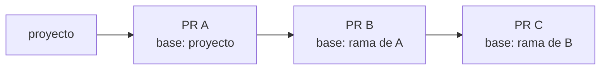

# 06 — Flujo de trabajo

Reglas para que 5 personas trabajen en el mismo repositorio sin pisarse, en un mini proyecto con
poco tiempo.

## 1. Rama de trabajo: `proyecto`

El repositorio es del curso y ya tiene ramas de otras entregas (`main`, `lab1`…`lab8`, `hdt2`,
`htd1`, `examenpractico`). **Todo el proyecto vive en una sola rama: `proyecto`.** No se crean
ramas nuevas.

| Regla | Detalle |
| ------- | --------- |
| Una sola rama | Todos hacen commit y push directamente a `proyecto` |
| No tocar otras ramas | Las ramas de laboratorios y exámenes no se modifican ni se mezclan con `proyecto` |
| Sincronizar antes de subir | `git pull --rebase origin proyecto` antes de cada `git push` |
| Nada de `push --force` | Reescribir la historia compartida rompe el trabajo de los demás |
| Excepción: PR | Un cambio de contrato (esquemas, `Policy`, `info`) o un trabajo en el módulo de otro rol va en una rama corta `feat/<id>-<tema>` y un PR hacia `proyecto`. Lo revisa el dueño del módulo; si el rol no tiene dueño (hoy R4), queda sin revisor asignado para que lo revise cualquier integrante. Se mezcla cuando está aprobado y se borra la rama |
| Commits pequeños | Un commit por cambio lógico, idealmente por tarea o subtarea de [04_tareas.md](04_tareas.md) |
| No subir con tests rotos | Si `uv run pytest` falla en local, no se hace push (ver sección 3) |

**Ciclo de trabajo:**

```bash
git switch proyecto
git pull --rebase origin proyecto      # traer lo último
# ... trabajar en la tarea, con sus tests ...
make check                             # lint, tipos y tests: tiene que pasar
git add <archivos>
git commit -m "feat(env): ... [ENV-04]"
git pull --rebase origin proyecto      # por si alguien subió algo mientras tanto
make check                             # volver a correr si el rebase trajo cambios
git push origin proyecto
```

### Pilas de PR

Para no detenerse mientras un PR espera revisión, el trabajo que depende de él sale de su rama en
vez de `proyecto`:



- Cada PR tiene una sección **Orden de merge**: de qué PR depende, cuál se aprueba primero y qué PR
  esperan por él.
- Se mezcla de abajo hacia arriba, empezando por el PR cuya base es `proyecto`. Al borrar su rama,
  GitHub cambia la base del PR siguiente a `proyecto`.
- Se mezcla con **"Create a merge commit"**. *Squash* y *rebase* reescriben los commits, y el PR
  siguiente vuelve a mostrar los cambios del anterior.
- Si la revisión cambia un PR de abajo, el cambio se lleva a los de arriba con `git merge`, sin
  `push --force`.

**Para evitar conflictos:** cada rol trabaja casi siempre dentro de sus propias carpetas
([03_roles.md](03_roles.md)). Los archivos compartidos (`pyproject.toml`, `conftest.py`, los
contratos) los cambia R1 o se avisa en el canal antes de tocarlos.

## 2. Commits

Se usan [Conventional Commits](https://www.conventionalcommits.org/es/), en español, con el ID de
la tarea:

```
<tipo>(<módulo>): <descripción en imperativo> [<ID>]

feat(env): agregar penalización por drawdown en la recompensa [ENV-05]
fix(data): evitar back-fill al re-muestrear precios [DAT-04]
test(evaluation): casos de max drawdown con curvas conocidas [EVA-03]
docs(arquitectura): documentar variante execute_at=next [ENV-09]
```

## 3. Entregas y tests

Salvo en los casos de PR de la sección 1, **los tests son la revisión**. Lo que se sube a `proyecto` se considera
entregado, y lo entregado tiene que venir con sus tests.

1. **Cada entrega trae sus tests.** El commit que completa una tarea incluye los tests de su
   criterio de aceptación ([04_tareas.md](04_tareas.md)), siguiendo las normas de
   [05_testing.md](05_testing.md).
2. **La CI corre en cada push a `proyecto`** (ADR-014). Si un push deja la CI en rojo, su autor
   lo arregla **antes de seguir con otra cosa**. Si no puede, avisa en el canal y R1 ayuda. Antes
   de subir, `make check` corre localmente lo mismo que la CI.
3. **El dueño del módulo verifica.** Cuando alguien sube algo que toca un módulo ajeno, el dueño
   corre los tests de ese módulo y revisa el cambio. Si encuentra un problema, se corrige con un
   commit `fix(...)` con su test de regresión.
4. **Los contratos no se rompen en silencio.** Un cambio en los esquemas, en `Policy` o en `info` se
   propone en un PR hacia `proyecto` y se avisa en el canal. Lo aprueban R1 y los dueños de los
   módulos que lo usan; la CI corre también en el PR.

**Checklist antes de cada push:**

- [ ] `uv run pytest` pasa en local
- [ ] `uv run ruff check . && uv run ruff format --check .` pasa
- [ ] Lo que entrego tiene tests que cubren su criterio de aceptación
- [ ] Hice `git pull --rebase` y los tests siguen pasando después
- [ ] El mensaje de commit sigue el formato de la sección 2

## 4. Issues y tablero

- Cada tarea de [04_tareas.md](04_tareas.md) es un **issue** en GitHub, con etiquetas de rol
  (`R1`–`R5`), fase (`F0`–`F4`) y prioridad (`P0`–`P2`).
- El tablero de GitHub Projects tiene las columnas `Pendiente → En progreso → Hecho`.
- Un issue se cierra desde el commit que entrega la tarea: `feat(env): ... [ENV-04] (cierra #12)`.
- Los bugs se reportan como issues con la etiqueta `bug` e incluyen los pasos para reproducirlos.

## 5. Experimentos

Los experimentos (barridos de hiperparámetros, ablaciones) se hacen en la misma rama, pero con
orden:

- Solo se suben las configs (`configs/`) y los scripts que se vayan a mantener. Las pruebas
  descartables se quedan en local.
- Cada experimento queda registrado en `reports/experimentos.md` con una tabla: fecha, autor,
  `run_id`, config, dataset, resultado en val y conclusión.
- **Nunca** se mira el conjunto de test durante un experimento (ver
  [05_testing.md](05_testing.md), "Aislamiento del test").

## 6. Qué se versiona y qué no

| Se versiona | No se versiona (`.gitignore`) |
| ------------- | ------------------------------- |
| Código, configs, tests y fixtures pequeñas | `data/raw/`, `data/processed/`, `data/offline/` |
| `docs/`, `reports/` (tablas y figuras finales) | `models/` (salvo los `metrics.json` finales) |
| Notebooks **con las salidas limpias** o EDA final ejecutado | Logs de TensorBoard (`runs/`) |
| `uv.lock` | `.env`, credenciales |

> Todo lo de la columna derecha ya está en `.gitignore`.

### Dónde va cada cosa

| Archivo | Qué contiene | Quién lo edita |
| --- | --- | --- |
| `pyproject.toml` | Dependencias que usa el paquete (`[project.dependencies]`), comandos propios del paquete (`[project.scripts]`, hoy `polym4v`), herramientas de desarrollo (`[dependency-groups] dev`) y la configuración de ruff, mypy, pytest y cobertura | Se edita a mano o con `uv add` / `uv add --dev` |
| `uv.lock` | Versiones exactas resueltas de todo lo anterior | Solo uv (`uv lock`, `uv add`); nunca a mano |
| `Makefile` | Comandos de flujo de trabajo: instalar, revisar, testear, capturar datos y generar entregas | A mano; cada comando nuevo del proyecto se agrega aquí |
| `.skills/entregable-pdf/scripts/requirements.txt` | Versiones fijas del generador de PDF, que corre aislado con `uv run --no-project` | La skill; no entra en `uv.lock` |
| `configs/*.yaml` | Parámetros de cada experimento, validados con pydantic | A mano; se versionan y se guardan resueltos con cada corrida |
| `.env` | Rutas de la máquina, nivel de log y credenciales | Cada integrante, a partir de `.env.example`; no se versiona |

Regla: si un comando se usa más de una vez, va al `Makefile`. La CI llama a los mismos targets
(`make install`, `make lint typecheck`, `make coverage`).

## 7. Definition of Done (DoD)

Una tarea está **hecha** cuando cumple todo esto:

1. Cumple el **criterio de aceptación** de [04_tareas.md](04_tareas.md).
2. Tiene tests, y la CI está en verde después del push.
3. Tiene docstrings en las funciones públicas y type hints.
4. Está subida a la rama `proyecto`.
5. Si cambió una decisión de diseño, se actualizó `docs/` o se agregó un ADR.
6. El issue está cerrado y movido a "Hecho" en el tablero.

## 8. Estilo de código

- `ruff` con línea de **100 caracteres** (coherente con `.vscode/settings.json`).
- Type hints en todas las funciones públicas.
- Docstrings en estilo Google, en español o en inglés, pero de forma **consistente dentro de cada
  módulo**.
- Sin números mágicos: los valores van en `configs/*.yaml`.
- Las funciones de `features/`, `metrics.py` y `reward.py` son **puras**: no tienen estado ni
  efectos secundarios.
