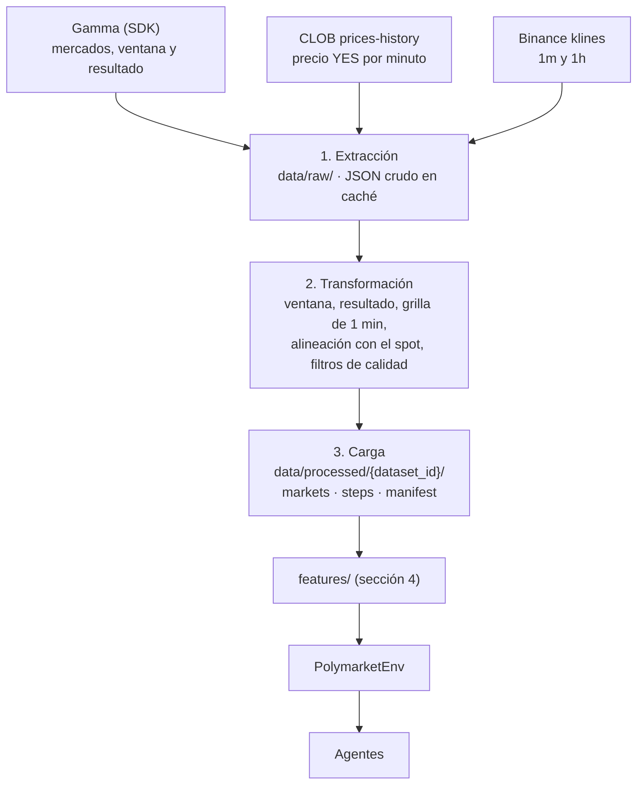

# 08 — Datos y entrada del modelo

Este documento baja a detalle cómo pasar de las APIs a la entrada del agente: extracción, ETL,
exploración, observación y supuestos del entrenamiento. Se basa en las mediciones del
[spike de datos](notas/spike_datos.md) y amplía las secciones 2.1 a 2.4 de
[02_arquitectura.md](02_arquitectura.md). Las decisiones están registradas como ADR en
[07_riesgos_y_decisiones.md](07_riesgos_y_decisiones.md).

Documentación oficial de las fuentes: [Polymarket](https://docs.polymarket.com) y
[Binance Spot API](https://developers.binance.com/docs/binance-spot-api-docs/rest-api/market-data-endpoints).

## 1. Resumen de decisiones

| Tema | Decisión | Evidencia o ADR |
| ------ | ---------- | ----------------- |
| Familia de mercados | **BTC Up or Down horario** (serie Gamma `10114`) | Resuelve con la vela 1h de Binance, así que el spot explica el resultado exactamente (ADR-004) |
| Volumen | Del orden de 12 000 mercados, del 28/05/2025 al 30/10/2026 | 24 por día. Supera con creces el mínimo de 300 (ADR-002) |
| Episodio | La **vela de 60 minutos**, en una grilla de 1 minuto: 60 decisiones | Antes de la vela el precio queda en 0,5 y no aporta información (ADR-008) |
| Precio de Polymarket | Endpoint CLOB `/prices-history` con `startTs`, `endTs` y `fidelity=1` | La Data API v2 del SDK devuelve vacío en mercados cerrados (ADR-007) |
| Precio spot | Klines de Binance `BTCUSDT`: 1m para features y 1h para verificar el resultado | Misma fuente que la resolución |
| Costos | Spread de 0,02 más la **comisión taker** de Polymarket, `0,07 × p × (1 - p)` por acción | Esquema vigente desde 2026 (ADR-009) |
| Split | Temporal por mercado, 70/15/15 | Sin cambios (ADR-002) |
| Ejecución | Propuesta: la acción decidida en `t` se ejecuta al precio de `t + 1 min` | La ventaja que se busca es un retraso, y ejecutar en `t` la sobreestima (ADR-011, propuesta) |

## 2. Flujo ETL



El ETL sí hace falta: las tres fuentes tienen relojes distintos, los mercados antiguos traen
metadatos inconsistentes y hay datos posteriores a la resolución que se tienen que cortar.

### 2.1 Extracción

| Paso | Llamada | Caché |
| ------ | --------- | ------- |
| Listar mercados | `PublicClient.list_events(series_ids=10114, closed=True, order="endDate", ascending=True)`, recorrido con `iter_items()` | `data/raw/gamma/events/<event_id>.json` |
| Precio YES | `GET https://clob.polymarket.com/prices-history?market=<yes_token_id>&startTs=<w0 - 3600>&endTs=<w1>&fidelity=1` | `data/raw/clob/<yes_token_id>.json` |
| Spot 1m | `GET /api/v3/klines?symbol=BTCUSDT&interval=1m&startTime=&limit=1000`, en bloques consecutivos | `data/raw/binance/BTCUSDT_1m_<día>.json` |
| Vela 1h | La misma llamada con `interval=1h` | `data/raw/binance/BTCUSDT_1h_<mes>.json` |

Reglas:

- **La caché es la fuente de verdad.** Si el archivo existe, no se llama a la red. Reconstruir el
  dataset no repite descargas.
- Reintentos con espera exponencial y una pausa entre llamadas. Los límites de rate del endpoint
  CLOB no están documentados: conviene empezar con unas 5 llamadas por segundo.
- Se pide una hora antes de la ventana (`w0 - 3600`) para tener contexto: el último precio previo
  y la volatilidad del spot.
- Volumen estimado: unas 12 000 llamadas al CLOB (una por mercado) y unas 750 a Binance. Para
  iterar rápido, primero se construye un **v0 con los últimos 1 000 mercados**.

### 2.2 Transformación

**Ventana del mercado.** Se calcula `w0` (inicio de la vela) desde el **título**, en la zona
`America/New_York` y con horario de verano. Hay dos formatos:
`Bitcoin Up or Down – May 28 (1 AM ET Candle)` y `Bitcoin Up or Down - October 30, 8PM ET`. Luego
`w1 = w0 + 3600`. El campo `end_date` de Gamma **no** sirve en los mercados antiguos. En los
recientes se usa como control cruzado, junto con `metadata.priceToBeat` cuando existe.

**Resultado.** `outcome = 1` si `outcomes.yes.price == 1` después del cierre. Se verifica con la
vela 1h de Binance (`close >= open`). Si no coinciden, el mercado se descarta y queda registrado
en el manifest.

**Grilla.** Los instantes de decisión son `t_k = w0 + 60·k` para `k = 0..59`. En cada `t_k`:

- `p_yes(t_k)` es el **último punto con `ts <= t_k`** (solo *forward-fill*). Se guarda también
  `p_stale_s = t_k - ts`, los segundos desde ese punto.
- `spot(t_k)` es el `close` de la última kline de 1 minuto **ya cerrada**, la que abre en
  `t_k - 60`. La kline que abre en `t_k` cierra en `t_k + 59,999 s`, así que usarla filtra
  información del futuro.
- **Pendiente de la decisión D6:** el precio de `t_k` puede tener hasta 60 s de atraso respecto
  del spot, y el mercado real ya habría incorporado ese movimiento. La propuesta es tomar el spot
  en el mismo instante que el último punto de precio (klines de 1 s) y ejecutar en el punto
  siguiente. Ver la sección 2.3 de
  [decisiones_previas_al_diseno.md](notas/decisiones_previas_al_diseno.md).
- `spot_open` es el `open` de la vela 1h que empieza en `w0`. Es el precio de referencia de la
  resolución y se conoce desde `w0`.
- Se descarta todo dato con `ts >= w1`. Hay precios y trades posteriores a la resolución.

**Filtros de calidad** (configurables):

- Menos de 45 puntos de precio dentro de la ventana.
- Un hueco de más de 600 s dentro de la ventana.
- No coincide el resultado con Binance, o no se pudo leer la ventana del título.

### 2.3 Carga: contrato de salida

Amplía el contrato de la sección 2.1 de [02_arquitectura.md](02_arquitectura.md).

`markets.parquet`, una fila por mercado:

| Columna | Tipo | Descripción |
| --------- | ------ | ------------- |
| `market_id` | str | `condition_id` |
| `slug`, `question` | str | Para la demo y para depurar |
| `yes_token_id`, `no_token_id` | str | Para volver a consultar la API |
| `w0`, `w1` | int (unix s) | Ventana de la vela |
| `outcome` | int | `1` si ganó UP (YES) y `0` si ganó DOWN |
| `spot_open`, `spot_close` | float | Open y close de la vela 1h de Binance |
| `fees_enabled` | bool | Esquema de comisiones que tenía el mercado |
| `fee_rate`, `fee_exponent` | float | `0` si no tenía comisiones |
| `n_points_window`, `max_gap_s` | int | Calidad de los datos |
| `split` | str | `train`, `val` o `test` |

`steps.parquet`, una fila por mercado y minuto:

| Columna | Tipo | Descripción |
| --------- | ------ | ------------- |
| `market_id` | str | FK a `markets` |
| `k` | int | Minuto de la ventana, de 0 a 59 |
| `ts` | int | `t_k` |
| `p_yes` | float | Último precio YES conocido en `t_k` |
| `p_stale_s` | int | Segundos desde el último punto de precio |
| `spot` | float | Close de la última kline de 1m cerrada |

Más una tabla auxiliar `spot_1m.parquet` (`ts`, `close`) con la hora previa a cada ventana, para
calcular la volatilidad sin volver a Binance. `manifest.json` guarda la configuración, la fecha de
construcción, los mercados descartados con su motivo, el número de mercados por split y el hash de
cada Parquet.

Configuración propuesta, `configs/data.yaml`:

```yaml
dataset_id: btc_updown_1h_v1
series_id: 10114
asset: BTC
date_from: 2025-05-28
date_to: 2026-10-30
step_seconds: 60
window_minutes: 60
context_minutes: 60          # historia previa para volatilidad y features
quality:
  min_points_in_window: 45
  max_gap_seconds: 600
split: {train: 0.70, val: 0.15, test: 0.15}
sources:
  clob_history: https://clob.polymarket.com/prices-history
  binance_klines: https://data-api.binance.vision/api/v3/klines
```

## 3. Exploración (EDA)

La EDA (DAT-08) tiene que responder estas preguntas **antes** de entrenar, porque deciden si hay
algo que aprender:

| Pregunta | Por qué importa | Cómo |
| ---------- | ----------------- | ------ |
| ¿Qué tan calibrado está `p_yes` minuto a minuto? | Un mercado bien calibrado deja poco margen | Brier y curva de confiabilidad por minuto. En el spike, el favorito acierta el 57 % en el minuto 0 y el 90 % en el 55. |
| ¿`p_yes` reacciona tarde al spot? | Es la única fuente plausible de ventaja | Correlación cruzada entre `Δspot` y `Δp_yes` con desfases de 0 a 5 minutos |
| ¿Cuánto se separa el valor justo del precio? | Indica si la ventaja cubre los costos | Distribución de `p_fair - p_yes` (sección 4) y su relación con el resultado |
| ¿Cambió el mercado con las comisiones? | Train es casi todo sin comisiones y val y test con comisiones | Las mismas métricas, antes y después de la introducción de las comisiones |
| ¿Cuánto cuesta operar? | Define si existe alguna estrategia rentable | Costo de ida y vuelta por precio, con el spread y la comisión |
| ¿Hay sesgos por hora o por día? | Posibles features de contexto | Tasa de UP por hora del día y por día de la semana |
| ¿Qué tan buenos son los datos? | Afecta la confianza en los resultados | Huecos, `p_stale_s` y mercados descartados por motivo |

## 4. Entrada del modelo

### 4.1 Observación

Vector de 15 valores por paso. Solo usa información con `ts <= t`.

| # | Feature | Definición | Escala |
| --- | --------- | ------------ | -------- |
| 1 | `p_yes` | Último precio YES | Ya está en [0, 1] |
| 2–3 | `dp_1`, `dp_5` | `p_yes(t) - p_yes(t - 1 min)` y lo mismo con 5 minutos | z-score |
| 4 | `p_stale` | `min(p_stale_s / 300, 1)` | Ya está en [0, 1] |
| 5 | `x` | `ln(spot / spot_open)`: distancia al precio de referencia | z-score |
| 6–7 | `r_1`, `r_5` | Retorno logarítmico del spot en 1 y 5 minutos | z-score |
| 8 | `sigma` | Desviación de los retornos de 1 minuto en los 60 minutos previos | z-score |
| 9 | `tau` | `(w1 - t) / 3600`, fracción de la vela que queda | Ya está en (0, 1] |
| 10 | `z` | `x / (sigma · sqrt(minutos restantes))` | Recorte a [-5, 5] |
| 11 | `p_fair` | `Φ(z)`: probabilidad de UP si el spot sigue un paseo aleatorio | Ya está en [0, 1] |
| 12 | `edge` | `p_fair - p_yes` | Ya está en [-1, 1] |
| 13–15 | `pos_side`, `entry_price`, `upnl` | Estado del agente: lado (-1, 0 o 1), precio de entrada (0 sin posición) y PnL no realizado sobre el monto apostado | Acotados |

Notas:

- Los z-score se ajustan **solo con train** y se guardan junto al dataset.
- `p_fair` es una feature hecha a mano: el valor de una opción digital sin deriva. Se agrega porque
  el agente tiene pocos episodios para descubrirla solo. Una ablación **sin** las features 10 a 12
  muestra cuánto aprende el agente por su cuenta.
- Son 12 valores de mercado y 3 del agente. No se incluye `cash / initial_cash` porque
  cada episodio empieza con el mismo capital y solo hay una posición a la vez.

### 4.2 Simulación y costos

- Compra: `precio = p + spread / 2 + slippage` y
  `comisión = acciones × 0,07 × precio × (1 - precio)`.
- Venta: `precio = p - spread / 2 - slippage`, con la misma comisión.
- Liquidación en `w1`: la posición paga 1 o 0 según `outcome`, **sin comisión** (no es un trade).
- Último paso (`k = 59`): no se abren posiciones nuevas.

Cuánto cuesta operar con `p = 0,5`, spread de 0,02 y sin contar el slippage:

| Operación | Costo por acción | Sobre el nocional |
| ----------- | ------------------ | ------------------- |
| Comprar y mantener hasta la resolución | 0,01 + 0,0175 = 0,0275 | 5,5 % |
| Comprar y vender antes | 0,055 | 11 % |
| Comprar con `p = 0,9` y mantener | 0,01 + 0,0063 = 0,0163 | 1,8 % |

Con estos costos, operar seguido no puede ser rentable. Lo esperable es que una buena política
opere poco, entre cuando el precio ya está lejos de 0,5 o cuando `edge` sea grande, y mantenga la
posición hasta la resolución. El riesgo R5 (que el agente aprenda a no operar nunca) se vuelve
más probable, y conviene monitorear el número de operaciones desde la primera corrida.

### 4.3 Lo que necesita el entrenamiento (R4)

| Aspecto | Valor |
| --------- | ------- |
| Pasos por episodio | 60 |
| Episodios por split (aproximado) | 8 400 train, 1 800 val y 1 800 test |
| Pasos de train | Cerca de 500 000: un PPO de 500k timesteps recorre train una vez |
| Acciones | `Discrete(4)`, sin cambios (ADR-005) |
| Baseline más exigente | `FairValuePolicy`: compra el lado con `edge` mayor que los costos y mantiene hasta la resolución |
| Test de cordura (AGT-06) | Mercado sintético donde `p_yes` es `p_fair` con 1 a 2 minutos de retraso. PPO y DQN deben aprender a explotar ese retraso. |
| Dataset offline | Transiciones de los baselines con ε-greedy, incluido `FairValuePolicy` |

`FairValuePolicy` es la referencia honesta: si el agente de RL no la supera, el resultado se
reporta así (riesgo R4).

## 5. Supuestos: qué se sostiene y qué hacemos

| Supuesto | Estado | Evidencia | Qué hacemos |
| ---------- | -------- | ----------- | ------------- |
| La API da precio fino en mercados cerrados | **Confirmado** con CLOB, **falso** con el SDK | Un punto cada 60 s con CLOB; vacío con la Data API v2 | Extraer del endpoint CLOB (ADR-007) |
| Hay episodios suficientes | **Confirmado** | Del orden de 12 000 horarios | v0 con 1 000 y luego el dataset completo |
| El spot de Binance explica el resultado | **Confirmado** solo en la serie horaria | La horaria resuelve con Binance; 5m y 15m resuelven con Chainlink | Usar la serie horaria (ADR-004) |
| `p_no = 1 - p_yes` | **Confirmado**, aproximado | Desvío medio 0,006 y máximo 0,045 | Se mantiene; el spread absorbe la diferencia (ADR-003) |
| No hay comisiones (`fee_rate: 0`) | **Falso** | Comisión taker desde 2026 | Modelar la fórmula real (ADR-009) |
| `end_date` marca el fin de la ventana | **Falso** en mercados antiguos | 12:00 UTC para una vela de 05:00 UTC | Leer la ventana desde el título |
| El precio antes de la vela aporta información | **Falso** | Queda entre 0,455 y 0,545 | El episodio es solo la vela (ADR-008) |
| El spread es fijo en 0,01 | **Parcial** | Entre 0,01 y 0,02 hoy; no hay histórico | 0,02 por defecto y análisis de sensibilidad (ENV-09) |
| `p` del historial es el punto medio | **Abierto** | La API no lo documenta | Tratarlo como el punto medio y cobrar medio spread; contrastarlo con trades si da el tiempo |
| Price-taker sin impacto | **Aceptado** | Tamaño mínimo de orden de 5 acciones; el monto simulado es chico | Documentarlo como limitación |
| El mercado tiene ineficiencias explotables | **Abierto** | Bastante calibrado en la muestra del spike | La EDA lo mide; un resultado negativo es válido |
| Ejecutar al precio del mismo instante | **Riesgoso** | Sobreestima la ventaja de reaccionar a un retraso | Ejecutar en `t + 1` por defecto (ADR-011, propuesta) |

## 6. Estructura del código y pasos siguientes

Los módulos siguen la sección 2.1 de [02_arquitectura.md](02_arquitectura.md):

```bash
src/polym4v/data/
├── clients/
│   ├── gamma.py       # Reutiliza PublicClient del SDK (list_events por serie)
│   ├── clob.py        # GET /prices-history directo, con httpx
│   └── binance.py     # Klines 1m y 1h
├── cache.py           # data/raw/, clave = parámetros de la petición
├── window.py          # Título → (w0, w1) en America/New_York
├── transform.py       # Grilla, alineación, filtros
├── schemas.py         # Contratos de markets y steps
├── build_dataset.py   # Orquesta extracción → transformación → carga
└── splits.py
```

El paquete se llama `polym4v` (ADR-012). Lo reutilizable de `rl_polymarket` se mueve allí; su
`get_price_history` no sirve para mercados cerrados.

Orden de trabajo:

1. Clientes con caché (DAT-02, DAT-03), probados con respuestas grabadas.
2. Ventana, resultado y grilla (DAT-04), con el test de no-*lookahead* del spot.
3. Dataset v0 con 1 000 mercados (DAT-05) y su split (DAT-06).
4. EDA (DAT-08) para responder la sección 3. Si no aparece ninguna ventaja después de los costos,
   se discute en equipo antes de invertir en los agentes.
5. Features de la sección 4.1 (DAT-07) y contratos compartidos con R3 y R4 (INF-06).
6. Dataset completo.
