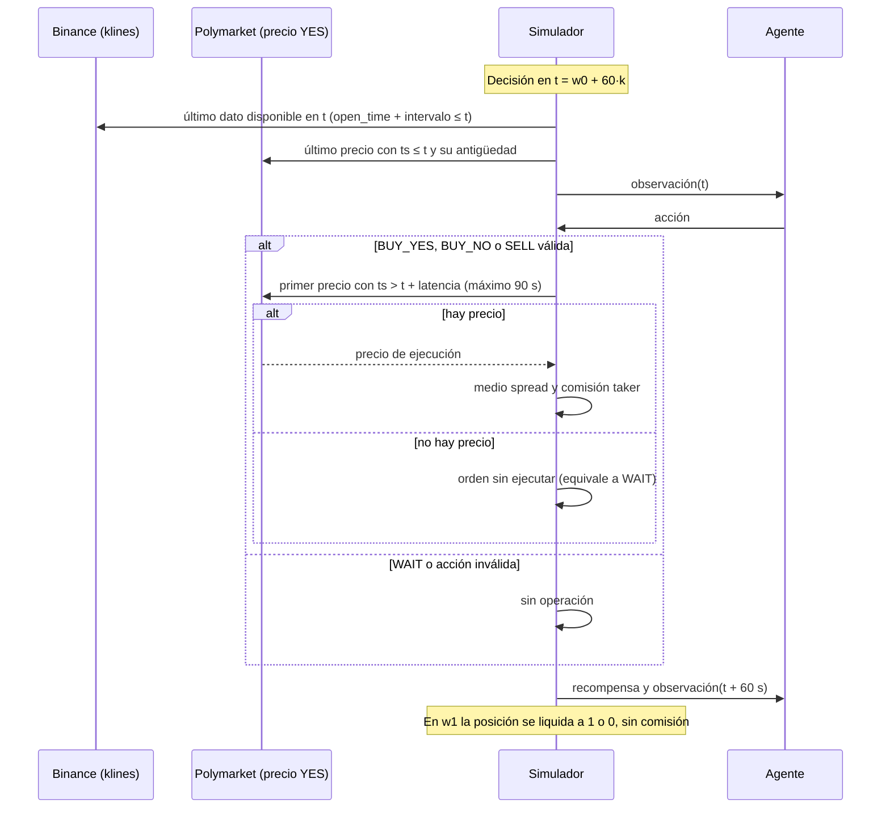
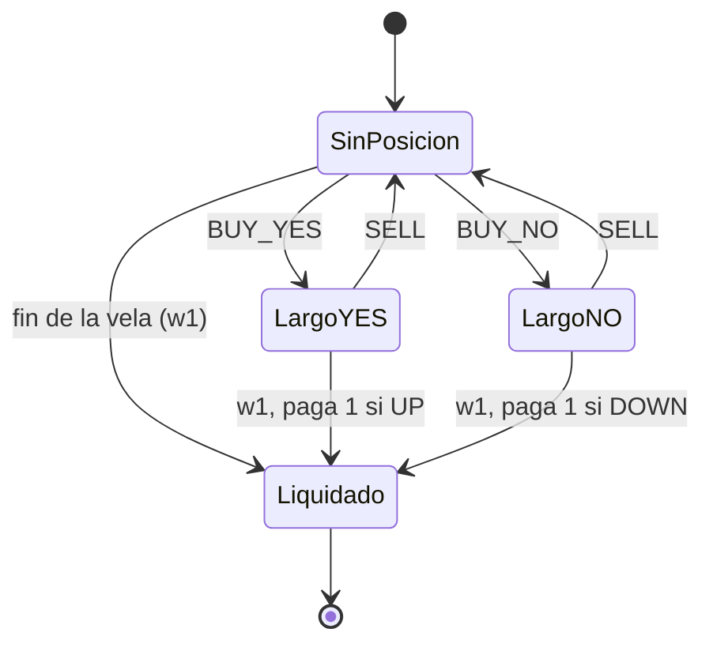
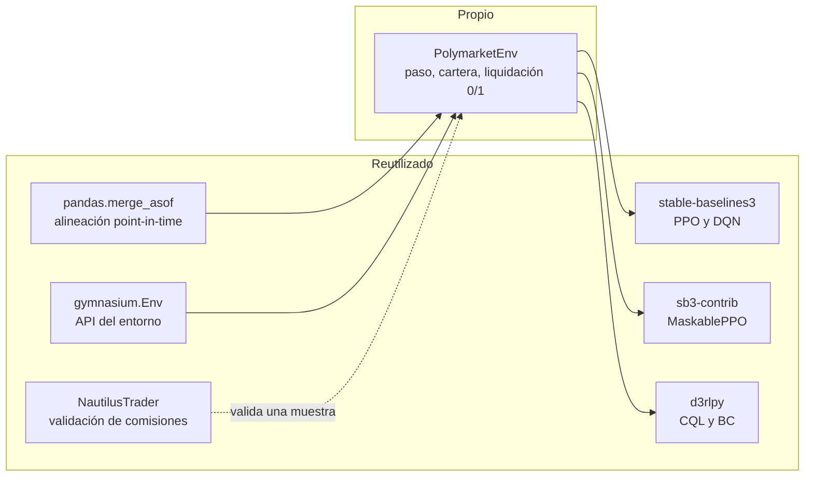

# 09 — Sistema de simulación

Documentación oficial de las piezas que se reutilizan: [Gymnasium](https://gymnasium.farama.org),
[stable-baselines3](https://stable-baselines3.readthedocs.io),
[sb3-contrib MaskablePPO](https://sb3-contrib.readthedocs.io/en/master/modules/ppo_mask.html),
[d3rlpy](https://d3rlpy.readthedocs.io),
[pandas.merge_asof](https://pandas.pydata.org/docs/reference/api/pandas.merge_asof.html),
[comisiones de Polymarket](https://docs.polymarket.com/trading/fees) y
[klines de Binance](https://developers.binance.com/docs/binance-spot-api-docs/rest-api/market-data-endpoints).

Este documento define **cómo se comporta el simulador**: qué ve el agente, cuándo y a qué precio
se ejecuta una orden, qué cuesta y cómo termina un episodio. Nace de la decisión D6 de
[decisiones_previas_al_diseno.md](notas/decisiones_previas_al_diseno.md): el atraso del precio de
Polymarket mostró que el sistema no tenía un modelo de tiempo definido. La regla es **reutilizar
prácticas y herramientas open source establecidas** en lugar de inventar.

- **Estado (30/10/2026):** R1 aceptó S1, S2, S5, S6, S7, S8 y S11 con los ajustes de la revisión
  independiente (sección 4), registradas en el ADR-013. S3, S4, S9 y S10 quedan pendientes.
- **Base:** investigación de backtesters (backtrader, backtesting.py, zipline-reloaded, vectorbt,
  NautilusTrader, hftbacktest, LEAN) y entornos de RL de trading (gym-anytrading,
  Gym-Trading-Env, FinRL, TensorTrade, mbt_gym, ABIDES-gym), consultada el 30/10/2026.

## 1. Comportamiento esperado

### 1.1 Un paso del episodio

### 1.2 Estados de la posición

Acciones inválidas: `BUY_*` con una posición abierta o `SELL` sin posición. El simulador las
ejecuta como `WAIT` (decisión S6).

### 1.3 Qué se reutiliza y qué se escribe

Ningún entorno de RL existente modela un activo que liquida a 0 o 1, dos tokens (YES y NO) ni la
comisión `p × (1 - p)`. Heredar de cualquiera obligaría a reescribir el paso, la cartera y los
costos, que es casi todo el entorno. Por eso el entorno es propio y lo demás se reutiliza.

## 2. Resumen de decisiones

| # | Qué define | Recomendación | Práctica open source que la respalda | Estado |
| --- | --- | --- | --- | --- |
| S1 | Modelo de tiempo de los datos | Cada dato guarda cuándo ocurrió y cuándo estuvo disponible | `ts_event`/`ts_init` (NautilusTrader), `exch_ts`/`local_ts` (hftbacktest), `EndTime` (LEAN) | Aceptada con ajuste |
| S2 | Reloj de decisión | Grilla fija de 1 minuto, 60 decisiones por episodio | Backtesters por barras y todos los entornos de RL revisados | Aceptada |
| S3 | Qué ve el agente | Último dato disponible de cada fuente, más la antigüedad del precio | `merge_asof(direction="backward")`; regla de dato viejo de LEAN | Pendiente |
| S4 | Cuándo y a qué precio se ejecuta | Primer precio posterior a `t` + latencia; sin precio en 90 s, no hay ejecución | `trade_on_close=False` (backtesting.py), `coc=False` (backtrader), latencia constante (hftbacktest) | Pendiente |
| S5 | Costos | Medio spread de 0,01 y comisión oficial con redondeo, igual para todos los mercados | `spread` (backtesting.py), bid/ask (mbt_gym), modelo de comisión de Polymarket (NautilusTrader) | Aceptada con ajuste |
| S6 | Acciones inválidas | Se ejecutan como `WAIT`; el entorno expone `action_masks()` | MaskablePPO (sb3-contrib); Huang y Ontañón (2022) | Aceptada con ajuste |
| S7 | Base del entorno | `gymnasium.Env` propio, gymnasium 1.0.0, patrones de entornos existentes | Restricciones de d3rlpy 2.8.1 y SB3 2.9.2 | Aceptada con ajuste |
| S8 | Captura de datos | Descargar y archivar ya todo el historial de 1 minuto | Riesgo R15: la API nueva solo guarda 1 minuto durante 7 días | Aceptada con ajuste |

## 3. Decisiones

### S1 — Modelo de tiempo de los datos

**Qué define:** cuándo un dato "existe" para el simulador. El error de D6 viene de no distinguir
entre cuándo ocurrió algo y cuándo se pudo conocer.

**Qué hacen los proyectos existentes:** NautilusTrader ordena todo por `ts_init` (disponibilidad)
y guarda aparte `ts_event` (ocurrencia). hftbacktest exige `local_ts > exch_ts`. LEAN entrega la
barra de 9:30 a 9:31 a las 9:31. backtrader usa `rightedge=True`.

**Recomendación:** cada fila del dataset guarda `ts_event` y `ts_available`:

- Kline de Binance: `ts_available = open_time + intervalo`. La kline de 1 minuto con
  `open_time = t` contiene datos hasta `t + 59 s`.
- Precio de Polymarket: `ts_available = ts` (más una latencia de feed opcional).
- Toda consulta del simulador filtra por `ts_available <= t`.

### S2 — Reloj de decisión

**Opciones:**

- **Grilla fija de 1 minuto** (60 decisiones). Es lo que usan los backtesters por barras y todos
  los entornos de RL revisados. Encaja con SB3 y d3rlpy.
- **Por eventos** (una decisión por cada punto de precio). Es lo que hacen NautilusTrader y
  hftbacktest. Es más fiel, pero el número de pasos varía por episodio y complica el
  entrenamiento.

**Recomendación:** grilla fija. El atraso del precio se resuelve con S3 y S4, no con el reloj.

### S3 — Qué ve el agente

**Opciones:**

- **A. Último dato disponible de cada fuente:** spot hasta `t` y precio de Polymarket con
  `ts <= t`, más la antigüedad del precio como feature (`p_stale`). Es el as-of join estándar.
- **B. Foto coherente:** todo tomado en el instante del último precio de Polymarket. Elimina la
  diferencia de frescura, pero tira información del spot.

**Recomendación:** A, siempre junto con S4. El agente puede "intuir" que el precio viejo se va a
mover, pero como ejecuta en el precio siguiente (que ya se movió), esa intuición no se convierte en
una ganancia falsa. Se implementa con `merge_asof(direction="backward", allow_exact_matches=True,
tolerance=...)` sobre `ts_available`.

### S4 — Cuándo y a qué precio se ejecuta

**Opciones:**

- **Al precio de `t`** (*cheat-on-close*). Ningún backtester lo usa por defecto, porque es
  justamente el error de D6.
- **Al precio del minuto siguiente de la grilla.** Si falta ese minuto, puede terminar ejecutando
  a un precio viejo.
- **Al primer precio con `ts > t + latencia`**, con un máximo de 90 s. Si no hay precio, la orden
  no se ejecuta.

**Recomendación:** la tercera, con
`merge_asof(direction="forward", allow_exact_matches=False, tolerance=90 s)`. Latencia constante
de 2 s como base, con análisis de sensibilidad a 15 y 30 s. La única medición pública encontrada da
un rezago del libro de Polymarket frente a Binance de 0,3 s en la mediana y 8 s en el percentil
99, así que 2 s es conservador.

### S5 — Costos

**Qué hacen los proyectos existentes:** backtesting.py y mbt_gym compran a medio más medio spread
y venden a medio menos medio spread. NautilusTrader trae un modelo de comisión de Polymarket.

**Fórmula oficial:** `comisión = acciones × 0,07 × p × (1 - p)`, solo taker, redondeada a 5
decimales, con un mínimo de 0,00001 USDC. Los mercados horarios cobran desde el 06/03/2026 (solo
los creados después de esa fecha).

**Opciones:**

- **A. Comisión vigente para todos los mercados** (ADR-009). Costos parejos en train y test, y se
  usa todo el dataset.
- **B. Comisión que tenía cada mercado.** Es más fiel al pasado, pero train (sin comisión) y test
  (con comisión) quedan en condiciones distintas.
- **C. Solo mercados desde el 06/03/2026.** Todo es consistente, pero quedan unos 5 700 mercados y
  la evaluación solo detectaría diferencias de 8 % o más.

**Recomendación:** A, con medio spread de 0,01 y una sensibilidad con 0,02. La comisión se copia de
la documentación oficial y se valida contra el modelo de NautilusTrader con una muestra de órdenes.

### S6 — Acciones inválidas

**Qué hay disponible:** MaskablePPO (sb3-contrib) acepta un método `action_masks()` en el entorno.
DQN de SB3 y d3rlpy no soportan máscaras. Huang y Ontañón (2022) muestran que enmascarar escala
mejor que penalizar, y que una penalización grande frena la exploración.

**Recomendación:** el entorno convierte una acción inválida en `WAIT`, con penalización nula o
pequeña (`lambda_invalid` configurable), y expone `action_masks()`. PPO se entrena con y sin
máscara, y DQN y d3rlpy sin máscara. El dataset offline guarda la acción **ejecutada**, no la
pedida.

### S7 — Base del entorno

**Opciones:**

- **A. `gymnasium.Env` propio**, copiando patrones de proyectos con licencia MIT: el historial de
  pasos y la rotación entre varios datasets de Gym-Trading-Env, y el gráfico de operaciones de
  gym-anytrading.
- **B. Depender de Gym-Trading-Env.** Al importarse convierte todas las advertencias en errores, y
  su `reset` no respeta la semilla.
- **C. Construir todo sobre NautilusTrader.** Es un motor por eventos muy completo (y trae
  integración con Polymarket), pero no está pensado para RL y su licencia es LGPL.

**Recomendación:** A. Fijar `gymnasium==1.0.0`, porque d3rlpy 2.8.1 exige esa versión y SB3 2.9.2
acepta de 0.29.1 a 2.0. Usar NautilusTrader solo para validar costos y resultados de una muestra.

### S8 — Captura de datos

**Qué se encontró:** desde el 04/09/2026, Polymarket tiene una API nueva de historial
(`/v2/prices-history`) que guarda el detalle de 1 minuto solo durante 7 días. El endpoint antiguo
(`/prices-history` del CLOB) todavía devuelve 1 minuto para mercados de 2025, pero puede retirarse
sin aviso. La documentación oficial (consultada con Context7) lo confirma: en la API nueva, los
datos de 1 minuto duran al menos 7 días, cualquier resolución menor a 3 horas cubre solo los
últimos 30 días, y los rangos explícitos tienen un máximo de 15 días.

**Estado:** la captura de BTC horario está en curso con `make capture` (`SERIES=10114`).

**Recomendación:** descargar y archivar **ahora** el historial de 1 minuto de todos los mercados
BTC horarios (unos 12 500 pedidos) y las klines de Binance, como datos crudos inmutables
(`data/raw/`). Además, respaldar ese archivo fuera del repo. No depende de las demás decisiones.

## 4. Revisión independiente (30/10/2026)

Dos revisores independientes, con los agentes `specialized-master-plan-architect` (plan e
ingeniería) y `specialized-model-qa` (validez de los resultados), evaluaron las consecuencias de
aceptar S1 a S8. Ninguno rechaza una decisión. Casi todas necesitan un ajuste.

### 4.1 Consecuencias por decisión

| # | Ganamos | Perdemos | No perdemos (aunque parezca) | Ajuste que piden | Reversibilidad |
| --- | --- | --- | --- | --- | --- |
| S1 | Una regla única y testeable de "qué se sabe en `t`" | Solo disciplina: toda consulta pasa por `ts_available` | No obliga a un motor por eventos | Disponibilidad **por campo**: el `open` de una vela se conoce al abrir y el `close` al cerrar. `outcome` y `spot_close` solo existen en `w1` | Barata ahora, cara después |
| S2 | Encaja con SB3 y d3rlpy; episodios de largo fijo | Cualquier ventaja de menos de 1 minuto | Fidelidad: el feed trae un punto por minuto | Ninguno. El informe dice que la conclusión vale "decidiendo cada minuto" | Baja, pero sin motivo para cambiar |
| S3 | No se tira información del spot | `edge` mezcla spot fresco con precio viejo y mide el atraso del feed | La protección contra la ganancia falsa, si va junto con S4 | Los baselines reciben la misma información de frescura; agregar `edge` calculado en el instante del precio; marcar ADR-011 como reemplazada | Alta |
| S4 | Se elimina la ejecución al precio viejo | La "latencia de 2 s" casi no cambia nada: el atraso real lo da el hueco hasta el punto siguiente | La igualdad de trato entre agente y baselines | **Tolerancia de 60 s o menos** (90 s filtra precios futuros); latencia base de unos 15 s según la medición propia; ejecución calculada en el entorno; reportar las órdenes sin ejecutar | Alta si se calcula en el entorno |
| S5 | Mismo costo en todos los splits | Fidelidad histórica en train | Potencia: val y test ya tienen comisión, así que A y B dan lo mismo en la cifra principal | Un solo parámetro `half_spread`; reportar 0,01 y 0,02; testear la fórmula con los ejemplos oficiales, sin NautilusTrader | Alta |
| S6 | Entorno robusto | PPO con y sin máscara duplica corridas y rompe la igualdad con DQN y CQL | El % de acciones inválidas, si se guarda la acción pedida | PPO principal **sin** máscara (MaskablePPO como P2); `lambda_invalid = 0`; guardar la acción pedida y la ejecutada | Alta |
| S7 | Control de la liquidación 0/1 y de la comisión | La corrección depende de tests propios | Realismo: NautilusTrader aporta con libro de órdenes, que no tenemos | Sacar NautilusTrader del plan (P2 como mucho); fijar versiones con `uv lock`; evaluar cada mercado de test una vez y en orden fijo | Baja para la base, alta para versiones |
| S8 | Cierra R15 y asegura la reproducibilidad | Cerca de un día de R2 | Libertad de diseño, si el crudo se guarda tal cual | Incluir el token NO (valida ADR-003) y ETH; ventana amplia; metadatos de cada petición; hash del crudo; esta semana | No hacerlo puede ser irreversible |

### 4.2 Hallazgos que la propuesta no cubría

- **Fuga por la tolerancia de 90 s.** Es mayor que el paso de 60 s: una orden ejecutada después de
  `t + 60` mostraría un precio futuro en la observación siguiente.
- **Latencia subestimada.** La medición propia (decisiones previas, sección 2.3) indica que cada
  punto refleja el mercado de hasta 15 s antes de su fecha. Con 2 s de latencia, se compraría a
  un precio anterior a la decisión.
- **Ventaja fantasma.** Con spot fresco y precio viejo, `FairValuePolicy` opera sobre ventajas que
  no existen y paga comisión. Un agente que aprenda a ignorarlas "le gana" por un defecto del
  feed. Sin baselines con la misma información, un H1 positivo no se puede defender.
- **Test contaminado.** Las muestras de 298, 40 y 70 mercados de los análisis previos incluyen el
  periodo de test, y con ellas se fijaron umbrales y latencias.
- **Huecos del sistema:** el precio con que se valora la posición (recompensa, PnL no realizado y
  drawdown); las reglas de fin de episodio (desde qué minuto no se compra y qué pasa con un `SELL`
  sin ejecutar); y la obligación de que los baselines corran por el mismo entorno.
- **Calendario:** el modo de ejecución pasa de ENV-09 (F3, P2) a ENV-03/04 (F1, P0, ruta crítica);
  el contrato INF-06 suma `ts_available` y una tabla de precios crudos; AGT-06 se redefine con un
  retraso de 2 pasos o más.

### 4.3 Decisiones nuevas que salieron de la revisión

| # | Qué define | Recomendación | Estado |
| --- | --- | --- | --- |
| S9 | Precio con que se valora la posición abierta (recompensa, PnL no realizado y drawdown) | Lo que se obtendría al vender ahora: `p - half_spread` | Pendiente |
| S10 | Reglas de fin de episodio | No abrir posiciones en los últimos 2 minutos; un `SELL` sin ejecutar antes de `w1` deja la posición a la liquidación | Pendiente |
| S11 | Mercados de test usados en análisis previos | Excluir de test los mercados de las muestras de 298, 40 y 70; congelar la configuración antes de abrir test | Aceptada |

Restricción que ya está acordada para cuando se decida S4: la tolerancia de ejecución no puede
superar el paso de la grilla (60 s).

### 4.4 Tests de no-fuga que piden los revisores

- **Mercado nulo:** el precio es exactamente el valor justo del spot, con un punto por minuto.
  Sin costos ninguna política gana de forma significativa; con costos todas pierden.
- **Mercado nulo con fechas atrasadas 15 s:** con latencia menor al atraso aparece una ventaja, y
  con latencia mayor o igual desaparece. Calibra la latencia.
- **Control positivo (AGT-06):** con un retraso real de 2 minutos, el agente lo explota.
- Alterar cualquier dato con `ts > t` (incluidos `outcome` y `spot_close`) no cambia la
  observación en `t`.
- Una orden ejecutada después de `t + 60` no aparece en la observación de `t + 60`.
- El PnL de una política fija no sube al aumentar la latencia.

## 5. Pendiente de verificar

- Que `/prices-history` devuelva el punto medio y no el último trade. No está documentado; se puede
  contrastar con los trades de la Data API.
- La fecha exacta desde la que rige la fórmula actual de comisiones.
- La única medición pública del rezago del mercado (0,3 s) viene de una sola fuente.
