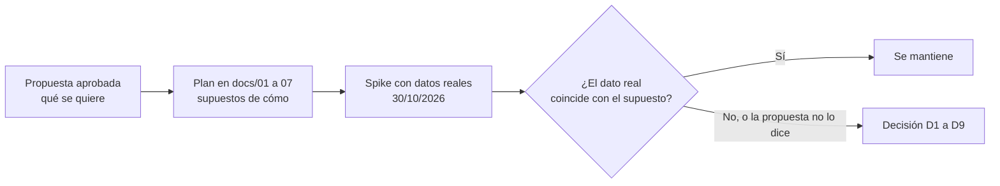
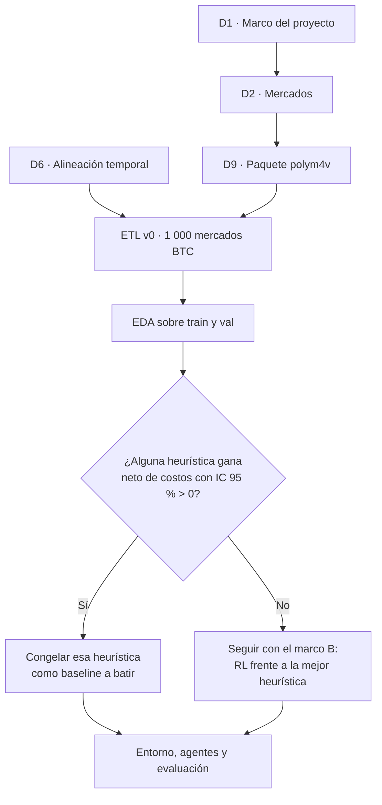

# Decisiones previas al diseño

Documentación oficial de las fuentes: [Polymarket](https://docs.polymarket.com) y
[Binance Spot API](https://developers.binance.com/docs/binance-spot-api-docs/rest-api/market-data-endpoints).

- **Preparado por:** R1 (Josué), 30/10/2026
- **Para qué:** listar lo que el equipo tiene que decidir **antes** de implementar el ETL, el
  entorno y los agentes. Cada decisión trae la evidencia medida, las opciones y una recomendación.
- **Base:** [spike de datos](spike_datos.md) y
  [08_datos_y_entrada_modelo.md](../08_datos_y_entrada_modelo.md). Cuando una decisión se cierra,
  se registra como ADR en [07_riesgos_y_decisiones.md](../07_riesgos_y_decisiones.md).

## 0. De dónde salen estas decisiones

La propuesta aprobada describe **qué** se quiere hacer, en cuatro pasos. Para construirlo hay que
fijar **cómo**, y al probar con datos reales aparecieron vacíos o choques con lo que el plan
suponía. Cada decisión nace de uno de esos puntos.

| Paso de la propuesta | Qué no dice o qué chocó con los datos | Decisión |
| --- | --- | --- |
| 1. "Obtener datos históricos de Polymarket, inicialmente de BTC o ETH" | Hay muchas familias de mercados de BTC (5m, 15m, 1h, 4h, diario) que resuelven distinto. "BTC **o** ETH" no dice si van los dos. | D2 |
| 1. (cont.) | El historial de precios llega con hasta 60 s de atraso respecto del precio de BTC. | D6 |
| 2. "Reproducir esos mercados dentro de un entorno simulado" | No menciona costos, y Polymarket cobra comisión desde 2026. | D5 |
| 2. (cont.) | Con el atraso del paso 1, el simulador dejaría comprar a precios viejos. | D6 |
| 3. "Entrenar agentes mediante recompensas y penalizaciones" | No dice qué ve el agente ni con qué mercados se entrena y con cuáles se evalúa. | D7, D8 |
| 4. "Comparar contra estrategias simples para comprobar si aprendieron algo útil" | Qué cuenta como "útil", cuántos mercados hacen falta para demostrarlo y qué hacer si ninguna estrategia gana. | D1, D3, D4 |
| (Ingeniería) | El código existente y la documentación usaban nombres distintos para el paquete. | D9 |

**Lo que ya está respondido:**

- D1, por el objetivo de la propuesta: "aprovechar la información del mercado **mejor que
  estrategias básicas**". El éxito es relativo a esas estrategias, no ganar dinero.
- D9: `polym4v` (ADR-012).
- D5: ADR-009 (comisión vigente para todos y ablación sin comisión). Queda abierto a revisión.
- D3 no es una elección: es la consecuencia de D2.

## 1. Resumen

| # | Pregunta | Recomendación | Decide | ¿Bloquea el diseño? |
| --- | --- | --- | --- | --- |
| D1 | ¿Qué pregunta responde el proyecto? | **Respondida por la propuesta:** superar a las estrategias básicas con los mismos costos. El retorno absoluto puede ser negativo. | Todo el equipo | Cerrada |
| D2 | ¿Qué mercados usamos? | **Decidida:** BTC horario primero; ETH horario si sobra tiempo (DAT-09) | R1 y R2 | Cerrada |
| D3 | ¿Los datos alcanzan? | Consecuencia de D2: sí para entrenar; con BTC solo, la evaluación detecta diferencias de unos 6 % o más por operación | R1 y R5 | Informativa |
| D4 | ¿Vale la pena? ¿Hay señal? | **Decidida:** si nada gana neto de costos, el proyecto sigue igual y se reporta | Todo el equipo | Cerrada |
| D5 | ¿Con qué costos se evalúa? | Comisión vigente para todos los mercados; sin comisión como ablación | R3 y R5 | No (ADR-009) |
| D6 | ¿Cómo se alinea el tiempo del precio con el del spot? | Se reformuló como la definición del sistema: decisiones S1 a S8 de [09_sistema_simulacion.md](../09_sistema_simulacion.md) | R1, R2 y R3 | Sí: define el simulador |
| D7 | ¿Le damos al agente features hechas a mano (`p_fair`)? | Sí, con una ablación sin ellas | R2 y R4 | No |
| D8 | ¿Cómo se parte el dataset? | Cronológico; test queda entero en el régimen con comisión | R2 y R5 | No |
| D9 | ¿Cómo se llama el paquete? | **Decidida: `polym4v`** (ADR-012) | R1 | Cerrada |

## 2. Evidencia nueva

### 2.1 Series disponibles

Medido el 30/10/2026. El volumen es el del último mercado cerrado de cada serie, así que solo es
indicativo.

| Serie | Episodios aprox. | Pasos por episodio (1 min) | Resuelve con | Volumen del último mercado (USD) |
| --- | --- | --- | --- | --- |
| BTC horario | 12 500 (24 por día desde el 28/05/2025) | 60 | Binance BTC/USDT | 9 400 |
| ETH horario | 12 200 (desde el 11/06/2025) | 60 | Binance ETH/USDT | 2 700 |
| BTC 15m | 39 600 (96 por día desde el 13/09/2025) | 15 | Chainlink, TWAP de 60 s | 23 900 |
| BTC 5m | 91 000 (288 por día desde el 18/12/2025) | 5 | Chainlink, TWAP de 60 s | 29 |
| BTC 4h | 2 300 (6 por día desde el 15/10/2025) | 240 | Chainlink, TWAP de 60 s | 12 400 |
| BTC diario | 590 (desde el 15/03/2025) | 1 440 | Binance BTC/USDT | 100 500 |

Hoy todas las series cobran la misma comisión taker (`rate = 0,07`, `exponent = 1`).

### 2.2 Muestra de 298 mercados BTC horarios

Mercados de junio de 2025 a octubre de 2026, 129 de ellos con comisiones. Ejecución en el minuto
siguiente, spread de 0,02 y comisión vigente.

- **El mercado está bien calibrado.** Su Brier y el del valor justo calculado con el spot
  (`p_fair`) son casi iguales en todos los tramos. `p_fair` solo es algo mejor en los últimos 20
  minutos: 0,112 contra 0,118 y 0,054 contra 0,059.
- **Ninguna heurística gana de forma significativa** (sin contar el mercado corrupto de más abajo):

| Estrategia | Operaciones | Sin costos | Con spread y comisión |
| --- | --- | --- | --- |
| `FairValue`, `abs(edge) > 0,10` | 285 | -0,9 % [-12,8; +11,2] | -5,7 % [-16,6; +5,7] |
| `FairValue`, `abs(edge) > 0,30` | 33 | +14,6 % [-15,7; +44,5] | +9,7 % [-18,8; +37,1] |
| Favorito en el minuto 50 | 298 | +2,8 % [-2,1; +7,5] | +0,8 % [-3,9; +5,3] |

Retorno medio por operación mantenida hasta la resolución, con su IC 95 % por bootstrap entre
corchetes.

- **Calidad:** 1 de 299 mercados traía precios corruptos (`p = 5000,49`). El ETL tiene que
  descartar precios fuera de [0, 1].

### 2.3 El tiempo del precio y el atraso de la grilla

En la grilla de 1 minuto, el cambio del valor justo en el último minuto predice casi perfectamente
el movimiento siguiente del mercado (correlación de 0,90). Parece una ventaja enorme, pero es un
artefacto. Se comprobó con el spot de Binance segundo a segundo en 70 mercados (4 127 pares de
puntos de precio):

| Desfase del spot respecto del punto de precio | -60 s | -30 s | -15 s | 0 s | +15 s | +30 s | +60 s |
| --- | --- | --- | --- | --- | --- | --- | --- |
| Correlación entre el cambio de `p` y el de `p_fair` | 0,22 | 0,63 | **0,79** | **0,78** | 0,57 | 0,37 | 0,05 |

- Cada punto del historial refleja el spot de entre 0 y 15 segundos antes. **El mercado reacciona
  en segundos, no en minutos.**
- En la grilla, el precio puede tener hasta 60 s de atraso mientras el spot está al día. El agente
  "ve" el futuro del mercado. Si `p_fair` se calcula en el mismo instante que el precio, la
  capacidad de predecir el punto siguiente cae de 0,90 a 0,22.
- Un agente que decide cada minuto no puede ganarle a un mercado que reacciona en 15 segundos.
  Cualquier ventaja grande que aparezca en el simulador tiene que tratarse como sospechosa hasta
  descartar este artefacto.

### 2.4 Tamaño de muestra para evaluar

El retorno por operación es casi binario. Su desviación va de 0,4 (entrando con precios altos,
como el favorito en el minuto 50) a 0,9 (entrando cerca de 0,5). Con el caso conservador de 0,9,
la diferencia mínima detectable con α = 5 % y potencia de 80 % es:

| Conjunto de test | Mercados en test | Si opera en todos | Si opera en el 30 % |
| --- | --- | --- | --- |
| BTC horario | 1 800 | 5,9 % | 10,8 % |
| BTC y ETH horario | 3 600 | 4,2 % | 7,7 % |
| BTC horario y 15m | 7 800 | 2,9 % | 5,2 % |
| BTC diario | 90 | 26,6 % | 48,5 % |

BTC y ETH se mueven juntos en la misma hora, así que sumar ETH da menos que el doble de
información. La comparación pareada (los mismos mercados para el agente y el baseline) reduce la
varianza y mejora estas cifras.

## 3. Decisiones

### D1 — ¿Qué pregunta responde el proyecto?

- **A. "¿Se puede ganar dinero?"** El éxito es un retorno neto positivo. Con la evidencia actual
  lo más probable es que no, y el proyecto se quedaría sin un resultado positivo que mostrar.
- **B. "¿Aprende RL una política mejor que la mejor heurística, con los mismos costos?"** El éxito
  es la diferencia pareada contra `FairValue`, el favorito y `NoTrade`. El retorno absoluto puede
  ser negativo, y aprender a no operar es un resultado válido si está bien medido. Es lo que ya
  plantea la hipótesis H1 de [01_idea_general.md](../01_idea_general.md).
- **C. Escenario sin comisiones como principal.** Hay más margen para aprender, pero es menos
  realista.

**Recomendación:** B como marco principal, con C como ablación para separar "RL no aprende" de "los
costos se comen todo".

### D2 — ¿Qué mercados usamos?

- **BTC horario solo.** Es lo más simple, pero solo detecta diferencias de 6 % o más.
- **BTC y ETH horario.** Misma estructura, misma fuente de resolución y el mismo pipeline
  parametrizado por símbolo. Casi duplica los episodios.
- **Agregar BTC 15m.** Muchos más episodios, pero resuelve con un TWAP de Chainlink que no tenemos
  como histórico (Binance sería una aproximación) y solo tiene 15 pasos por episodio.
- **Diario o 4h.** Pocos episodios (590 y 2 300) y el 4h resuelve con Chainlink.
- **5m.** Cinco pasos por episodio y muy poco volumen.

**Decidida el 30/10/2026 (R1):** BTC horario primero. ETH horario queda como extensión si sobra
tiempo (DAT-09), como ya decía `docs/01_idea_general.md`. Consecuencia aceptada: con BTC solo, la
evaluación detecta diferencias de unos 6 % por operación o más (sección 2.4). El pipeline se
parametriza por símbolo para que sumar ETH sea barato. 15m queda fuera.

### D3 — ¿Los datos alcanzan?

- **Para entrenar, sí.** BTC horario da unos 500 000 pasos de train; con ETH, cerca de un millón.
  Sobra para una MLP de `[64, 64]`.
- **Para evaluar, depende del tamaño de la diferencia.** Las ventajas plausibles son de pocos
  puntos porcentuales y los costos rondan el 5 % por operación (sección 2.4).

**Recomendación:** incluir ETH (D2), usar siempre comparaciones pareadas y fijar en el protocolo de
evaluación (EVA-01) cuál es la diferencia mínima que el equipo considera relevante. No cambiar de
mercado solo para tener más datos: el cuello de botella es la señal, no el volumen.

### D4 — ¿Vale la pena? ¿Hay señal?

En la muestra no hay señal neta de costos. El mercado está bien calibrado y reacciona en segundos.
El riesgo es seguir buscando hasta "encontrar" algo, que es *p-hacking*.

**Decidida el 30/10/2026:** se sigue el objetivo de la propuesta (D1). El criterio queda fijado
antes de la EDA completa:

- La EDA corre solo sobre train y val. Test no se toca.
- Si alguna heurística gana neto de costos con un IC 95 % por encima de 0, se congela su
  definición y pasa a ser el baseline a batir.
- Si ninguna gana, el proyecto sigue igual con el marco B de D1. **No** se cambia de mercado ni de
  costos para buscar una ventaja.

### D5 — ¿Con qué costos se evalúa?

Ya está decidido en el ADR-009: la comisión vigente se aplica a todos los mercados, y correr sin
comisión es una ablación. La evidencia de la sección 2.2 lo refuerza: los costos explican buena
parte del resultado, así que las dos versiones tienen que estar en el informe.

### D6 — ¿Cómo se alinea el tiempo del precio con el del spot?

> **Actualización (30/10/2026):** esta decisión mostró que el simulador no tenía un modelo de
> tiempo definido. Se reemplaza por las decisiones S1 a S8 de
> [09_sistema_simulacion.md](../09_sistema_simulacion.md), basadas en prácticas open source.

El simulador de [08_datos_y_entrada_modelo.md](../08_datos_y_entrada_modelo.md) toma en cada
minuto `t` el último precio con `ts <= t` y el spot hasta `t`. Según la sección 2.3, eso le da al
agente información que el mercado real ya habría incorporado.

- **A. Spot al mismo instante que el precio.** La observación usa el spot del momento del último
  punto de precio (`ts_p`), no el de `t`. Necesita klines de 1 s de Binance, que están
  disponibles.
- **B. Ejecutar en el punto de precio siguiente** (ADR-011). Ya está propuesto.
- **C. Ambas.**

**Recomendación:** C. Además, sumar un test que verifique que en un mercado sintético sin retraso
ninguna política gana dinero: si gana, el simulador tiene una fuga de tiempo.

### D7 — ¿Le damos al agente features hechas a mano?

`p_fair`, `z` y `edge` resumen lo que calcularía un trader humano. Si se incluyen, el agente parte
cerca de `FairValuePolicy` y la comparación mide lo que RL agrega (cuándo entrar y cuándo
abstenerse). Si no se incluyen, mide si RL descubre esa relación por sí solo.

**Recomendación:** incluirlas en la versión principal y hacer la ablación sin ellas.

### D8 — ¿Cómo se parte el dataset?

Con el split cronológico 70/15/15, train cubre de junio de 2025 a mediados de 2026 (con y sin
comisiones), y val y test caen enteros en el régimen con comisiones.

**Recomendación:** mantenerlo. Es el escenario realista: se entrena con el pasado y se evalúa en
las condiciones de hoy. La EDA compara los dos regímenes (riesgo R13).

### D9 — ¿Cómo se llama el paquete?

**Decidida el 30/10/2026 (ADR-012): `polym4v`**, "poly" más el numerónimo de *markov* (m-arko-v,
como i18n o k8s), porque todo el proyecto se formula como un MDP. Reemplaza al nombre provisional
`polyrl`. El código existente en `rl_polymarket` se mueve a `polym4v`: su cliente sirve para listar
mercados (`polym4v/data/clients/gamma.py`, conservando sus tests), pero su historial de precios no
sirve para mercados cerrados.

## 4. Qué puede avanzar cada rol mientras tanto

- **R2 (Mathew):** extractor con caché de Gamma, CLOB y Binance. No depende de D1 ni de D4.
- **R3 (Gustavo):** `Portfolio` y modelo de costos con la fórmula del ADR-009, sobre fixtures.
- **R1 (Josué):** cerrar D1, D2, D6 y D9 con el equipo, y publicar los contratos (INF-06).
