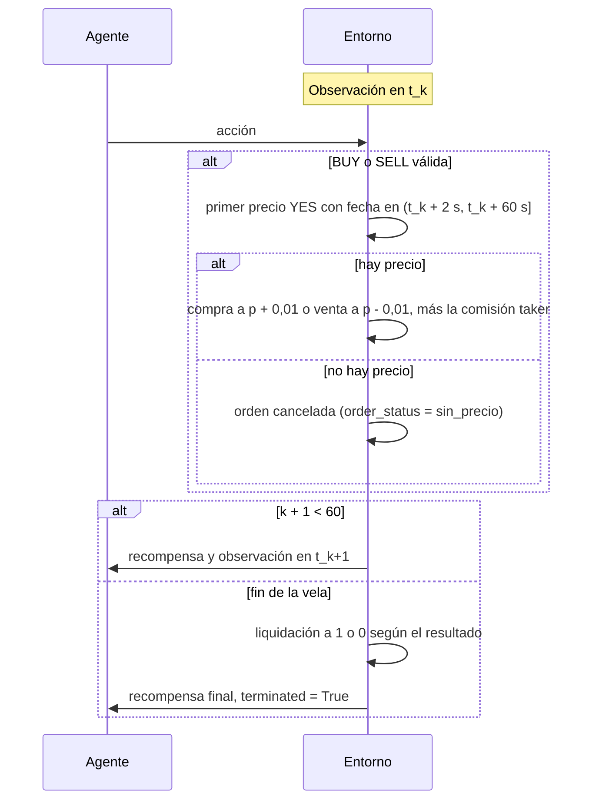

# MDP del entorno

Documentación oficial de la API que implementa el entorno: [Gymnasium](https://gymnasium.farama.org/api/env/).

Especificación del proceso de decisión de Markov de `PolymarketEnv` (ENV-01). No agrega decisiones
nuevas: reúne en un solo lugar las que ya se tomaron, con su origen, para que R4 entrene y R5 evalúe
contra la misma definición. El código está en `src/polym4v/env/` y la config en `configs/env.yaml`.

## 1. Resumen

| Elemento | Definición | Origen |
| --- | --- | --- |
| Episodio | Un mercado horario: la vela `[w0, w1)` | ADR-008 |
| Instantes de decisión | `t_k = w0 + 60·k`, con `k = 0..59` | S2 |
| Estado observado | 13 features de mercado y 3 del agente, todo con datos de `ts_available <= t_k` | S1, S3 (ADR-016) |
| Acciones | `WAIT`, `BUY_YES`, `BUY_NO` y `SELL` | ADR-005 |
| Transición | La orden se ejecuta al primer precio en `(t + 2 s, t + 60 s]`, con medio spread y comisión | S4 (ADR-017), S5 |
| Recompensa | Cambio del valor de la cartera sobre el saldo inicial, con la posición valorada a liquidación | S9 (ADR-016), ENV-05 |
| Fin | En `w1` la posición se liquida a 1 o 0, sin comisión | S10 (ADR-017) |
| Descuento | `γ` cercano a 1 | S9 |

## 2. Estado

La observación es un vector de 16 valores (sección 4.1 de
[08_datos_y_entrada_modelo.md](../08_datos_y_entrada_modelo.md)):

- **Mercado (13):** `p_yes`, `dp_1`, `dp_5`, `p_stale`, `x`, `r_1`, `r_5`, `sigma`, `tau`, `z`,
  `p_fair`, `edge` y `edge_tp`, de la fila `k` de `steps.parquet`. Las que no tienen escala acotada
  llevan el z-score ajustado con train.
- **Agente (3):** `pos_side` (1 YES, -1 NO, 0 sin posición), `entry_price` y `upnl`, el PnL no
  realizado sobre el monto apostado.

El estado no es completamente markoviano: el precio llega con atraso y el agente no ve el libro de
órdenes. `p_stale` y los cambios recientes (`dp_1`, `dp_5`, `r_1`, `r_5`) resumen la historia
relevante.

## 3. Acciones

`Discrete(4)`. Cada compra usa `stake_fraction × initial_cash`: 20 USDC con los valores de la config
(S4b). Hay una sola posición a la vez.

| Acción | Válida si | Si no es válida |
| --- | --- | --- |
| `WAIT` | Siempre | — |
| `BUY_YES`, `BUY_NO` | No hay posición, `k` no está en los últimos 2 minutos y alcanza el saldo | Se ejecuta `WAIT`, con `λ_invalid = 0` (S6) |
| `SELL` | Hay posición, hasta el último paso | Se ejecuta `WAIT` (S6) |

`action_masks()` devuelve las acciones válidas del paso, para MaskablePPO (P2) y para el backtest.

## 4. Transición

- El precio del lado NO es `1 - p_yes` (ADR-003).
- La ejecución termina antes del instante de decisión siguiente, así que la observación de `t_k+1`
  ya incluye ese precio y nunca uno posterior (ENV-10).
- El mercado de cada `reset` se elige al azar del split con el generador del entorno; el backtest
  pasa `options={"market_id": ...}` para recorrer cada mercado una vez y en orden.

## 5. Recompensa

`V_t = cash_t + valor de liquidación de la posición en t` (S9): lo que se recibiría al vender ya,
`p - half_spread`, menos la comisión de venta. En `w1` la posición vale 1 o 0 por acción.

- **`pnl`:** `r_t = (V_t+1 - V_t) / V_0`. La suma del episodio es `(V_final - V_0) / V_0`, así que
  los costos cuentan una sola vez (test de ENV-05).
- **`pnl_risk`:** `pnl` menos `λ_dd` por el aumento del drawdown dentro del episodio.
- **`terminal`:** cero en cada paso y `(V_final - V_0) / V_0` al final.
- **`λ_invalid`:** se resta en las acciones inválidas; vale 0 (S6).

Al comprar, `V` cae lo que costaría salir, y la recompensa del paso es negativa aunque la compra sea
buena. Para que el agente juzgue la compra por su resultado, `γ` tiene que quedar cerca de 1 (S9):
con `γ = 0,99`, un resultado 60 pasos después pesa 0,55.

## 6. Fin del episodio

- 60 pasos por episodio: `terminated = True` al llegar a `w1`. No hay `truncated`.
- No se abren posiciones en los últimos 2 minutos (`k ≥ 58`). `SELL` sigue permitido hasta el final;
  si no se ejecuta, la posición queda hasta la liquidación (S10).
- La liquidación paga 1 por acción del lado ganador, sin comisión.

## 7. Cómo se verifica

| Propiedad | Test |
| --- | --- |
| Cumple la API de Gymnasium | `check_env` (ENV-04), en `tests/test_env.py` |
| La suma de recompensas `pnl` es el PnL final sobre `V_0` | `tests/test_env.py` (ENV-05) |
| En el mercado nulo ninguna política gana de forma significativa | `tests/test_no_leak.py` (ENV-10) |
| El mismo test detecta un retraso real de 2 minutos | `tests/test_no_leak.py`, control positivo |
| Alterar datos posteriores a `t` no cambia las observaciones hasta `t` | `tests/test_no_leak.py` (ENV-10) |
| Ninguna orden se ejecuta después de la decisión siguiente | `tests/test_no_leak.py` |
