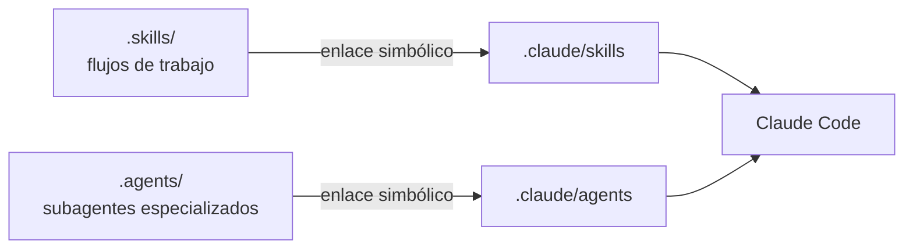

# Uso de IA en el proyecto

Documentación oficial: [Claude Code, subagentes](https://docs.anthropic.com/en/docs/claude-code/sub-agents) y
[Claude Code, skills](https://docs.anthropic.com/en/docs/claude-code/skills).

El proyecto usa asistentes de IA, pero cada uso tiene que poder explicarse: **con qué herramienta,
para qué tarea, por qué esa y quién verifica el resultado**. Este documento es ese registro.

## 1. Reglas

- La IA propone y una persona decide. Toda decisión queda en un ADR o en
  [decisiones_previas_al_diseno.md](decisiones_previas_al_diseno.md) con su responsable humano.
- Ningún número entra al informe sin un script o test que lo reproduzca. La IA no es fuente de
  datos ni de resultados.
- Las referencias que sugiera la IA se verifican abriendo la fuente original.
- El código generado con IA pasa por los mismos tests y revisión del dueño del módulo que el
  escrito a mano.
- En el informe se declara qué partes se hicieron con ayuda de IA y cómo se verificaron.

## 2. Dónde vive cada cosa

- `.skills/` y `.agents/` son la fuente versionada. `.claude/skills` y `.claude/agents` son enlaces
  simbólicos para que Claude Code los cargue. El resto de `.claude/` (la configuración personal)
  no se versiona.
- Si al clonar los enlaces no funcionan (por ejemplo en Windows sin soporte de symlinks), se
  recrean desde la raíz del repo con `ln -sfn ../.skills .claude/skills` y
  `ln -sfn ../.agents .claude/agents`.

## 3. Subagentes (`.agents/`)

Son copias **sin modificar** de agentes existentes. No se escriben agentes ni skills propios.

- Los de análisis vienen de [agency-agents](https://github.com/msitarzewski/agency-agents)
  (licencia MIT, commit `b37b5bb`).
- Los de diseño vienen del catálogo que ya usa el equipo en otros proyectos (la misma fuente; tres
  tienen diferencias menores con la versión actual del repo).
- Están en inglés y no traen contexto de PolyRL: al invocarlos hay que darles el contexto (qué
  archivo, qué decisión, qué ADR).

### 3.1 Análisis, datos y evaluación

| Agente | Para qué en PolyRL | Por qué este | Rol |
| --- | --- | --- | --- |
| `academic-statistician` | Protocolo de evaluación (EVA-01), IC 95 %, potencia, comparaciones múltiples | Exige tamaño de efecto con intervalo y análisis fijado de antemano (decisión D4) | R5, R1 |
| `specialized-model-qa` | Auditar fuga de información, separación temporal, calibración y reproducibilidad | Ya apareció un artefacto temporal que regalaba ganancias (D6) | R1, R3 |
| `engineering-data-engineer` | Revisar el ETL: crudo inmutable, idempotencia, esquemas, validaciones | Base del pipeline. Ignorar lo de Spark, nube y Kafka: el dataset es chico | R2 |
| `specialized-master-plan-architect` | Criticar un plan antes de implementarlo: modos de falla y supuestos | Obliga a escribir riesgos y validación por paso | R1 |
| `research-synthesist` | Marco teórico y trabajo relacionado del informe (DOC-02) | Califica fuentes y separa lo establecido de lo disputado | R4, R5 |
| `project-management-meeting-notes-specialist` | Minutas con decisiones, tareas y preguntas abiertas | Deja trazables las decisiones del equipo | R1 |

### 3.2 Diseño: demo, reporte final y artefactos

| Agente | Para qué en PolyRL |
| --- | --- |
| `design-ux-architect` | Estructura de la información de la demo o de una página de resultados |
| `design-ui-designer` | Sistema visual (tipografía, color, componentes) del reporte o artefacto final |
| `design-ui-finish-gate-reviewer` | Revisión final de la interfaz antes de entregarla |
| `design-ux-researcher` | Validar que la demo se entiende: qué ve primero quien la usa |
| `design-persona-walkthrough` | Recorrer la demo desde el punto de vista de un evaluador (el profesor) |
| `design-visual-storyteller` | Narrativa de la presentación final: problema, enfoque, resultados |
| `design-inclusive-visuals-specialist` | Accesibilidad y representación en imágenes generadas |
| `design-image-prompt-engineer` | Prompts para imágenes generadas, si se usan en la presentación |
| `design-brand-guardian` | Identidad visual coherente entre demo, reporte y diapositivas |
| `design-whimsy-injector` | Detalles de personalidad en la demo; usar con moderación en un trabajo académico |

**Cuidado con estos agentes:**

- Los de diseño están pensados para sitios web con CSS propio. Streamlit se configura en
  `.streamlit/config.toml`, así que se aprovechan sus criterios, no su código.
- `design-visual-storyteller` viene del marketing: tiende a "vender" resultados. En el informe los
  resultados se reportan tal como salen, incluidos los negativos.
- Ninguno declara `tools`, así que reciben todas las herramientas de la sesión. Se usan para
  revisar y proponer; los cambios los aplica la persona responsable.

**Evaluados y descartados de agency-agents:** `testing-reality-checker` (para sitios web, y obliga
a ejecutar un script que no existe en el repo), `engineering-ai-engineer` (MLOps de producción, sin
RL) y `project-manager-senior` (atado a Laravel; `docs/04_tareas.md` ya cumple esa función). El
catálogo no tiene un agente de RL: para eso están los apuntes del curso y la documentación de
stable-baselines3 y d3rlpy.

## 4. Documentación actualizada (Context7)

El código se escribe contra la documentación vigente de cada librería, no contra lo que el
asistente recuerde. Para eso el proyecto configura Context7 como servidor MCP en `.mcp.json`.

- Cada integrante ejecuta `make keys-init`, que crea `keys/context7.key` vacío, y pega su clave
  en una sola línea. Todo `keys/` está ignorado por git, salvo `.gitkeep`.
- El servidor lee la clave de ese archivo y la pasa como variable de entorno.
- Ejemplo de uso: con Context7 se confirmó que `from __future__ import annotations` está
  deprecado desde Python 3.14 y se quitó del código, y que la API nueva de historial de Polymarket
  solo guarda 1 minuto durante 7 días (decisión S8).

## 5. Skills (`.skills/`)

| Skill | Para qué | Cuándo usarla |
| --- | --- | --- |
| `test-driven-development` | Escribir el test antes del código | Cada tarea con criterio de aceptación verificable |
| `systematic-debugging` | Encontrar la causa raíz antes de corregir | Un test falla o un resultado no cuadra |
| `code-reviewer` | Revisión de cambios con foco en errores | Antes de subir un cambio a un módulo ajeno |
| `planning-with-files` | Planes persistentes en archivos | Tareas largas de varias sesiones |
| `security-compliance` | Revisar secretos y controles | Al tocar `.env` o credenciales de Polymarket |
| `entregable-pdf` | Generar los entregables con el formato acordado | Cada entrega al profesor |

## 6. Cómo pedirle algo a un agente

Nombrarlo en la petición, por ejemplo: "usa el agente `specialized-model-qa` para revisar
`src/polym4v/data/transform.py`". El agente devuelve un informe; la persona responsable decide qué
se aplica y lo deja registrado.
