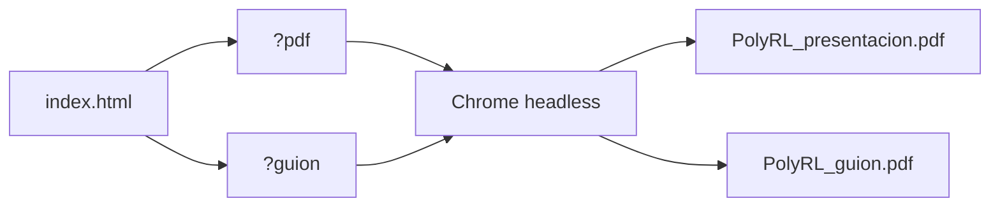

# DESIGN — Presentación final de PolyRL

Sistema de diseño de las slides de la entrega final: **un solo `index.html` autocontenido** que se
presenta en el navegador y se convierte a PDF para subirlo a Canvas. La misma identidad visual se
aplica a la demo de Streamlit, para que la web y la presentación se lean como un solo producto.

Documentación del proyecto: [README](../../../README.md) · Requisitos de la entrega:
[docs/10_entrega_final.md](../../../docs/10_entrega_final.md) · Contenido:
[informe final](../informe/Informe_final.md).

## 1. Resumen de la decisión

| Decisión | Valor |
| :--- | :--- |
| Marca | **PolyRL** |
| Idea visual | Un campo de probabilidad que se ordena: del ruido de precios a una decisión |
| Lienzo | 1600 $\times$ 900 px (16:9), escalado a la ventana |
| Tipografía | Space Grotesk (títulos), Inter (texto), JetBrains Mono (datos) |
| Paleta | Tinta `#0B1220`, papel `#F7F8FA`, azul `#1D4ED8`, verde `#0E7C66`, rojo `#B42318` |
| Slides | 10, alineadas a las secciones del informe |
| Interacción | Flechas, `p` pantalla completa, `o` vista general, `n` notas, `r` repetir |
| PDF | `?pdf` y `?guion` + Chrome sin interfaz, una slide por página |
| Archivo | `index.html` autocontenido: CSS, JS, fuentes e imágenes embebidas |
| Web | La demo ya aplica esta identidad (PR #40 y #41); la sección 9 describe cómo quedó |
| Regla dura | Sin PowerPoint, Canva, plantillas ni imágenes de stock |

## 2. Método: qué aportó cada agente

El diseño se construyó con los agentes de `.agents/`. Cada uno dejó una parte verificable de este
documento.

| Agente | Aporte en este `DESIGN.md` |
| :--- | :--- |
| Brand Guardian | Propósito, promesa, personalidad, voz y sistema de identidad (secciones 3 y 4) |
| UI Designer | Tokens, escala tipográfica, componentes y estados (secciones 4 y 5) |
| UX Architect | Lienzo, retícula, plantillas, navegación y accesibilidad (secciones 5, 7 y 10) |
| Visual Storyteller | Arco narrativo, jerarquía de mensajes y plan de las 10 slides (sección 6) |
| UI Finish-Gate Reviewer | Contrato de diseño y compuerta de salida antes de exportar (sección 11) |
| Whimsy Injector | Un solo gesto de deleite: el campo de probabilidad de la portada (sección 7.4) |

## 3. Marca

### 3.1 Fundamento

| Elemento | Definición |
| :--- | :--- |
| Propósito | Mostrar con evidencia si el aprendizaje por refuerzo puede decidir mejor que reglas simples en mercados de predicción |
| Visión | Que cualquier persona pueda reproducir el experimento completo desde el repositorio |
| Promesa | Cada número de la presentación se puede rastrear a un archivo del repositorio (`reports/`, `data/`, `configs/` o `docs/`) |
| Personalidad | Analítica, sobria, honesta, precisa. Nunca promete ganar dinero |
| Voz | Directa y en primera persona del plural; dice "no concluyente" cuando lo es |
| Lema | **Del dato histórico a la decisión** |
| Aviso permanente | Polymarket solo se usa como fuente de datos. El agente nunca opera en vivo ni con dinero real |

### 3.2 Reglas de voz

- Sí: "PPO queda equivalente a `no_trade` en test: su diferencia cabe en ±1 % del monto".
- No: "PPO le gana a `no_trade` en test" (la media de D es −0,0005, IC 98,75 % de −0,0029 a
  +0,0018, clasificación "equivalente").
- No: "el agente aprende a ganar en Polymarket".
- Sí: "12 294 mercados, 70/15/15 cronológico".
- No: "miles de mercados" cuando el número exacto está disponible.
- Cada slide tiene **una sola idea** en el título; la evidencia va en el cuerpo.
- Prohibido el lenguaje financiero especulativo: "rentable", "ganancia segura", "alpha".

### 3.3 Nombre y monograma

- Nombre visible: **PolyRL**. Siempre con esa capitalización.
- Monograma: dos triángulos opuestos que forman una `P` implícita, uno apuntando arriba (YES) y
  otro abajo (NO), separados por una línea de precio. Se dibuja en SVG inline, sin archivo externo.
- Uso mínimo: 40 px de alto en la esquina inferior derecha de cada slide.
- No se usa el logo de Polymarket ni se insinúa afiliación.

## 4. Identidad visual

### 4.1 Paleta

```css
:root {
  /* Base */
  --tinta: #0B1220;          /* fondo oscuro y texto principal */
  --papel: #F7F8FA;          /* fondo claro */
  --papel-2: #EDF1F7;        /* superficie secundaria */
  --superficie: #FFFFFF;     /* tarjetas y paneles sobre papel */
  --linea: #D7DEE8;          /* bordes y retícula */

  /* Texto */
  --texto: #0B1220;
  --texto-2: #5A6472;        /* secundario, contraste 5.6:1 sobre papel */
  --texto-inv: #F7F8FA;
  --texto-inv-2: #A7B0BD;    /* secundario sobre tinta */

  /* Acento y semántica */
  --azul: #1D4ED8;           /* acento principal, foco y PPO */
  --azul-claro: #93B4FF;     /* acento sobre fondo oscuro */
  --verde: #0E7C66;          /* YES, ganancia */
  --rojo: #B42318;           /* NO, pérdida */
  --ambar: #E8A317;          /* paso actual y marcas de gráfico */
  --ambar-texto: #8A5A00;    /* ámbar legible como texto */

  /* Series de agentes (nunca reutilizar verde/rojo aquí) */
  --serie-ppo: #1D4ED8;
  --serie-dqn: #7C3AED;
  --serie-cql: #0891B2;
  --serie-bc: #C2410C;
  --serie-base: #64748B;     /* baselines, siempre con trazo discontinuo */
}
```

Reglas de color:

- El verde y el rojo están **reservados** para YES/NO y ganancia/pérdida. No se usan como color de
  serie de un agente.
- Ningún dato se distingue **solo** por color: siempre hay etiqueta, forma o patrón de trazo.
- Sobre tinta, el azul de texto cambia a `--azul-claro`; el ámbar solo se usa como relleno.
- Contraste mínimo: 4.5:1 en texto normal y 3:1 en texto grande y trazos de gráfico.

### 4.2 Tipografía

| Rol | Fuente | Pesos | Uso |
| :--- | :--- | :--- | :--- |
| Display | Space Grotesk | 500, 700 | Títulos, cifras grandes, portada |
| Texto | Inter | 400, 600 | Párrafos, tablas, notas |
| Dato | JetBrains Mono | 400, 600 | Etiquetas, ejes, código, cifras exactas |

- Se embeben subconjuntos WOFF2 en base64 (`latin` + signos de puntuación). Sin red al abrir.
- Origen de los WOFF2: Google Fonts sirve los subconjuntos en
  `https://fonts.googleapis.com/css2?family=...&display=swap`; los originales se descargan del
  repositorio público de Google Fonts (`ofl/spacegrotesk`, `ofl/inter` y `ofl/jetbrainsmono`) con
  licencia SIL Open Font License 1.1.
- Los archivos `.woff2` originales quedan en `entregas/final/presentacion/fonts/`, junto a un
  `LICENSE` por familia. El `index.html` lleva su copia en base64; `fonts/` no se publica.
- Reserva: `system-ui, -apple-system, "Segoe UI", Arial, sans-serif` y
  `ui-monospace, "SFMono-Regular", Consolas, monospace`.
- Todas las cifras usan `font-variant-numeric: tabular-nums`.
- Máximo tres familias en todo el deck. No se agregan fuentes decorativas.

Escala sobre el lienzo de 1600 $\times$ 900:

| Token | Tamaño / interlínea | Uso |
| :--- | :--- | :--- |
| `--t-display` | 104 / 0.95, tracking -0.03em | Portada y cierre |
| `--t-h1` | 64 / 1.05, tracking -0.02em | Título de slide |
| `--t-h2` | 40 / 1.15 | Subtítulo y bloques |
| `--t-h3` | 28 / 1.25 | Encabezado de tarjeta |
| `--t-body` | 24 / 1.45 | Texto corrido |
| `--t-small` | 18 / 1.4 | Pie, fuentes, notas |
| `--t-label` | 14 / 1.2, mono, mayúsculas, tracking 0.14em | Kicker y etiquetas |
| `--t-metric-xl` | 160 / 0.9 | Cifra protagonista |
| `--t-metric-l` | 96 / 1 | Cifra secundaria |

### 4.3 Retícula y espaciado

- Lienzo 1600 $\times$ 900. Márgenes: 96 px laterales, 72 px arriba y abajo.
- 12 columnas, gutter 24 px, ancho de columna 95.33 px.
- Base de 8 px para todo el espaciado.
- Zona segura de título: `x=96..1504`, `y=72..250`.
- Zona de contenido: `y=280..780`.
- Pie: `y=812..860` con fuente, número de slide y monograma.

### 4.4 Iconografía e imágenes

- Iconos de trazo de 1.5 px, 24 px de caja, dibujados en SVG inline. Sin emojis.
- Prohibido: imágenes de stock, capturas genéricas, ilustraciones 3D, degradados morado-azul.
- Las únicas imágenes permitidas son **evidencia del proyecto**: captura real de la demo, gráficos
  de `reports/`, diagramas propios y la foto del equipo si el curso la pide.
- Cada imagen lleva pie con archivo de origen o comando que la genera.

### 4.5 Estilo de datos

- Gráficos con fondo transparente sobre el color de la slide, sin marcos ni sombras.
- Ejes en `--texto-2`, retícula al 8 % de tinta, sin borde superior ni derecho.
- Línea de referencia en 0 siempre visible en PnL.
- Series de agentes con la paleta categórica de 4.1; baselines en gris discontinuo.
- Anotaciones directas sobre la línea, no leyendas lejanas cuando hay 4 series o menos.
- Títulos de gráfico en `--t-h3`; ejes y ticks en `--t-label` mono.

## 5. Sistema de slides

### 5.1 Anatomía

Toda slide comparte cinco zonas:

1. **Kicker**: etiqueta mono en mayúsculas que ubica la sección del informe.
2. **Título**: una sola idea, máximo 2 líneas.
3. **Cuerpo**: evidencia (gráfico, tabla, diagrama o tres cifras).
4. **Pie**: fuente del dato, número de slide y monograma.
5. **Nota del orador**: texto oculto en pantalla, visible en `?guion`.

### 5.2 Plantillas

| Plantilla | Cuándo | Composición |
| :--- | :--- | :--- |
| `portada` | Slide 1 | Fondo tinta, campo de probabilidad, título display, equipo y fecha |
| `declaracion` | Idea única | Fondo papel, título grande a la izquierda, cifra o frase a la derecha |
| `datos` | Evidencia cuantitativa | Gráfico a 8 columnas + 3 métricas a 4 columnas |
| `diagrama` | Pipeline o MDP | Diagrama a 12 columnas, máximo 9 nodos |
| `comparacion` | YES/NO, antes/después | Dos mitades separadas por una línea de 1 px, nunca dos tarjetas iguales |
| `tabla` | Resultados | Tabla de 4 a 6 filas, fila destacada con fondo `--papel-2` |
| `demo-cierre` | Slide 10 | Captura a 9 columnas, repo, `make demo` y una frase de cierre |

Reglas de composición:

- Máximo **seis elementos** visuales por slide (sin contar pie ni numeración).
- Máximo **dos niveles** de lectura: título y cuerpo. Si hace falta un tercero, sobra contenido.
- Nada de tarjetas con sombra, bordes redondeados grandes ni glassmorphism.
- Alineación a la izquierda por defecto. Centrar solo portada y cierre.
- Una slide no se llena: el espacio vacío es parte de la jerarquía.

### 5.3 Componentes y estados

| Componente | Especificación |
| :--- | :--- |
| Botón de control | 40 $\times$ 40 px, borde `--linea`, foco visible de 2 px `--azul` |
| Métrica | Cifra en display, etiqueta mono arriba, unidad en texto pequeño |
| Chip de clasificación | Cinco sellos con el color de `CLASS_COLOR`: `mejor` verde, `equivalente` azul, `peor, pero no relevante` naranja, `inconcluso` gris e `inferior` rojo |
| Tabla | Encabezado mono 14 px, filas de 56 px, cifras tabulares a la derecha |
| Nota al pie | 18 px, `--texto-2`, máximo dos líneas |
| Barra de progreso | 2 px en `--linea`, avance en `--azul`, ancho completo al pie |

## 6. Narrativa y plan de las 10 slides

Arco: **problema real $\to$ datos $\to$ propuesta $\to$ sistema $\to$ herramientas $\to$
resultados $\to$ honestidad $\to$ demo $\to$ cierre**. Duración objetivo: 10 a 12 minutos.

### 6.1 Plan de las 10 slides

| # | Título | Sección del informe | Mensaje único | Evidencia visual | Fuente |
| :--- | :--- | :--- | :--- | :--- | :--- |
| 1 | PolyRL | Portada | Del dato histórico a la decisión | Campo de probabilidad animado | Marca |
| 2 | Una pregunta binaria cada hora | Descripción del problema | Decidir cuándo comprar YES, comprar NO, vender o esperar | Diagrama de un mercado con precio y resolución | `docs/01_idea_general.md` |
| 3 | 12 294 mercados, tres cortes | Análisis | Los datos alcanzan y el corte es cronológico | Tabla de los tres cortes: 8 682 / 1 861 / 1 751 | `data/processed/btc_updown_1h_v1/manifest.json` |
| 4 | Por qué RL y no una regla | Propuesta de solución | El MDP captura costo, riesgo y momento | Diagrama $S \to A \to R$ y recompensa en 5 componentes | `configs/env.yaml`, `docs/02_arquitectura.md` |
| 5 | El sistema completo | Descripción de la solución | De la captura a la demo, todo reproducible | Pipeline: captura $\to$ dataset $\to$ train $\to$ evaluate $\to$ report $\to$ demo | `src/`, `Makefile` |
| 6 | Cuatro agentes, tres familias | Descripción de la solución | PPO, DQN, CQL y BC comparten el mismo entorno | Tabla comparativa de algoritmos | `configs/*.yaml`, `reports/test/comparison.csv` |
| 7 | Herramientas aplicadas en detalle | Herramientas aplicadas | uv, pandera, Gymnasium, SB3, d3rlpy, Actions y Streamlit | Mapa de herramientas por capa | `entregas/final/informe/Informe_final.md` (sección 5.1) |
| 8 | ¿Le ganó a no operar? | Resultados | En val PPO queda mejor, pero no relevante; en test queda equivalente | Tabla de D con IC + curva de capital | `reports/val/comparison.csv`, `reports/test/comparison.csv` |
| 9 | Lo que funcionó y lo que no | Conclusión | El pipeline y la evaluación son sólidos; la ventaja económica no se demuestra | Tres hallazgos con su límite | `reports/test/inspection.md` |
| 10 | Cualquiera puede reproducirlo | Cierre | La demo, el repo y `make demo` cierran el arco | Captura real + repo y `make demo` | `app/demo.py` |

### 6.2 Fuentes de cada slide

Toda cifra que aparece en una slide sale de uno de estos archivos. La columna "cifra exacta" es la
que se escribe en el cuerpo o en el pie; se usa la precisión del reporte (4 decimales para D, 2 para
USDC) y no se inventa ningún valor.

| Slide | Archivo | Cifra exacta o dato que se toma |
| :--- | :--- | :--- |
| 1 | `entregas/final/presentacion/DESIGN.md` | Nombre PolyRL, lema y monograma; sin cifras |
| 2 | `docs/01_idea_general.md` | Precio entre `0` y `1`; el token ganador paga `1`; acciones `WAIT`, `BUY_YES`, `BUY_NO`, `SELL` |
| 3 | `data/processed/btc_updown_1h_v1/manifest.json` | 12 294 mercados; train 8 682, val 1 861, test 1 751; split `0.7` / `0.15` / `0.15`; `date_from` 2025-05-28 y `date_to` 2026-10-30 |
| 4 | `configs/env.yaml` | `initial_cash` 1000.0; `stake_fraction` 0.02 (20 USDC); `no_open_last_minutes` 2; `lambda_dd` 1.0; recompensa `pnl_risk` |
| 4 | `docs/02_arquitectura.md` (sección 2.4) | Componentes `pnl`, `drawdown`, `hold`, `invalid`, `terminal`; la suma es la recompensa del paso |
| 5 | `src/` y `Makefile` | Nombres de los comandos (`make dataset`, `make train`, `make report`, `make demo`); sin cifras |
| 6 | `configs/*.yaml` y `reports/test/comparison.csv` | Agentes PPO, DQN, CQL y BC; 5 semillas por agente (columna `seeds`) |
| 7 | `entregas/final/informe/Informe_final.md` (sección 5.1) | Herramientas y su función; sin cifras |
| 8 | `reports/val/comparison.csv` | PPO +0,0012 "mejor, pero no relevante"; CQL +0,0109 "inconcluso"; BC +0,0029 "inconcluso"; DQN −0,0015 "equivalente" |
| 8 | `reports/test/comparison.csv` | PPO −0,0005 "equivalente"; DQN −0,0018 "equivalente"; BC −0,0014 "peor, pero no relevante"; CQL −0,0126 "inferior" |
| 8 | `reports/val/comparison.csv` y `reports/test/comparison.csv` | MDE: PPO 0,0021; DQN 0,0061; BC 0,0129; CQL 0,0737 (misma en val y test) |
| 9 | `reports/test/inspection_payoff.csv` | PPO, tramo 0,98-1 (`price` 0.98-1): 838 compras, 99,76 % de aciertos (`side_won` 0.9976), 99,88 % necesario (`cost` 0.9988), neto −27,23 USDC |
| 9 | `reports/test/summary.csv` | Mejor heurística en test, modo normal: `fair_value`, retorno medio −0,0214 (fila `fair_value,False`) |
| 9 | `reports/test/inspection.md` | PnL total de PPO en test: −83,81 USDC en 1 006 operaciones |
| 10 | `app/demo.py` | Título `PolyRL [DEMO]`; cuatro páginas; comando `make demo` |
| 10 | `entregas/final/presentacion/img/` | Captura de la página Simulación, PPO semilla 0 en test, mercado del 13/08/2026 12:00 UTC |

Figuras disponibles para las slides:

- `reports/val/`: `ablation.png`, `behavior_importance.png`, `behavior_map.png`, `capital.png`,
  `learning.png`, `returns.png`.
- `reports/test/`: `capital.png`, `returns.png`.
- `docs/images/eda/`: `01_calidad.png`, `02_brier_por_minuto.png`, `03_confiabilidad.png`,
  `04_desfase_precio_spot.png`, `05_ventaja_aparente.png`, `06_regimen_comisiones.png`,
  `07_costo_de_operar.png`, `08_sesgos_hora_dia.png`.

### 6.3 Notas de contenido

- La slide 8 es la más importante: debe mostrar la clasificación honesta
  ("mejor, pero no relevante" para PPO en val; "equivalente" en test) y la MDE.
- La slide 9 no es un resumen: es una rendición de cuentas. Cada hallazgo lleva su límite.
- La slide 10 incluye el comando `make demo` y la URL del repositorio.
- Las slides 3, 8 y 10 usan cifras reales; se prohíben números redondeados o inventados.
- Los artefactos de la entrega (reportes, modelos y trayectorias) están en el Release v1.0 del
  repositorio, no en el HTML.

## 7. Interacción y movimiento

### 7.1 Controles

| Tecla | Acción |
| :--- | :--- |
| `→`, espacio, `PageDown`, `Enter` | Avanzar |
| `←`, `PageUp`, `Backspace` | Retroceder |
| `p` | Pantalla completa |
| `o` | Vista general de las 10 slides |
| `n` | Mostrar u ocultar notas del orador |
| `r` | Repetir la animación de la slide |
| `Home` / `End` | Primera / última |
| `Esc` | Salir de vista general o pantalla completa |

- Clic en el 25 % izquierdo retrocede; en el resto avanza.
- Deslizamiento horizontal en pantallas táctiles.
- Enlaces profundos: `#5` abre la slide 5; `#5-2` abre su segundo paso.
- La vista general muestra miniaturas 16:9 con título y slide actual marcada.

### 7.2 Transiciones

- Cambio de slide: desplazamiento de 24 px + opacidad, 420 ms,
  `cubic-bezier(.2,.7,.2,1)`.
- Entrada de elementos: escalonado de 60 ms, máximo seis elementos, 320 ms cada uno.
- Salida: solo opacidad, 180 ms. Nunca se anima el texto letra por letra.
- Sin rebotes, sin rotaciones, sin animaciones que duren más de 600 ms.

### 7.3 Accesibilidad del movimiento

- `prefers-reduced-motion: reduce` desactiva transiciones y deja todo en su estado final.
- `?estatico` fuerza el modo sin animación para capturas y pruebas.
- `?pdf` desactiva animación y renderiza cada slide en su estado final.

### 7.4 El único gesto de deleite

En la portada, 240 puntos que representan precios se ordenan en una curva de probabilidad al cargar
(1.2 s, una sola vez). Es decorativo, se puede saltar con clic o tecla, y no se repite en ninguna
otra slide. Todo lo demás es sobrio.

## 8. Versión PDF

### 8.1 Modos del mismo archivo

| URL | Resultado |
| :--- | :--- |
| `index.html` | Presentación interactiva |
| `index.html?pdf` | Las 10 slides en estado final, una por página |
| `index.html?guion` | Slide + notas del orador, para ensayar y para el guion impreso |

`?guion` añade la clase `guion` al `<body>`; `?pdf` no la añade. Esa clase es la que activa las
notas en el CSS de impresión.

Flujo de exportación: el mismo archivo sirve para presentar y para generar los dos PDF.



### 8.2 CSS de impresión

```css
@page { size: 1600px 900px; margin: 0; }

@media print {
  html, body { height: auto; overflow: visible; background: #fff; }
  #stage { position: static; overflow: visible; }
  #deck { position: static; transform: none !important; width: auto; height: auto; }
  .slide {
    position: relative;
    visibility: visible;
    width: 1600px;
    height: 900px;
    break-after: page;
    page-break-after: always;
  }
  .slide:last-child { break-after: auto; }
  .ui, .ayuda, .notas { display: none !important; }
  .slide { display: block !important; }
  body.guion .notas { display: block !important; }
  * { animation: none !important; transition: none !important; }
}
```

### 8.3 Script de exportación

`generar_pdf.sh` genera los dos PDF con Chrome o Chromium sin interfaz:

```bash
google-chrome --headless=new --disable-gpu --no-sandbox \
  --no-pdf-header-footer --run-all-compositor-stages-before-draw \
  --virtual-time-budget=10000 \
  --print-to-pdf="PolyRL_presentacion.pdf" \
  "file://$PWD/index.html?pdf"
```

- Repetir con `?guion` para `PolyRL_guion.pdf`.
- El script busca `google-chrome`, `google-chrome-stable`, `chromium` o `chromium-browser` y falla
  con un mensaje claro si no encuentra ninguno.
- No requiere red: fuentes e imágenes están embebidas.

### 8.4 Criterios de aceptación del PDF

| Criterio | Umbral |
| :--- | :--- |
| Páginas | Exactamente 10 |
| Tamaño de página | 1600 $\times$ 900 px, sin márgenes del navegador |
| Texto | Seleccionable y buscable, sin recortes ni desbordes |
| Fuentes | Embebidas; se ve igual en otra máquina |
| Imágenes | Ancho nativo mayor o igual al ancho de display, sin pixelado; las que se amplíen se regeneran a 2$\times$ |
| Enlaces | Repositorio y demo clicables |
| Peso | Menos de 6 MB por PDF |
| Modo guion | Cada página muestra slide y notas completas |

Anchos nativos de las figuras: `learning.png` 937 px, `ablation.png` 959 px, `capital.png` 965 px,
`behavior_importance.png` 2413 px; las EDA 04, 06 y 07 miden 676, 685 y 766 px. Las que no lleguen
al ancho de display se usan a 6 columnas o se regeneran; no se amplían.

## 9. La web (demo de Streamlit): cómo quedó

> **Estado:** implementada. La demo tiene diseño propio desde los PR #40 y #41 (EVA-13): tema,
> cuatro páginas, gráficos Altair y el `DESIGN.md` como fuente de tokens. Lo que sigue describe lo
> que hay en `app/`, no una propuesta. La única pieza pendiente es la captura final para la
> slide 10.

### 9.1 Estado y alcance

La demo reproduce trayectorias ya calculadas: no entrena ni evalúa test. Se abre con `make demo` y,
en Streamlit Community Cloud, usa la muestra de `app/trayectorias/`. El código vive en
`app/demo.py` (entrada), `app/core.py` (datos y tokens), `app/charts.py` (Altair),
`app/selection.py` (política y mercado compartidos) y `app/app_pages/` (las cuatro páginas).

| Archivo | Qué hace |
| :--- | :--- |
| `app/demo.py` | `st.set_page_config`, logo, CSS mínimo y `st.navigation` |
| `app/core.py` | Lee trayectorias, mercados y reportes; define los tokens de color y `card()` |
| `app/charts.py` | Gráficos Altair con el estilo de la sección 4.5 |
| `app/selection.py` | Estado compartido entre Simulación y Comparación |
| `app/app_pages/` | `home.py`, `simulation.py`, `comparison.py`, `guide.py` |

### 9.2 Las cuatro páginas

Se navegan con `st.navigation(..., position="top")`:

| Página | Archivo | Qué muestra |
| :--- | :--- | :--- |
| Inicio | `app/app_pages/home.py` | Lema, cuatro métricas (12 294 mercados, 70/15/15, 4 agentes, 5 semillas), el resultado de test y el enlace a las otras páginas |
| Simulación | `app/app_pages/simulation.py` | Una hora de mercado minuto a minuto: BTC contra su apertura, precio YES con las órdenes, cartera, posición, valor, recompensa y el detalle del paso |
| Comparación | `app/app_pages/comparison.py` | Varias políticas en el mismo mercado y en el PnL acumulado, más el bosque de D con su IC y la clasificación |
| Cómo funciona | `app/app_pages/guide.py` | Cinco pestañas: el mercado, el entorno y los costos, las acciones, las políticas y los datos |

- La barra lateral existe en las cuatro páginas: `folder_input()` se dibuja en `demo.py` antes de
  `pages.run()`.
- La reproducción usa `st.fragment(run_every=...)` y `st.session_state`; no vuelve a correr la
  política.
- El título de la pestaña es `PolyRL [DEMO]` y el logo sale de `app/static/polyrl_marca.svg`.

### 9.3 El tema

El tema está en `.streamlit/config.toml` de la **raíz** del repositorio, no en `app/.streamlit/`:
Streamlit Community Cloud solo lee la configuración desde la raíz del proyecto. Extracto de los
valores que definen la identidad:

```toml
[theme]
base = "light"
primaryColor = "#1D4ED8"
backgroundColor = "#F7F8FA"
secondaryBackgroundColor = "#EDF1F7"
textColor = "#0B1220"
linkColor = "#1D4ED8"
borderColor = "#D7DEE8"
baseRadius = "8px"
buttonRadius = "6px"
greenColor = "#0E7C66"
redColor = "#B42318"
orangeColor = "#E8A317"
violetColor = "#7C3AED"
grayColor = "#64748B"
chartCategoricalColors = ["#1D4ED8", "#7C3AED", "#0891B2", "#C2410C", "#64748B"]
```

- Las tres familias se declaran con `font`, `headingFont` y `codeFont`, con su URL de Google Fonts
  y una reserva del sistema. En el deck van embebidas; en la web se cargan por CSS.
- `[client] toolbarMode = "minimal"` y `[browser] gatherUsageStats = false` reducen el cromo.
- La barra lateral es blanca (`[theme.sidebar]`), coherente con la superficie de las tarjetas.

### 9.4 Los gráficos son Altair

Ningún gráfico de la demo se dibuja con matplotlib; Altair es el único motor de gráficos de la
interfaz. `app/charts.py` construye todo con Altair y una función `styled()` que aplica el estilo de
datos del `DESIGN.md`. matplotlib sigue en `app/requirements.txt` porque
`polym4v.evaluation.report` lo usa para los PNG de `reports/`, pero no dibuja nada en la demo.
El estilo aplicado es:

- Fondo transparente y `view.stroke = None`.
- Ejes y leyenda en `JetBrains Mono`, color `#5A6472`, tamaño 11.
- Retícula en `#0B1220` con opacidad 0.08; dominio y ticks en `#D7DEE8`.
- BTC en gris neutro `#3B4558`, línea de 2.5 px.
- Precio YES en tinta `#0B1220`, `step-after`, de 2 px.
- Órdenes: el color dice el lado (YES verde, NO rojo) y la forma, la acción (compra o venta).
- El minuto actual es una regla ámbar `#E8A317` de 2 px.
- Series de agentes con `#1D4ED8`, `#7C3AED`, `#0891B2`, `#C2410C`; baselines en gris y trazo
  discontinuo.

Los gráficos se insertan con `st.altair_chart(..., theme=None, alt="...")` para que Streamlit no
imponga su tema y para que el gráfico tenga texto alternativo.

### 9.5 El CSS mínimo

La demo no reescribe el tema con CSS. Solo agrega un bloque en `app/demo.py` con `st.html`:

```python
st.html(
    "<style>"
    "[class*='st-key-card_'],[data-testid='stMetric']{background:#FFFFFF}"
    "[data-testid='stMetricValue']{font-variant-numeric:tabular-nums}"
    "[data-testid='stMetricLabel'] p{font-family:'JetBrains Mono',monospace;"
    "text-transform:uppercase;letter-spacing:.12em;font-size:11px}"
    "</style>"
)
```

- Las tarjetas se crean con `core.card(name)`, que devuelve
  `st.container(border=True, key=f"card_{name}", height="stretch")`. El CSS pinta su superficie de
  blanco con la clave `st-key-card_*`.
- Las métricas quedan sobre blanco, con la cifra tabular y la etiqueta en mono y mayúsculas.
- El margen superior, los radios y los colores vienen del tema, no de CSS.
- Los chips de clasificación usan `st.badge` y el mapa `CLASS_COLOR`: `mejor` verde,
  `equivalente` azul, `peor, pero no relevante` naranja, `inconcluso` gris e `inferior` rojo.

### 9.6 Lenguaje y formato de cifras

| Concepto | Deck y web | Prohibido |
| :--- | :--- | :--- |
| Política | `ppo_pnl_risk` en mono, "PPO" en prosa | "el modelo bueno" |
| Baseline | `no_trade` en mono, "no operar" en prosa | "la nada" |
| Resultado | `−27,23 USDC`, con signo y dos decimales | "ganó bastante" |
| Diferencia | `D = −0,0005`, IC y MDE | "mejor" sin intervalo |
| Clasificación | `equivalente`, `inferior`, `inconcluso`, `mejor, pero no relevante` | "funciona" o "no funciona" a secas |
| Saldo | "saldo inicial 1 000 USDC" en el texto; en la captura, `1,000 USDC` | "dinero real" o "ganancia" |

Formato decimal:

- Las tablas Markdown del informe y de las slides usan **coma decimal** y espacio fino para miles:
  `−27,23 USDC`, `12 294`, `0,0012`.
- Los CSV de `reports/` usan **punto decimal**, que es el formato de máquina:
  `-0.00047866780160105615`. No se copian literales a una slide: se reformatean a coma y a la
  precisión de la tabla.
- La demo usa **punto decimal y coma de miles** porque formatea con Python: `1,000 USDC`,
  `+0.02 USDC`, `0.9976`. La captura de la slide 10 conserva ese formato: es una imagen literal de
  la demo y no se retoca.
- Precisión: D a 4 decimales, USDC a 2 y porcentajes a 2. Se escribe con la precisión del reporte,
  sin inventar ni redondear de más.
- Para que no se contradigan, ninguna tabla de la slide repite las cifras de la captura. Si una
  cifra de la demo se cita en el texto, se reescribe con coma. El pie de la captura dice "cifras
  como las muestra la demo".

El aviso de saldo ficticio del pie se quitó por decisión de R1 (09/11/2026), porque
sobreexplicaba. La idea sigue en "Cómo funciona", donde se dice que cada hora empieza con 1 000
USDC ficticios. Las slides no repiten el aviso en cada pie: lo dicen una vez, en la slide 2 o en la
slide 10.

Los chips usan el mismo color y el mismo texto de clasificación en el deck y en la web. La anatomía
no es idéntica porque el contexto cambia: en Inicio el sello incluye la política (`PPO: equivalente`)
y en Comparación la política va en la línea y el sello lleva solo `equivalente`. Si un término
cambia en un lugar, cambia en el otro.

### 9.7 Alcance del cambio

La demo cambió solo la capa de presentación; no se reescribió la carga de datos, las métricas ni la
comparación.

| Archivo | Cambio |
| :--- | :--- |
| `.streamlit/config.toml` | Nuevo en la raíz: tema, fuentes y colores de gráfico |
| `app/demo.py` | Entrada, logo, CSS mínimo y `st.navigation` |
| `app/app_pages/` | Cuatro páginas con `st.navigation` |
| `app/core.py`, `app/charts.py`, `app/selection.py` | Tokens, Altair y estado compartido |
| `app/views/` | Eliminado: se reemplazó por `app/app_pages/` |
| `src/polym4v/` y `reports/` | Sin cambios: la demo lee los mismos Parquet |

Fuera de alcance: autenticación, un despliegue nuevo, métricas nuevas y cualquier cambio al
simulador.

### 9.8 Plan de implementación

| Paso | Acción | Estado |
| :--- | :--- | :--- |
| 1 | Aplicar tokens y tema en la raíz | Cumplido: `.streamlit/config.toml` |
| 2 | Cuatro páginas con `st.navigation` | Cumplido: `app/app_pages/` |
| 3 | Métricas y tarjetas con superficie blanca | Cumplido: `card()` y CSS de `demo.py` |
| 4 | Gráficos con el estilo del deck | Cumplido: `app/charts.py` en Altair |
| 5 | Estados vacío, cargando y reproduciendo | Parcial: avisos de carpeta y de mercado; faltan los de carga y error |
| 6 | Captura de la slide 10 | Pendiente: falta tomarla con el diseño ya aplicado |
| 7 | Compuerta de 9.9 | Parcial: ver 9.9; faltan contraste, responsive, rendimiento y captura |

### 9.9 Criterios de aceptación de la web

| Criterio | Umbral | Estado |
| :--- | :--- | :--- |
| Coherencia | Mismos tokens y tipografía que el deck | Cumplido: tokens de `core.py` y tema de la raíz |
| Contraste | 4.5:1 en texto normal y 3:1 en texto grande | Pendiente: falta medir los ratios con un checker |
| Teclado | Controles alcanzables y con foco visible | Parcial: controles nativos de Streamlit; falta tabular las cuatro páginas |
| Responsive | Sin desbordes a 1280 px; los paneles se apilan a 900 px | Parcial: `layout="wide"`; falta probar 900 y 390 px |
| Cromo | Sin pie de Streamlit ni menú | Parcial: `toolbarMode = "minimal"` reduce la barra; la captura usa `?embed=true` |
| Rendimiento | Primer render en menos de 2 s con datos locales | Parcial: lee Parquet ya calculados y no usa red; falta medirlo |
| Estados | Vacío y error con mensaje claro y acción siguiente | Parcial: avisos de carpeta y de mercado; faltan carga y error |
| Captura | Lista para la slide 10 | Pendiente |

### 9.10 Captura para la slide 10

Se toma de la demo real, ya con el diseño aplicado:

- `make demo` y abrir en Chrome a 1600 px de ancho.
- Página **Simulación**.
- Política **PPO · semilla 0**, split **test**.
- Mercado del **13/08/2026 12:00 UTC** (`0x57fcb558…`).
- Captura 1: **minuto 57**, con la compra de YES visible en el gráfico y en el registro. En la
  trayectoria: `p_yes` 0.9995, `fill_price` 0.999, `fill_shares` 20.018619 (la demo muestra 20.02)
  y comisión 0.0014 USDC.
- Captura 2: **cierre** del mercado (minuto 59), con la posición cerrada y el valor de la cartera en
  1,000.02 USDC (formato de la demo).
- `?embed=true` quita el cromo de Streamlit (menú, pie y encabezado). Si al usarlo se oculta la
  barra lateral, se toma la captura sin el parámetro y se recorta el cromo.
- Se guarda a 2$\times$ en `entregas/final/presentacion/img/` y se incrusta en base64; objetivo
  menor a 400 KB.
- No se maqueta ni se retoca: si el dato se ve, es porque la demo lo muestra. El pie dice "cifras
  como las muestra la demo" para explicar el punto decimal.

## 10. Accesibilidad y rendimiento

- Contraste y foco se verifican en la compuerta de la sección 11.2; los tokens declaran 4.5:1 en
  texto normal y 3:1 en texto grande, pero falta medirlos.
- Estructura semántica: `<section aria-label>` por slide, títulos reales, listas reales.
- Foco visible en todos los controles; la presentación se puede recorrer solo con teclado.
- YES y NO nunca se distinguen solo por color: llevan etiqueta y forma.
- Texto alternativo en cada imagen y `aria-hidden` en lo decorativo.
- Sin audio ni video obligatorio.
- Peso objetivo del HTML: menos de 6 MB. Sin librerías externas, sin frameworks, sin CDN.
- Render en menos de 2 s en una laptop de clase; sin bloqueos de hilo principal.

## 11. Contrato de diseño y compuerta de salida

Antes de exportar el PDF, la presentación pasa esta compuerta. Si un punto falla, se corrige; no se
exporta con pendientes. Mientras `index.html` no exista, los criterios del deck quedan en
**Pendiente** y la compuerta está en HOLD por definición.

### 11.1 Contrato

| Pantalla | Debe verse como | No debe verse como |
| :--- | :--- | :--- |
| Deck completo | Un informe técnico convertido en narrativa, con evidencia del propio repo | Una plantilla de startup o un dashboard genérico |
| Portada | Campo de probabilidad, tinta, una promesa clara | Collage de logos, degradado morado, frase motivacional |
| Datos | Gráficos del proyecto, cifras exactas, fuente al pie | Gráficos decorativos o números sin origen |
| Demo | Captura real de la demo con el diseño ya aplicado | Mockup inventado o captura de otra herramienta |
| Cierre | Repositorio, `make demo` y una frase de cierre | "Gracias" solo, sin rastro reproducible |
### 11.2 Compuerta PASS / HOLD

| # | Criterio | Evidencia | Estado |
| :--- | :--- | :--- | :--- |
| 1 | Cada slide tiene una sola idea y se entiende en 5 s | Revisión slide por slide contra el plan de 6.1 | Pendiente |
| 2 | Las 10 slides cubren las secciones del informe | Mapa de 6.1 contra `docs/10_entrega_final.md` | Pendiente |
| 3 | Todo número tiene fuente declarada en 6.2 | Tabla 6.2: `reports/`, `data/`, `configs/` o `docs/` | Cumplido |
| 4 | La clasificación es honesta (incluye "no relevante") | `reports/val/comparison.csv` y `reports/test/comparison.csv` | Cumplido |
| 5 | Paleta y tipografía son las de este documento | Tokens de la sección 4 y de `app/core.py` | Cumplido |
| 6 | No hay stock, emojis, sombras ni degradados prohibidos | Revisión visual del deck | Pendiente |
| 7 | Contraste, foco, alt y `prefers-reduced-motion` medidos y registrados | Checklist de la sección 10, con capturas fechadas | Pendiente |
| 8 | `?pdf` genera 10 páginas sin recortes | `pdfinfo` sobre `PolyRL_presentacion.pdf` | Pendiente |
| 9 | `?guion` incluye notas completas | Revisión de `PolyRL_guion.pdf` página por página | Pendiente |
| 10 | El HTML abre sin red y pesa menos de 6 MB | Peso del archivo y apertura con la red desconectada | Pendiente |
| 11 | Responsive del deck y de la web | Deck a 1280 $\times$ 720 y 1024 $\times$ 768; web a 1280, 900 y 390 px | Pendiente |
| 12 | Estados de la web: vacío, cargando, error y reproduciendo | Revisión de las cuatro páginas de `app/` | Parcial: hay avisos de carpeta y de mercado |

### 11.3 Prueba de especificidad

Si se cambia el logo y el título, ¿la presentación podría ser de otro proyecto? Si la respuesta es
sí, falta evidencia propia. La presentación debe contener, como mínimo: la tabla de los tres cortes
(8 682 / 1 861 / 1 751 sobre 12 294 mercados), la recompensa en cinco componentes, la clasificación
con intervalos y la captura de la demo. Eso la hace irreemplazable.

## 12. Entregables y estructura

```text
entregas/final/presentacion/
├── DESIGN.md                 # este documento
├── index.html                # deck autocontenido (interactivo, ?pdf y ?guion)
├── generar_pdf.sh            # exporta PolyRL_presentacion.pdf y PolyRL_guion.pdf
├── PolyRL_presentacion.pdf   # para Canvas
├── PolyRL_guion.pdf          # slide + notas, para ensayar
├── img/                      # originales editables de las capturas y figuras
└── fonts/                    # WOFF2 originales de las tres familias y sus licencias
```

Reglas de archivo:

- `index.html` es el entregable: no depende de `img/`, `fonts/` ni la red al abrirse.
- `img/` y `fonts/` conservan los originales para editar; el HTML lleva copias embebidas.
- Los nombres de archivo van en inglés y sin caracteres especiales, salvo `generar_pdf.sh`, que ya
  está referenciado en el [README de la entrega](README.md).

## 13. Referencias

| Referencia | Dónde está | Qué se toma | Qué no se toma |
| :--- | :--- | :--- | :--- |
| `Sentinel_Fase4_final.html` | `C:\Users\josue\OneDrive\Learning\UVG\2026\Proyecto Graduación\fase4\entrega_final\presentacion\Sentinel_Fase4_final.html` (Windows) o `/mnt/c/Users/josue/OneDrive/Learning/UVG/2026/Proyecto Graduación/fase4/entrega_final/presentacion/Sentinel_Fase4_final.html` (WSL). Es del proyecto Sentinel del mismo autor (`syntel-labs/burnout-sentinel`), no de PolyRL; no se copia al repositorio. | Lienzo 16:9, navegación por pasos, `?pdf`, `?guion`, script de exportación | Paleta amarilla, tipografías, marca, contenido y tono |
| [Polymarket](https://polymarket.com) | Sitio público | Lenguaje visual de precios binarios y curvas de probabilidad | Logo, colores de marca y cualquier insinuación de afiliación |
| `reports/val/` y `reports/test/` | Raíz del repositorio | Gráficos y cifras reales | Nada: son la evidencia |
| [Google Fonts](https://fonts.google.com) | `github.com/google/fonts`, carpetas `ofl/spacegrotesk`, `ofl/inter` y `ofl/jetbrainsmono` | Space Grotesk, Inter y JetBrains Mono (SIL Open Font License 1.1) | Dependencia de red en el archivo final |
| [docs/10_entrega_final.md](../../../docs/10_entrega_final.md) | Sección 4 del documento del curso | Requisitos de las slides y del PDF | Nada: es la norma |
| [docs/02_arquitectura.md](../../../docs/02_arquitectura.md) | Sección 2.4 | Función de recompensa y sus componentes | Nada: es la especificación |

## 14. Pendientes antes de construir

| Pendiente | Dueño | Estado | Criterio de cierre |
| :--- | :--- | :--- | :--- |
| Aplicar el diseño a la demo (9.3 a 9.5) | R5 | Cumplido: PR #40 y #41 | Criterios de 9.9 |
| Congelar las cifras de val y test de las slides 8 y 9 | R5 | Cumplido: `reports/*/comparison.csv` sin cambios al 09/11/2026 | Cifras de la sección 6.2 |
| Captura definitiva de la demo | R5 | Pendiente | Imagen 2$\times$ del mercado 13/08/2026 12:00 UTC |
| Guion oral de 10 a 12 minutos | R1 | Pendiente | Una nota por slide, 60 s máximo |
| Exportar y revisar el PDF en otra máquina | R1 | Pendiente | Compuerta de la sección 11 en PASS |
| Enlazar el PDF desde `entregas/final/README.md` | R1 | Pendiente | Enlace verificado |
