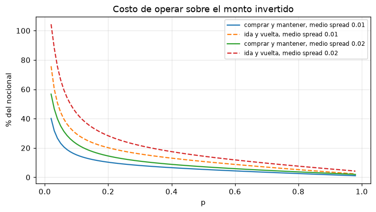
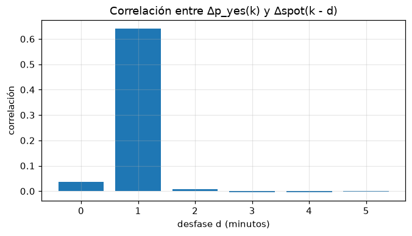
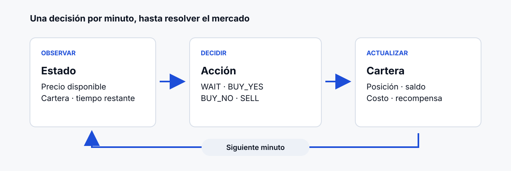
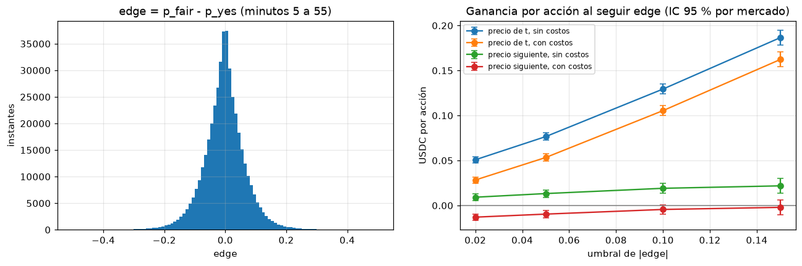
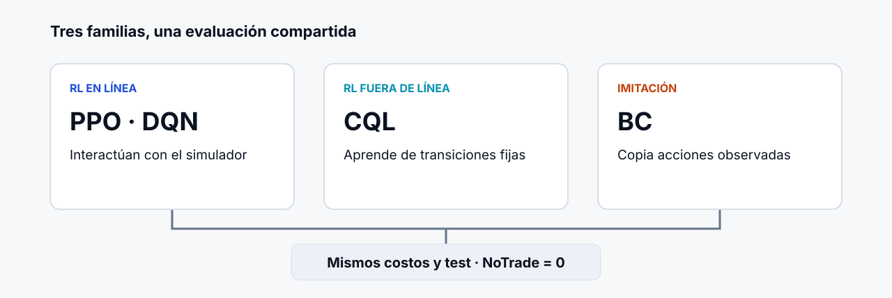
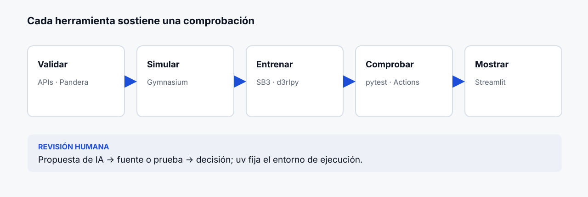
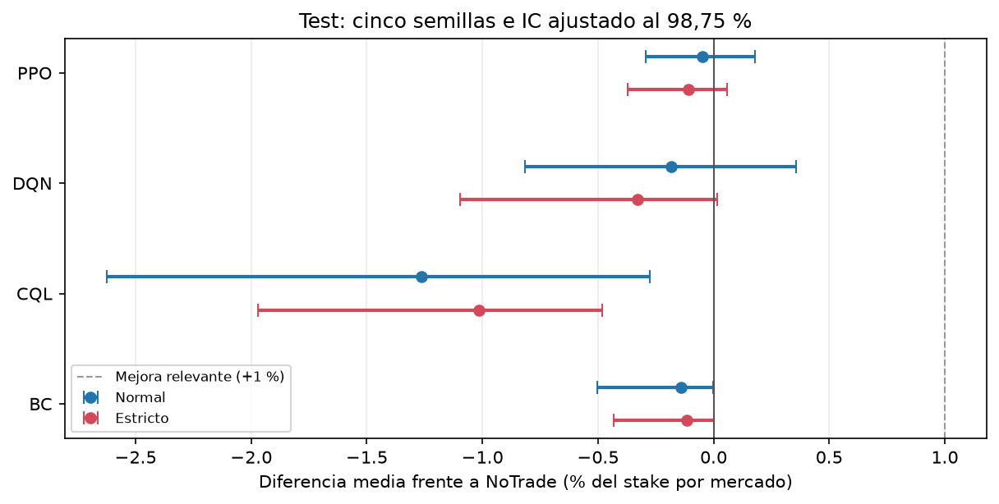
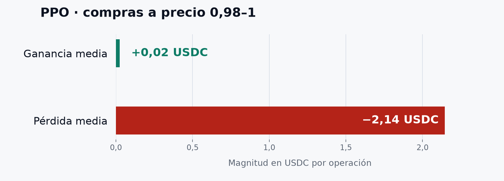
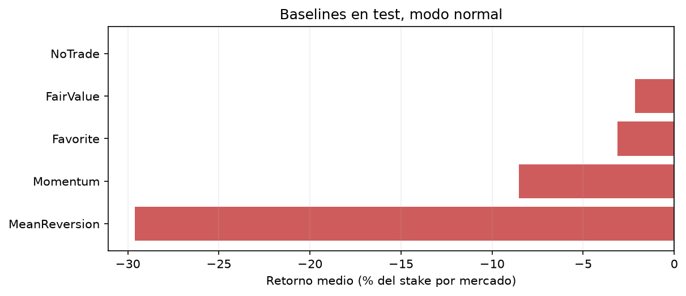

# Guion de contenido — presentación final de PolyRL

Este archivo define **qué aparece en cada diapositiva y qué explica el equipo**. Toma como referencia
visual la propuesta [Laboratorio nocturno](propuestas_estilo/02_laboratorio_nocturno/01_portada.png)
y se basa en el [informe final](../informe/Informe_final.md). La
presentación tiene diez diapositivas y una duración orientativa de **10 a 12 minutos**.

## Hilo narrativo

**Pregunta → por qué acertar no basta → problema del reloj → decisión secuencial → simulación
honesta → comparación justa → evidencia → explicación del resultado → cierre y demo.** La pregunta
de la primera diapositiva se responde explícitamente en la última.

Las frases de «En pantalla» son el texto propuesto para el público, no párrafos para leer en voz
alta. Las notas son **ideas para contar con palabras propias**. Cada diapositiva debe tener una
idea dominante y **la imagen indicada en su apartado**. Los diagramas SVG son visuales propios
preparados para el deck; los PNG proceden de las figuras del informe o de sus CSV. Al construir
las slides, se incrustan los archivos señalados, se mantienen sus rótulos legibles desde el fondo
del aula y se añade una fuente discreta cuando muestran datos. Las referencias completas
permanecen en la bibliografía del informe; no se dedica una
diapositiva a copiarlas. Las cifras de validación se presentan como selección y las de test como
resultado final.

## 1. Abrir la pregunta — 0:35

**Idea:** vamos a evaluar una decisión, no solo una predicción.

**En pantalla**

> PolyRL
> ¿Puede un agente aprender cuándo operar y cuándo esperar?
> BTC horario · datos históricos · saldo ficticio

**Visual:** el campo de probabilidades de la portada de [Laboratorio nocturno](propuestas_estilo/02_laboratorio_nocturno/01_portada.png): puntos
que se ordenan hacia una decisión YES, NO o WAIT. Incluir la marca SVG real de PolyRL. Curso,
grupo y fecha van en el pie, sin añadir resumen técnico.

**Imagen a incluir:** monograma [polyrl.svg](../../../app/static/polyrl.svg). El nombre «PolyRL»
se compone como texto de la diapositiva para no arrastrar la etiqueta `[DEMO]` de la marca de la web.

**Para contar:** presentar la pregunta del proyecto y prometer que al final se mostrará el
resultado bajo el mismo protocolo para todos. Aclarar desde el inicio que se estudian mercados
resueltos y que no hubo operaciones con dinero real. No adelantar todavía la conclusión.

**Apoyo al presentar:** abrir con una pregunta breve al público: «Si creen saber hacia dónde va
Bitcoin, ¿comprarían a cualquier precio?». Dejar una pausa antes de avanzar.

**Puente:** explicar qué se compra exactamente en un mercado horario.

## 2. Acertar no basta — 1:00

**Idea:** el precio de entrada decide si una predicción correcta tiene valor económico.

**En pantalla**

> Una pregunta binaria cada hora
> YES / NO → pago final de 1 / 0
> Comprar · vender · esperar

**Visual:** una línea simple de 60 minutos a la izquierda y la figura de costos a la derecha.
Resaltar que el precio pagado y el pago final son cantidades distintas; la curva de costos ayuda
a mostrar por qué acertar no basta. Mostrar WAIT junto a las otras acciones.

**Imagen a incluir:** [costo de operar según precio](../../../docs/images/eda/07_costo_de_operar.png),
figura 6 del informe. Conservar sus ejes y leyenda; no usarla como fondo decorativo.

**Para contar:** describir `BUY_YES`, `BUY_NO`, `SELL` y `WAIT`. El lado ganador paga una unidad,
pero una compra cara deja poco margen; además hay spread y comisión. El problema de investigación
es decidir **si y cuándo** actuar, con una posición abierta como máximo.

**Apoyo al presentar:** señalar el espacio pequeño entre precio de compra y pago final antes de
mencionar costos. El equipo puede usar un ejemplo oral hipotético; la diapositiva no necesita una
cuenta inventada.

**Puente:** antes de entrenar, había que saber qué información estaba disponible al decidir.

**Fuentes:** [informe, §1](../informe/Informe_final.md) y [descripción del proyecto](../../../docs/01_idea_general.md).

## 3. El reloj cambió la oportunidad — 1:00

**Idea:** un precio histórico puede ser viejo aunque parezca coincidir con el minuto de decisión.

**En pantalla**

> 12 294 mercados evaluables
> Entrenamiento 8 682 · Validación 1 861 · Test 1 751
> En entrenamiento: precio con 52 s de antigüedad mediana

**Visual:** la figura de desfase ocupa el área principal. Debajo, una línea de tiempo compacta
separa entrenamiento, validación y test; un rótulo de 52 s conecta el gráfico con la antigüedad
del último precio. No comprimir en la slide las ocho figuras de la EDA.

**Imagen a incluir:** [desfase entre precio de mercado y spot](../../../docs/images/eda/04_desfase_precio_spot.png),
figura 4 del informe. La barra del desfase de un minuto es la que se señala al hablar.

**Para contar:** de 12 471 mercados capturados se construyó el conjunto evaluable después de
filtros de calidad y exclusiones. La exploración usó entrenamiento; validación eligió modelos y
test quedó para el final. Una regla sencilla parecía ganar si se compraba al precio ya conocido,
pero su margen se volvía negativo después de ejecutar al siguiente precio y cobrar costos. Esa
observación obligó a rehacer la línea de tiempo del simulador.

**Apoyo al presentar:** revelar primero los tres cortes y después señalar la barra del desfase.
La [figura de ventaja aparente](../../../docs/images/eda/05_ventaja_aparente.png) aparece en la
diapositiva 5, donde se explica su consecuencia para la ejecución.

**Puente:** si el precio cambia y esperar conserva opciones, la tarea es una secuencia de
decisiones.

**Fuentes:** [manifest del dataset](../../../data/processed/btc_updown_1h_v1/manifest.json) e
[informe, §2.2–2.3](../informe/Informe_final.md).

## 4. Esperar también es una acción — 1:05

**Idea:** una política debe considerar mercado, cartera y tiempo restante en cada minuto.

**En pantalla**

> Estado → acción → cartera → siguiente minuto
> 60 decisiones · 4 acciones · 20 USDC por compra

**Visual:** bucle sencillo de decisión. En el nodo de acciones aparecen WAIT, BUY_YES, BUY_NO y
SELL; WAIT recibe el mismo peso visual que comprar. El estado puede representarse con tres pistas:
precio, tiempo y posición. No mostrar las 16 variables ni la fórmula completa de recompensa.

**Imagen a incluir:** [bucle de decisión](img/04_bucle_decision.svg), diagrama vectorial propio
basado en la sección 3 del informe.

**Para contar:** comprar ahora limita las acciones siguientes; esperar mantiene saldo y puede
evitar un precio excesivo. El agente observa 16 valores, opera con saldo ficticio de 1 000 USDC y
como máximo una posición. La recompensa combina cambio de cartera y penalización por aumento de
drawdown. Una predicción del resultado, por sí sola, todavía necesitaría reglas para elegir
momento y tamaño; por eso se conserva `FairValue` como baseline.

**Apoyo al presentar:** recorrer el bucle con el dedo o cursor una sola vez: observar, decidir,
actualizar cartera, avanzar un minuto. Definir «drawdown» oralmente como caída desde el máximo de
la cartera si el público no lo conoce.

**Puente:** para comparar políticas, cada acción debe pasar por una ejecución plausible.

**Fuentes:** [informe, §3](../informe/Informe_final.md) y [configuración del entorno](../../../configs/env.yaml).

## 5. La ejecución ocurre después de decidir — 1:15

**Idea:** la simulación separa observación, decisión, ejecución y resolución.

**En pantalla**

> Dato disponible → decisión `t` → precio posterior → costos
> Captura → dataset → entorno → evaluación → demo

**Visual:** usar la figura de ventaja aparente como evidencia principal. Señalar la diferencia
entre las curvas «precio en `t`» y «precio siguiente, con costos». Encima o debajo, una línea de
tiempo breve marca `ts_available ≤ t` para observar y el primer precio después de `t + 2 s`,
dentro de los 60 s siguientes, para ejecutar. El pipeline queda en una franja secundaria.

**Imagen a incluir:** [ventaja aparente al usar un precio atrasado](../../../docs/images/eda/05_ventaja_aparente.png),
figura 5 del informe. Mantener visibles sus cuatro curvas y la leyenda.

**Para contar:** Gamma, CLOB y Binance alimentan una caché cruda; las validaciones y el dataset
fijan qué dato podía conocerse en cada instante. El entorno aplica medio spread de 0,01 y comisión
taker. En modo normal usa el primer precio posterior; en modo estricto exige además apoyo de un
trade observado. El modo estricto es una prueba de sensibilidad ante la liquidez incompleta, no
una reconstrucción del libro de órdenes.

**Apoyo al presentar:** señalar primero dónde se observa y después dónde se cobra la operación.
La frase clave para decir de memoria es «el agente no compra al precio que usó para decidir».

**Puente:** con este mismo entorno se comparan agentes de aprendizaje y reglas simples.

**Fuentes:** [informe, §4.1 y §4.3](../informe/Informe_final.md) y [costos](../../../configs/costs.yaml).

## 6. Cuatro agentes, una misma prueba — 1:00

**Idea:** las diferencias se atribuyen a la política evaluada bajo un protocolo compartido.

**En pantalla**

> PPO · DQN | CQL | BC
> Cinco semillas por agente · mismos costos · mismo test
> Referencia: NoTrade

**Visual:** tres grupos: PPO/DQN interactúan con el simulador; CQL aprende de transiciones fijas;
BC imita esas transiciones. Una línea común conduce a la misma evaluación y a `NoTrade = 0`.
Evitar una tabla de hiperparámetros.

**Imagen a incluir:** [familias de agentes](img/06_familias_agentes.svg), diagrama vectorial
propio para explicar la comparación.

**Para contar:** aclarar que PPO y DQN son RL en línea **respecto del simulador** aunque este
reproduzca mercados históricos; CQL es RL fuera de línea y BC es imitación. Las configuraciones
se eligieron en validación y el test se abrió una vez. Se compararon también seis reglas sencillas.
La métrica divide el PnL de cada mercado por el monto fijo de 20 USDC, incluso cuando no se opera.

**Apoyo al presentar:** no explicar las arquitecturas de red salvo que lo pregunten. La pregunta
que debe quedar es si alguno supera una referencia evaluada con las mismas reglas.

**Puente:** antes de mostrar el resultado, indicar cómo se evitó que datos, código o IA lo
distorsionaran.

**Fuentes:** [informe, §3.3–3.4 y §6.1](../informe/Informe_final.md),
[comparación de test](../../../reports/test/comparison.csv).

## 7. Cada herramienta hizo verificable un paso — 1:05

**Idea:** las herramientas y la IA aportaron valor cuando permitieron comprobar una afirmación.

**En pantalla**

> Validar → simular → entrenar → comprobar → mostrar
> IA: propuesta → fuente o prueba → decisión humana

**Visual:** mapa de cinco etapas con etiquetas pequeñas: APIs/Pandera, Gymnasium, SB3/d3rlpy,
pytest/Actions y Streamlit. `uv` aparece como base del entorno reproducible. Las herramientas no
se presentan como una colección de logos.

**Imagen a incluir:** [cadena de verificación](img/07_cadena_verificacion.svg), diagrama
vectorial propio. La franja inferior muestra cómo se revisaron las propuestas de IA.

**Para contar:** elegir dos ejemplos concretos. Un Brier imposible de 25 078 reveló un precio
corrupto de 5000,49 y llevó a validar el rango `[0,1]`. Una correlación aparente de 0,90 cayó a
0,22 al revisar la alineación temporal. La revisión estadística llevó al remuestreo por días y
semillas; la revisión de ejecución motivó el modo estricto. Explicar que los números provienen de
datos y reportes, mientras que las propuestas de IA se contrastaron con fuentes o pruebas.

**Apoyo al presentar:** escoger solo **dos** ejemplos según el tiempo. Dejar los otros en notas
para preguntas. Este es el lugar para explicar el proceso iterativo sin leer un historial de
prompts.

**Puente:** una vez fijadas las reglas, ¿qué ocurrió en los mercados no vistos?

**Fuentes:** [informe, §5](../informe/Informe_final.md) e
[historial de prompts](../../../docs/ia/historial_prompts.md).

## 8. En test, nadie superó a NoTrade — 1:45

**Idea:** el resultado principal responde la pregunta inicial bajo el criterio declarado.

**En pantalla**

> Ningún agente superó a NoTrade
> PPO y DQN: equivalentes · CQL: inferior
> Mejora mínima relevante: +1 % por mercado

**Visual:** utilizar la figura 10 del informe: diferencia media `D` e IC ajustado del 98,75 %
para PPO, DQN, CQL y BC. Azul indica modo normal y rojo modo estricto; la línea sólida es cero y
la discontinua es el umbral `+0,01`. Añadir una nota discreta fuera de la figura: «BC: 23 mercados
informativos; intervalo poco confiable». No añadir otra curva de capital ni la tabla completa.

**Imagen a incluir:** [intervalos de confianza en test](img/08_intervalos_test.png), copia exacta
de la figura 10 incrustada en el informe.

**Para contar:** `NoTrade` quedó como baseline porque ninguna heurística lo desplazó en
validación según la regla fijada. PPO pasó de una media positiva pero económicamente pequeña en
validación (`+0,0012`) a `−0,0005` en test; DQN dio `−0,0018`; CQL `−0,0126`. BC dio `−0,0014`,
clasificado formalmente «peor, pero no relevante», pero su intervalo no se considera confiable
por la escasa actividad. El intervalo incorpora días y semillas; el umbral de 1 % estaba definido
antes de abrir test. El modo estricto conserva la conclusión principal para PPO y CQL, mientras
DQN pasa a inconcluso.

**Apoyo al presentar:** hacer una pausa tras leer la conclusión, señalar el cero y luego el
umbral. Si preguntan por potencia, la diferencia mínima detectable superó el 1 % para CQL y BC;
esta prueba tiene poca potencia para detectar esa mejora en esos dos casos. No llamar «fracaso» a
un resultado negativo ni presentar la media de validación como victoria.

**Puente:** el resultado merece una explicación de comportamiento, con sus límites.

**Fuentes:** [informe, §6.1 y §6.3](../informe/Informe_final.md),
[validación](../../../reports/val/comparison.csv) y [test](../../../reports/test/comparison.csv).

## 9. Acertar casi siempre aún puede perder — 1:15

**Idea:** una tasa alta de aciertos no garantiza retorno después del precio y los costos.

**En pantalla**

> PPO, compras con precio 0,98–1
> 99,76 % de lados acertados
> −27,23 USDC netos

**Visual:** la figura muestra la asimetría entre ganancia media `+0,02 USDC` y pérdida media
`−2,14 USDC` por operación en ese tramo. Las cifras de acierto y neto permanecen grandes fuera
del gráfico; «838 compras» va en el pie. Evitar que el visual sugiera que todas las pérdidas
proceden de una sola causa.

**Imagen a incluir:** [asimetría de ganancias y pérdidas de PPO](img/09_asimetria_ppo.png),
gráfico propio calculado desde [inspection_payoff.csv](../../../reports/test/inspection_payoff.csv).

**Para contar:** estas son operaciones inspeccionadas **después** del test, no una prueba nueva.
PPO acertó casi todos los lados de ese tramo, pero pagó precios muy altos y algunas pérdidas
superaron las ganancias pequeñas. La ablación de riesgo favoreció una
política que operaba poco; no demuestra que redujera drawdown sin sacrificar retorno. CQL tampoco
confirmó en test su señal de validación. Los límites son spread fijo, libro histórico incompleto,
trades observados solo parcialmente, una sola familia de mercados y 76 días de test. No atribuir
causalmente todo el resultado a la comisión.

**Apoyo al presentar:** usar la pregunta de la portada como eco: «¿Compraríamos a cualquier
precio?». Responder con la cifra de aciertos y la pérdida neta. Para preguntas técnicas, el costo
medio por acción del tramo fue 0,9988; es un umbral aproximado de acierto si se mantiene hasta la
resolución, no una explicación exacta de cada venta anticipada.

**Puente:** cerrar con la respuesta y mostrar dónde se puede inspeccionar el experimento.

**Fuentes:** [inspección posterior de test](../../../reports/test/inspection.md) e
[informe, §7](../informe/Informe_final.md).

## 10. La evidencia queda abierta — 0:50

**Idea:** la conclusión se puede revisar en el código, el informe y la demo.

**En pantalla**

> En este test, abstenerse fue la referencia que nadie superó
> `make demo`
> https://github.com/donmatthiuz/RL/tree/proyecto

**Visual:** la figura de baselines vuelve a colocar `NoTrade` en cero y cierra el arco de la
pregunta inicial. El enlace completo queda legible y clicable debajo. La captura **real** de la
página Simulación de la demo puede sustituir esta figura cuando se
prepare el deck; no presentar un mockup como ejecución real.

**Imagen a incluir:** [retorno de baselines en test](img/10_baselines_test.png), copia exacta de
la figura 11 incrustada en el informe.

**Para contar:** responder la pregunta de apertura con el alcance correcto: en los 1 751
mercados de test y bajo estos costos, no se demostró una ventaja neta frente a `NoTrade`. Mostrar
que la demo permite revisar una trayectoria y que el repositorio contiene código e informe. Para
reconstruir exactamente todos los resultados desde cero hacen falta las fuentes archivadas o
volver a consultarlas; no afirmar que todo el dato crudo y todos los modelos estén en el repo.
Proponer como siguiente experimento mejores datos de liquidez y nuevos periodos o mercados.

**Apoyo al presentar:** no iniciar una demo en vivo si consume el tiempo de cierre. Si se incluye
la captura real, usarla para indicar qué inspeccionar; el comando queda para después. Terminar
con la respuesta, dejar el enlace visible y abrir preguntas.

**Fuentes:** [demo](../../../app/demo.py), [informe, §7](../informe/Informe_final.md) y
[repositorio](https://github.com/donmatthiuz/RL/tree/proyecto).

## Respuestas breves para preguntas

- **¿Por qué `NoTrade`?** Fue el baseline retenido por la regla de validación; su retorno es cero
  y evita declarar éxito por perder menos que una estrategia mala.
- **¿Por qué 98,75 %?** Son cuatro comparaciones principales; el protocolo ajustó el intervalo
  bilateral con Bonferroni y remuestreó días y semillas.
- **¿Por qué «equivalente» no significa igual?** El intervalo completo de PPO o DQN en modo normal
  quedó dentro del margen predefinido de ±1 % del monto por mercado. No prueba identidad exacta.
- **¿Por qué llamar PPO y DQN «en línea» con datos históricos?** Interactúan con un simulador y
  generan nuevas trayectorias durante el entrenamiento. CQL y BC reciben transiciones fijas.
- **¿El modo estricto demuestra ejecutabilidad?** No. Solo exige apoyo en trades observados; la
  falta de libro histórico completo sigue siendo una limitación.
- **¿El resultado se puede generalizar?** Se limita a BTC horario, el periodo, la grilla de un
  minuto y los costos del simulador. Nuevos mercados y condiciones requieren otro experimento.

Si el tiempo se acorta, reducir la explicación de herramientas y algoritmos en las diapositivas
6 y 7. Conservar la pausa y el tiempo del resultado en la diapositiva 8.
