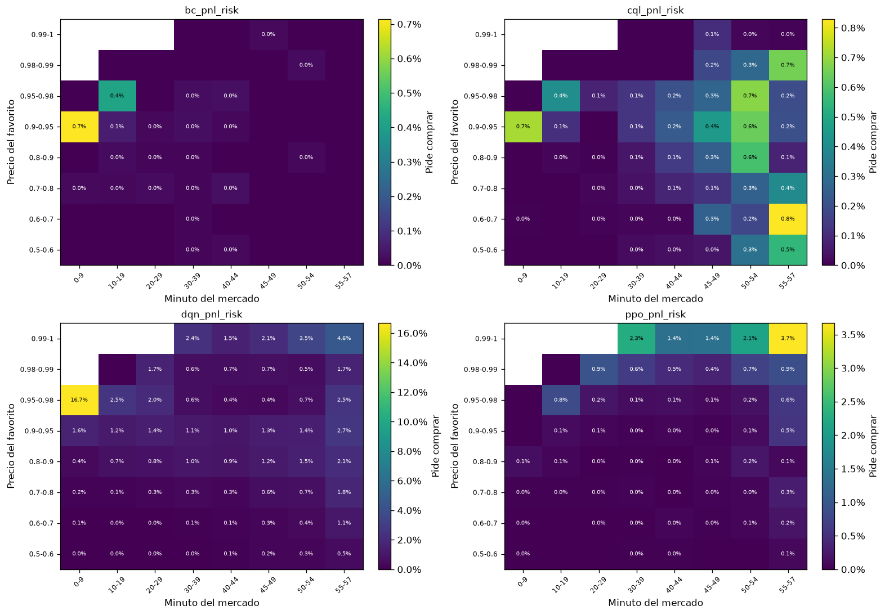
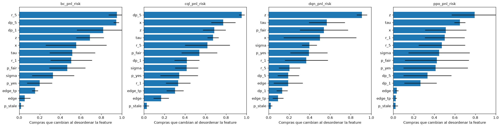

# Comportamiento de los agentes en val

Análisis exploratorio (EVA-12), fuera del protocolo de EVA-01: describe qué aprendió cada agente; no
decide cuál es mejor ni cambia la conclusión de test. Usa las trayectorias de val en modo normal:
las semillas de cada agente final y los baselines con sus umbrales de val. Val se usó para elegir
checkpoints e hiperparámetros, así que lo que se ve aquí puede ser mejor que lo que el agente
generaliza.

## Qué hace cada política

| Política | Semillas | Operaciones | Por mercado | Minuto mediano de compra | Compra el favorito | Precio > 0.98 | Vendidas antes del final | Lado acertado | Con ganancia | PnL total (USDC) | Verificadas |
| --- | --- | --- | --- | --- | --- | --- | --- | --- | --- | --- | --- |
| bc_pnl_risk | 5 | 39 | 0.0042 | 32 | 0.2308 | 0.0000 | 0.3077 | 0.3077 | 0.4103 | 539.27 | 0.5641 |
| cql_pnl_risk | 5 | 422 | 0.0454 | 49 | 0.0284 | 0.0024 | 0.5332 | 0.1303 | 0.1777 | 2019.94 | 0.6185 |
| dqn_pnl_risk | 5 | 2759 | 0.2965 | 47 | 0.9699 | 0.3860 | 0.1664 | 0.9337 | 0.8409 | -274.08 | 0.6731 |
| ppo_pnl_risk | 5 | 1032 | 0.1109 | 54 | 0.9845 | 0.8789 | 0.0891 | 0.9845 | 0.9331 | 219.67 | 0.5446 |
| fair_value | 1 | 394 | 0.2117 | 35 | 0.3655 | 0.0000 | 0.0000 | 0.3629 | 0.3629 | -703.75 | 0.5355 |
| favorite | 1 | 1860 | 0.9995 | 20 | 1.0000 | 0.0000 | 0.0000 | 0.6984 | 0.6984 | -741.21 | 0.5140 |
| mean_reversion | 1 | 3226 | 1.7335 | 39 | 0.0815 | 0.0000 | 0.9907 | 0.2635 | 0.2759 | -12972.39 | 0.5102 |
| momentum | 1 | 2533 | 1.3611 | 37 | 0.9049 | 0.0205 | 0.7430 | 0.7008 | 0.5136 | -3156.98 | 0.6068 |
| random | 1 | 18749 | 10.0747 | 27 | 0.5021 | 0.0496 | 0.9631 | 0.5035 | 0.2618 | -56609.62 | 0.4584 |

- Una operación va de la compra a la venta o a la liquidación al final del mercado; su PnL es el
  cambio del valor de la cartera en ese tramo, después de costos, y suma las semillas.
- Lado acertado: el lado comprado fue el ganador. Con ganancia: la operación terminó con PnL
  positivo; una venta antes del final puede perder aunque el lado gane.
- Verificadas: ejecuciones respaldadas por trades reales (EVA-11).

Entre los estados en que la política no tenía posición y podía comprar, la proporción en que pidió
comprar, por minuto del mercado y precio del favorito (el lado con precio mayor a 0,5), sumando las
semillas. Cada mapa tiene su escala. No dice qué lado compra: eso está en "Compra el favorito".

## Precisión contra rentabilidad

| Agente | Precio del lado comprado | Operaciones | Lado acertado | IC 95 % inferior | IC 95 % superior | Con ganancia | Ganancia media (USDC) | Pérdida media (USDC) | Ganancias por pérdida | Neto (USDC) | Costo por acción |
| --- | --- | --- | --- | --- | --- | --- | --- | --- | --- | --- | --- |
| bc_pnl_risk | 0-0.5 | 31 | 0.1613 | 0.0709 | 0.3263 | 0.2903 | 99.27 | -16.11 | 0.2 | 539.08 | 0.1416 |
| bc_pnl_risk | 0.5-0.8 | 3 | 0.6667 | 0.2077 | 0.9385 | 0.6667 | 6.34 | -20.00 | 3.2 | -7.31 | 0.7742 |
| bc_pnl_risk | 0.8-0.95 | 5 | 1.0000 | 0.5655 | 1.0000 | 1.0000 | 1.50 | — | — | 7.50 | 0.9308 |
| cql_pnl_risk | 0-0.5 | 399 | 0.0977 | 0.0723 | 0.1308 | 0.1504 | 119.01 | -15.11 | 0.1 | 2018.81 | 0.1018 |
| cql_pnl_risk | 0.5-0.8 | 20 | 0.6500 | 0.4329 | 0.8188 | 0.6000 | 8.94 | -13.92 | 1.6 | -4.12 | 0.6834 |
| cql_pnl_risk | 0.8-0.95 | 2 | 1.0000 | 0.3424 | 1.0000 | 1.0000 | 2.58 | — | — | 5.17 | 0.8902 |
| cql_pnl_risk | 0.98-1 | 1 | 1.0000 | 0.2065 | 1.0000 | 1.0000 | 0.09 | — | — | 0.09 | 0.9953 |
| dqn_pnl_risk | 0-0.5 | 66 | 0.3182 | 0.2185 | 0.4379 | 0.3182 | 10.22 | -9.64 | 0.9 | -218.97 | 0.2563 |
| dqn_pnl_risk | 0.5-0.8 | 118 | 0.7034 | 0.6156 | 0.7783 | 0.5847 | 5.84 | -9.12 | 1.6 | -44.12 | 0.7346 |
| dqn_pnl_risk | 0.8-0.95 | 1079 | 0.9147 | 0.8966 | 0.9300 | 0.8369 | 1.76 | -9.03 | 5.1 | -0.78 | 0.9179 |
| dqn_pnl_risk | 0.95-0.98 | 431 | 0.9768 | 0.9578 | 0.9873 | 0.9188 | 0.48 | -4.47 | 9.4 | 32.07 | 0.9764 |
| dqn_pnl_risk | 0.98-1 | 1065 | 0.9991 | 0.9947 | 0.9998 | 0.8742 | 0.03 | -0.50 | 18.5 | -42.27 | 0.9986 |
| ppo_pnl_risk | 0-0.5 | 13 | 0.3846 | 0.1771 | 0.6448 | 0.8462 | 12.98 | -8.92 | 0.7 | 124.95 | 0.2899 |
| ppo_pnl_risk | 0.5-0.8 | 19 | 0.7368 | 0.5121 | 0.8819 | 0.6316 | 6.15 | -3.87 | 0.6 | 46.74 | 0.7257 |
| ppo_pnl_risk | 0.8-0.95 | 54 | 0.9444 | 0.8489 | 0.9809 | 0.6852 | 1.90 | -2.11 | 1.1 | 34.48 | 0.9084 |
| ppo_pnl_risk | 0.95-0.98 | 39 | 1.0000 | 0.9103 | 1.0000 | 0.7692 | 0.49 | -0.76 | 1.6 | 7.75 | 0.9758 |
| ppo_pnl_risk | 0.98-1 | 907 | 1.0000 | 0.9958 | 1.0000 | 0.9625 | 0.02 | -0.42 | 18.3 | 5.74 | 0.9988 |

- Precio del lado comprado: al ejecutarse la orden, sin costos.
- Costo por acción: lo pagado por cada acción, con medio spread y comisión. La acción ganadora paga
  1, así que manteniendo hasta el final hay que acertar al menos esa proporción para no perder.
- Ganancias por pérdida: cuántas ganancias medias hacen falta para cubrir una pérdida media.
- IC de Wilson al 95 % del lado acertado. Las semillas operan en los mismos mercados, así que las
  operaciones no son independientes y el intervalo es optimista.

## Calibración del precio del favorito

| Minuto | Precio del favorito | Mercados | Precio medio | Acierto del favorito | IC 95 % inferior | IC 95 % superior | Costo por acción | Ventaja neta |
| --- | --- | --- | --- | --- | --- | --- | --- | --- |
| 50 | 0.5-0.8 | 513 | 0.6569 | 0.6472 | 0.6049 | 0.6873 | 0.6819 | -0.0347 |
| 50 | 0.8-0.95 | 513 | 0.8867 | 0.8928 | 0.8630 | 0.9167 | 0.9030 | -0.0103 |
| 50 | 0.95-0.98 | 274 | 0.9677 | 0.9781 | 0.9531 | 0.9899 | 0.9792 | -0.0011 |
| 50 | 0.98-0.99 | 190 | 0.9857 | 0.9947 | 0.9708 | 0.9991 | 0.9960 | -0.0013 |
| 50 | 0.99-1 | 371 | 0.9952 | 0.9946 | 0.9806 | 0.9985 | 0.9991 | -0.0045 |
| 55 | 0.5-0.8 | 376 | 0.6600 | 0.6543 | 0.6048 | 0.7006 | 0.6849 | -0.0306 |
| 55 | 0.8-0.95 | 330 | 0.8887 | 0.9091 | 0.8732 | 0.9356 | 0.9050 | 0.0041 |
| 55 | 0.95-0.98 | 225 | 0.9675 | 0.9689 | 0.9372 | 0.9848 | 0.9790 | -0.0101 |
| 55 | 0.98-0.99 | 177 | 0.9857 | 0.9718 | 0.9356 | 0.9879 | 0.9960 | -0.0242 |
| 55 | 0.99-1 | 753 | 0.9962 | 1.0000 | 0.9949 | 1.0000 | 0.9991 | 0.0009 |

- Un mercado por fila: el precio del favorito en ese minuto y si ganó.
- IC de Wilson al 95 %. Los mercados de un mismo día no son independientes, así que el intervalo es
  optimista.
- Ventaja neta = acierto − costo por acción: lo que se esperaría ganar por acción comprando el
  favorito a ese precio y manteniendo hasta el final. Positiva quiere decir que el precio
  subestima al favorito más de lo que cuestan el spread y la comisión.
- Es evidencia limitada: un solo período, dos minutos y tramos de precio gruesos.

## Qué información usa cada agente

Compras que cambian al desordenar cada grupo de features (media ± desviación
entre semillas):

| Grupo | bc_pnl_risk | cql_pnl_risk | dqn_pnl_risk | ppo_pnl_risk |
| --- | --- | --- | --- | --- |
| precio de Polymarket | 1.000 ± 0.000 | 0.970 ± 0.015 | 0.445 ± 0.188 | 0.508 ± 0.329 |
| spot de Binance | 1.000 ± 0.000 | 0.962 ± 0.036 | 0.951 ± 0.053 | 0.961 ± 0.058 |
| ventaja (spot contra precio) | 0.157 ± 0.099 | 0.345 ± 0.086 | 0.217 ± 0.140 | 0.040 ± 0.015 |
| tiempo restante | 0.425 ± 0.138 | 0.659 ± 0.078 | 0.567 ± 0.169 | 0.653 ± 0.068 |
| Compras originales | 39 | 427 | 2765 | 1035 |

Compras nuevas por cada compra original:

| Grupo | bc_pnl_risk | cql_pnl_risk | dqn_pnl_risk | ppo_pnl_risk |
| --- | --- | --- | --- | --- |
| precio de Polymarket | 0.687 ± 1.489 | 1.152 ± 0.572 | 3.182 ± 5.591 | 2.241 ± 2.333 |
| spot de Binance | 0.735 ± 1.552 | 1.539 ± 0.637 | 9.322 ± 7.891 | 5.000 ± 4.261 |
| ventaja (spot contra precio) | 0.213 ± 0.246 | 0.680 ± 0.248 | 0.277 ± 0.174 | 0.039 ± 0.025 |
| tiempo restante | 0.121 ± 0.171 | 1.253 ± 0.328 | 1.944 ± 2.740 | 0.280 ± 0.326 |
| Compras originales | 39 | 427 | 2765 | 1035 |

- Cada agente se vuelve a correr en val para guardar los estados que visitó; las acciones por lotes
  coinciden con las del backtest en el 100.00% de los pasos, como mínimo. Luego se
  desordenan las columnas de un grupo entre los estados, todas con la misma permutación, y se
  compara la decisión con la original. Las acciones inválidas cuentan como WAIT, igual que en el
  entorno.
- Mide qué información usa la política, no si esa información predice el resultado ni si el agente
  gana con ella.
- No es SHAP ni Integrated Gradients: no reparte una decisión entre las features ni explica un
  estado puntual. Desordenar crea estados que no existen (por ejemplo, un `z` alto con BTC en la
  apertura); por eso las features muy relacionadas se desordenan en grupo, y la figura de features
  sueltas subestima las que tienen un sustituto en otra columna.
- Con pocas compras originales, las proporciones son ruidosas.
